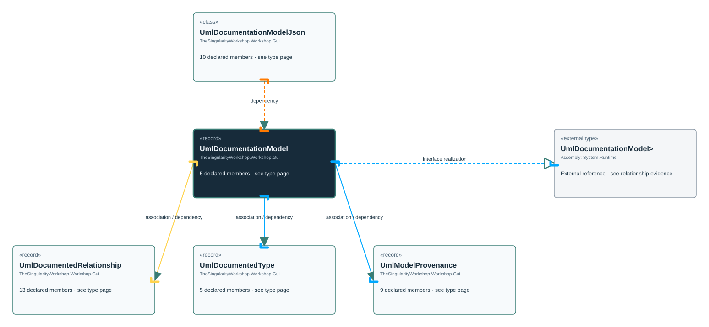

# TheSingularityWorkshop.Workshop.Gui.UmlDocumentationModel

> Generated from compiler-backed source analysis. Do not edit by hand.

- Repository: `TrentBest/TheSingularityWorkshop.GUI`
- Revision: [`8d11c5f449b73b519cfb1819c9c3942307f717c6`](https://github.com/TrentBest/TheSingularityWorkshop.GUI/tree/8d11c5f449b73b519cfb1819c9c3942307f717c6)
- Project: `src/Core/TheSingularityWorkshop.GUI.Core.csproj`
- Type ID: `type:TheSingularityWorkshop.GUI.Core, Version=0.1.0.0, Culture=neutral, PublicKeyToken=null:global::TheSingularityWorkshop.Workshop.Gui.UmlDocumentationModel`
- Metadata name: `UmlDocumentationModel`
- Kind: `record`
- Generic arity: 0

## UML diagram

## Source declarations

- [`src/Core/UmlDocumentationModel.cs:7-11`](https://github.com/TrentBest/TheSingularityWorkshop.GUI/blob/8d11c5f449b73b519cfb1819c9c3942307f717c6/src/Core/UmlDocumentationModel.cs#L7-11)

## Members

| Kind | Signature | Source |
|---|---|---|
| `Property` | `TheSingularityWorkshop.Workshop.Gui.UmlDocumentationModel.Provenance` | [`src/Core/UmlDocumentationModel.cs:9-9`](https://github.com/TrentBest/TheSingularityWorkshop.GUI/blob/8d11c5f449b73b519cfb1819c9c3942307f717c6/src/Core/UmlDocumentationModel.cs#L9-9) |
| `Property` | `TheSingularityWorkshop.Workshop.Gui.UmlDocumentationModel.Relationships` | [`src/Core/UmlDocumentationModel.cs:11-11`](https://github.com/TrentBest/TheSingularityWorkshop.GUI/blob/8d11c5f449b73b519cfb1819c9c3942307f717c6/src/Core/UmlDocumentationModel.cs#L11-11) |
| `Property` | `TheSingularityWorkshop.Workshop.Gui.UmlDocumentationModel.SchemaVersion` | [`src/Core/UmlDocumentationModel.cs:8-8`](https://github.com/TrentBest/TheSingularityWorkshop.GUI/blob/8d11c5f449b73b519cfb1819c9c3942307f717c6/src/Core/UmlDocumentationModel.cs#L8-8) |
| `Property` | `TheSingularityWorkshop.Workshop.Gui.UmlDocumentationModel.Types` | [`src/Core/UmlDocumentationModel.cs:10-10`](https://github.com/TrentBest/TheSingularityWorkshop.GUI/blob/8d11c5f449b73b519cfb1819c9c3942307f717c6/src/Core/UmlDocumentationModel.cs#L10-10) |
| `Method` | `TheSingularityWorkshop.Workshop.Gui.UmlDocumentationModel.UmlDocumentationModel(string, TheSingularityWorkshop.Workshop.Gui.UmlModelProvenance, System.Collections.Generic.IReadOnlyList<TheSingularityWorkshop.Workshop.Gui.UmlDocumentedType>, System.Collections.Generic.IReadOnlyList<TheSingularityWorkshop.Workshop.Gui.UmlDocumentedRelationship>)` | [`src/Core/UmlDocumentationModel.cs:7-11`](https://github.com/TrentBest/TheSingularityWorkshop.GUI/blob/8d11c5f449b73b519cfb1819c9c3942307f717c6/src/Core/UmlDocumentationModel.cs#L7-11) |

## Relationships

| Direction | Kind | Related type | Resolution | Evidence |
|---|---|---|---|---|
| outgoing | `InterfaceRealization` | `global::System.IEquatable<global::TheSingularityWorkshop.Workshop.Gui.UmlDocumentationModel>` | `External` | [`src/Core/UmlDocumentationModel.cs:7-11`](https://github.com/TrentBest/TheSingularityWorkshop.GUI/blob/8d11c5f449b73b519cfb1819c9c3942307f717c6/src/Core/UmlDocumentationModel.cs#L7-11) |
| outgoing | `Association` | `TheSingularityWorkshop.Workshop.Gui.UmlDocumentedRelationship` | `Resolved` | [`src/Core/UmlDocumentationModel.cs:11-11`](https://github.com/TrentBest/TheSingularityWorkshop.GUI/blob/8d11c5f449b73b519cfb1819c9c3942307f717c6/src/Core/UmlDocumentationModel.cs#L11-11) |
| outgoing | `Association` | `TheSingularityWorkshop.Workshop.Gui.UmlDocumentedType` | `Resolved` | [`src/Core/UmlDocumentationModel.cs:10-10`](https://github.com/TrentBest/TheSingularityWorkshop.GUI/blob/8d11c5f449b73b519cfb1819c9c3942307f717c6/src/Core/UmlDocumentationModel.cs#L10-10) |
| outgoing | `Association` | `TheSingularityWorkshop.Workshop.Gui.UmlModelProvenance` | `Resolved` | [`src/Core/UmlDocumentationModel.cs:9-9`](https://github.com/TrentBest/TheSingularityWorkshop.GUI/blob/8d11c5f449b73b519cfb1819c9c3942307f717c6/src/Core/UmlDocumentationModel.cs#L9-9) |
| outgoing | `Dependency` | `TheSingularityWorkshop.Workshop.Gui.UmlDocumentedRelationship` | `Resolved` | [`src/Core/UmlDocumentationModel.cs:7-11`](https://github.com/TrentBest/TheSingularityWorkshop.GUI/blob/8d11c5f449b73b519cfb1819c9c3942307f717c6/src/Core/UmlDocumentationModel.cs#L7-11) |
| outgoing | `Dependency` | `TheSingularityWorkshop.Workshop.Gui.UmlDocumentedType` | `Resolved` | [`src/Core/UmlDocumentationModel.cs:7-11`](https://github.com/TrentBest/TheSingularityWorkshop.GUI/blob/8d11c5f449b73b519cfb1819c9c3942307f717c6/src/Core/UmlDocumentationModel.cs#L7-11) |
| outgoing | `Dependency` | `TheSingularityWorkshop.Workshop.Gui.UmlModelProvenance` | `Resolved` | [`src/Core/UmlDocumentationModel.cs:7-11`](https://github.com/TrentBest/TheSingularityWorkshop.GUI/blob/8d11c5f449b73b519cfb1819c9c3942307f717c6/src/Core/UmlDocumentationModel.cs#L7-11) |
| incoming | `Dependency` | `TheSingularityWorkshop.Workshop.Gui.UmlDocumentationModelJson` | `Resolved` | [`src/Core/UmlDocumentationModel.cs:161-169`](https://github.com/TrentBest/TheSingularityWorkshop.GUI/blob/8d11c5f449b73b519cfb1819c9c3942307f717c6/src/Core/UmlDocumentationModel.cs#L161-169) |
| incoming | `Dependency` | `TheSingularityWorkshop.Workshop.Gui.UmlDocumentationModelJson` | `Resolved` | [`src/Core/UmlDocumentationModel.cs:190-268`](https://github.com/TrentBest/TheSingularityWorkshop.GUI/blob/8d11c5f449b73b519cfb1819c9c3942307f717c6/src/Core/UmlDocumentationModel.cs#L190-268) |
| incoming | `Dependency` | `TheSingularityWorkshop.Workshop.Gui.UmlDocumentationModelJson` | `Resolved` | [`src/Core/UmlDocumentationModel.cs:172-188`](https://github.com/TrentBest/TheSingularityWorkshop.GUI/blob/8d11c5f449b73b519cfb1819c9c3942307f717c6/src/Core/UmlDocumentationModel.cs#L172-188) |

[Back to the generated type index](index.md)

