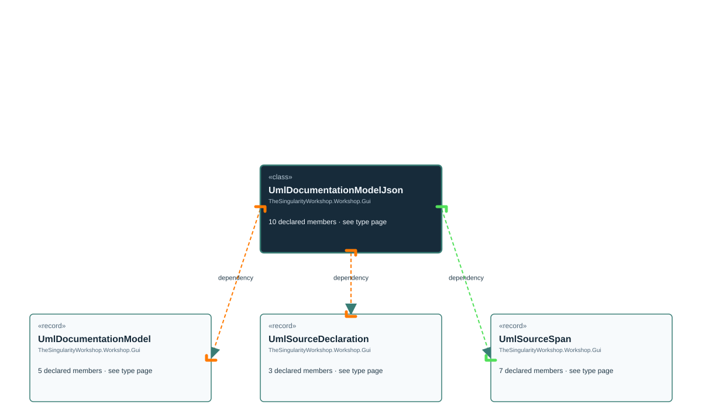

# TheSingularityWorkshop.Workshop.Gui.UmlDocumentationModelJson

> Generated from compiler-backed source analysis. Do not edit by hand.

- Repository: `TrentBest/TheSingularityWorkshop.GUI`
- Revision: [`0644fd4a6c6dc743fb9882f25358651ebbed954b`](https://github.com/TrentBest/TheSingularityWorkshop.GUI/tree/0644fd4a6c6dc743fb9882f25358651ebbed954b)
- Project: `src/Core/TheSingularityWorkshop.GUI.Core.csproj`
- Type ID: `type:TheSingularityWorkshop.GUI.Core, Version=0.1.0.0, Culture=neutral, PublicKeyToken=null:global::TheSingularityWorkshop.Workshop.Gui.UmlDocumentationModelJson`
- Metadata name: `UmlDocumentationModelJson`
- Kind: `class`
- Generic arity: 0

## UML diagram

## Source declarations

- [`src/Core/UmlDocumentationModel.cs:154-308`](https://github.com/TrentBest/TheSingularityWorkshop.GUI/blob/0644fd4a6c6dc743fb9882f25358651ebbed954b/src/Core/UmlDocumentationModel.cs#L154-308)

## Members

| Kind | Signature | Source |
|---|---|---|
| `Method` | `TheSingularityWorkshop.Workshop.Gui.UmlDocumentationModelJson.CreateOptions()` | [`src/Core/UmlDocumentationModel.cs:296-307`](https://github.com/TrentBest/TheSingularityWorkshop.GUI/blob/0644fd4a6c6dc743fb9882f25358651ebbed954b/src/Core/UmlDocumentationModel.cs#L296-307) |
| `Field` | `TheSingularityWorkshop.Workshop.Gui.UmlDocumentationModelJson.CurrentSchemaVersion` | [`src/Core/UmlDocumentationModel.cs:156-156`](https://github.com/TrentBest/TheSingularityWorkshop.GUI/blob/0644fd4a6c6dc743fb9882f25358651ebbed954b/src/Core/UmlDocumentationModel.cs#L156-156) |
| `Method` | `TheSingularityWorkshop.Workshop.Gui.UmlDocumentationModelJson.Deserialize(string)` | [`src/Core/UmlDocumentationModel.cs:172-188`](https://github.com/TrentBest/TheSingularityWorkshop.GUI/blob/0644fd4a6c6dc743fb9882f25358651ebbed954b/src/Core/UmlDocumentationModel.cs#L172-188) |
| `Field` | `TheSingularityWorkshop.Workshop.Gui.UmlDocumentationModelJson.Options` | [`src/Core/UmlDocumentationModel.cs:158-158`](https://github.com/TrentBest/TheSingularityWorkshop.GUI/blob/0644fd4a6c6dc743fb9882f25358651ebbed954b/src/Core/UmlDocumentationModel.cs#L158-158) |
| `Method` | `TheSingularityWorkshop.Workshop.Gui.UmlDocumentationModelJson.Require(bool, string)` | [`src/Core/UmlDocumentationModel.cs:290-294`](https://github.com/TrentBest/TheSingularityWorkshop.GUI/blob/0644fd4a6c6dc743fb9882f25358651ebbed954b/src/Core/UmlDocumentationModel.cs#L290-294) |
| `Method` | `TheSingularityWorkshop.Workshop.Gui.UmlDocumentationModelJson.RequireText(string?, string)` | [`src/Core/UmlDocumentationModel.cs:287-288`](https://github.com/TrentBest/TheSingularityWorkshop.GUI/blob/0644fd4a6c6dc743fb9882f25358651ebbed954b/src/Core/UmlDocumentationModel.cs#L287-288) |
| `Method` | `TheSingularityWorkshop.Workshop.Gui.UmlDocumentationModelJson.Serialize(TheSingularityWorkshop.Workshop.Gui.UmlDocumentationModel)` | [`src/Core/UmlDocumentationModel.cs:161-169`](https://github.com/TrentBest/TheSingularityWorkshop.GUI/blob/0644fd4a6c6dc743fb9882f25358651ebbed954b/src/Core/UmlDocumentationModel.cs#L161-169) |
| `Method` | `TheSingularityWorkshop.Workshop.Gui.UmlDocumentationModelJson.ValidateModel(TheSingularityWorkshop.Workshop.Gui.UmlDocumentationModel)` | [`src/Core/UmlDocumentationModel.cs:190-268`](https://github.com/TrentBest/TheSingularityWorkshop.GUI/blob/0644fd4a6c6dc743fb9882f25358651ebbed954b/src/Core/UmlDocumentationModel.cs#L190-268) |
| `Method` | `TheSingularityWorkshop.Workshop.Gui.UmlDocumentationModelJson.ValidateSource(TheSingularityWorkshop.Workshop.Gui.UmlSourceDeclaration)` | [`src/Core/UmlDocumentationModel.cs:270-275`](https://github.com/TrentBest/TheSingularityWorkshop.GUI/blob/0644fd4a6c6dc743fb9882f25358651ebbed954b/src/Core/UmlDocumentationModel.cs#L270-275) |
| `Method` | `TheSingularityWorkshop.Workshop.Gui.UmlDocumentationModelJson.ValidateSpan(TheSingularityWorkshop.Workshop.Gui.UmlSourceSpan)` | [`src/Core/UmlDocumentationModel.cs:277-285`](https://github.com/TrentBest/TheSingularityWorkshop.GUI/blob/0644fd4a6c6dc743fb9882f25358651ebbed954b/src/Core/UmlDocumentationModel.cs#L277-285) |

## Relationships

| Direction | Kind | Related type | Resolution | Evidence |
|---|---|---|---|---|
| outgoing | `Dependency` | `TheSingularityWorkshop.Workshop.Gui.UmlDocumentationModel` | `Resolved` | [`src/Core/UmlDocumentationModel.cs:161-169`](https://github.com/TrentBest/TheSingularityWorkshop.GUI/blob/0644fd4a6c6dc743fb9882f25358651ebbed954b/src/Core/UmlDocumentationModel.cs#L161-169) |
| outgoing | `Dependency` | `TheSingularityWorkshop.Workshop.Gui.UmlDocumentationModel` | `Resolved` | [`src/Core/UmlDocumentationModel.cs:190-268`](https://github.com/TrentBest/TheSingularityWorkshop.GUI/blob/0644fd4a6c6dc743fb9882f25358651ebbed954b/src/Core/UmlDocumentationModel.cs#L190-268) |
| outgoing | `Dependency` | `TheSingularityWorkshop.Workshop.Gui.UmlDocumentationModel` | `Resolved` | [`src/Core/UmlDocumentationModel.cs:172-188`](https://github.com/TrentBest/TheSingularityWorkshop.GUI/blob/0644fd4a6c6dc743fb9882f25358651ebbed954b/src/Core/UmlDocumentationModel.cs#L172-188) |
| outgoing | `Dependency` | `TheSingularityWorkshop.Workshop.Gui.UmlSourceDeclaration` | `Resolved` | [`src/Core/UmlDocumentationModel.cs:270-275`](https://github.com/TrentBest/TheSingularityWorkshop.GUI/blob/0644fd4a6c6dc743fb9882f25358651ebbed954b/src/Core/UmlDocumentationModel.cs#L270-275) |
| outgoing | `Dependency` | `TheSingularityWorkshop.Workshop.Gui.UmlSourceSpan` | `Resolved` | [`src/Core/UmlDocumentationModel.cs:277-285`](https://github.com/TrentBest/TheSingularityWorkshop.GUI/blob/0644fd4a6c6dc743fb9882f25358651ebbed954b/src/Core/UmlDocumentationModel.cs#L277-285) |

[Back to the generated type index](index.md)

