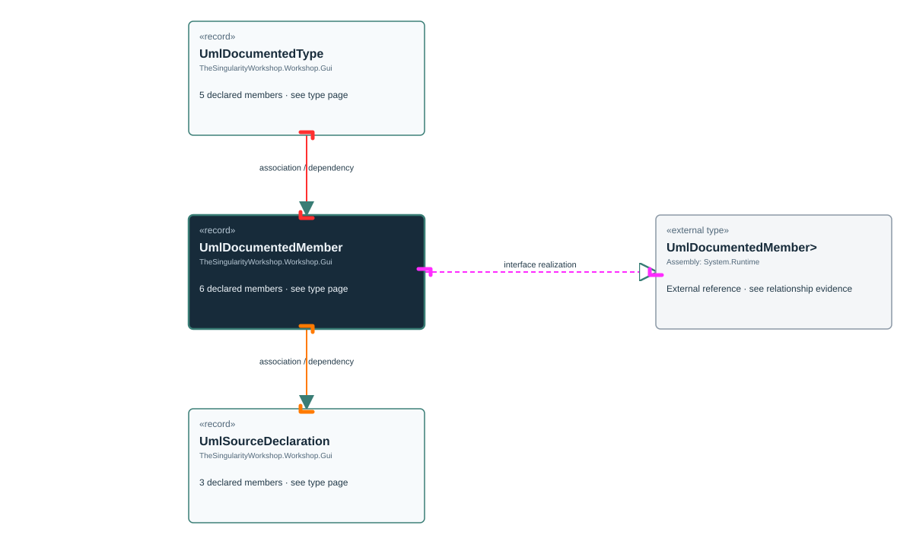

<!-- The Singularity Workshop moniker -->

# TheSingularityWorkshop.Workshop.Gui.UmlDocumentedMember

> Generated from compiler-backed source analysis. Do not edit by hand.

- Repository: `TrentBest/TheSingularityWorkshop.GUI`
- Revision: [`f5c9a2817cdcb9c9ab1ec235e7b67502bcd3b732`](https://github.com/TrentBest/TheSingularityWorkshop.GUI/tree/f5c9a2817cdcb9c9ab1ec235e7b67502bcd3b732)
- Project: `src/Core/TheSingularityWorkshop.GUI.Core.csproj`
- Type ID: `type:TheSingularityWorkshop.GUI.Core, Version=0.1.0.0, Culture=neutral, PublicKeyToken=null:global::TheSingularityWorkshop.Workshop.Gui.UmlDocumentedMember`
- Metadata name: `UmlDocumentedMember`
- Kind: `record`
- Generic arity: 0

## UML diagram

## Source declarations

- [`src/Core/UmlDocumentationModel.cs:41-46`](https://github.com/TrentBest/TheSingularityWorkshop.GUI/blob/f5c9a2817cdcb9c9ab1ec235e7b67502bcd3b732/src/Core/UmlDocumentationModel.cs#L41-46)

## Members

| Kind | Signature | Source |
|---|---|---|
| `Property` | `TheSingularityWorkshop.Workshop.Gui.UmlDocumentedMember.Id` | [`src/Core/UmlDocumentationModel.cs:42-42`](https://github.com/TrentBest/TheSingularityWorkshop.GUI/blob/f5c9a2817cdcb9c9ab1ec235e7b67502bcd3b732/src/Core/UmlDocumentationModel.cs#L42-42) |
| `Property` | `TheSingularityWorkshop.Workshop.Gui.UmlDocumentedMember.Kind` | [`src/Core/UmlDocumentationModel.cs:43-43`](https://github.com/TrentBest/TheSingularityWorkshop.GUI/blob/f5c9a2817cdcb9c9ab1ec235e7b67502bcd3b732/src/Core/UmlDocumentationModel.cs#L43-43) |
| `Property` | `TheSingularityWorkshop.Workshop.Gui.UmlDocumentedMember.MetadataName` | [`src/Core/UmlDocumentationModel.cs:44-44`](https://github.com/TrentBest/TheSingularityWorkshop.GUI/blob/f5c9a2817cdcb9c9ab1ec235e7b67502bcd3b732/src/Core/UmlDocumentationModel.cs#L44-44) |
| `Property` | `TheSingularityWorkshop.Workshop.Gui.UmlDocumentedMember.Signature` | [`src/Core/UmlDocumentationModel.cs:45-45`](https://github.com/TrentBest/TheSingularityWorkshop.GUI/blob/f5c9a2817cdcb9c9ab1ec235e7b67502bcd3b732/src/Core/UmlDocumentationModel.cs#L45-45) |
| `Property` | `TheSingularityWorkshop.Workshop.Gui.UmlDocumentedMember.SourceDeclarations` | [`src/Core/UmlDocumentationModel.cs:46-46`](https://github.com/TrentBest/TheSingularityWorkshop.GUI/blob/f5c9a2817cdcb9c9ab1ec235e7b67502bcd3b732/src/Core/UmlDocumentationModel.cs#L46-46) |
| `Method` | `TheSingularityWorkshop.Workshop.Gui.UmlDocumentedMember.UmlDocumentedMember(string, string, string, string, System.Collections.Generic.IReadOnlyList<TheSingularityWorkshop.Workshop.Gui.UmlSourceDeclaration>)` | [`src/Core/UmlDocumentationModel.cs:41-46`](https://github.com/TrentBest/TheSingularityWorkshop.GUI/blob/f5c9a2817cdcb9c9ab1ec235e7b67502bcd3b732/src/Core/UmlDocumentationModel.cs#L41-46) |

## Relationships

| Direction | Kind | Related type | Resolution | Evidence |
|---|---|---|---|---|
| outgoing | `InterfaceRealization` | `global::System.IEquatable<global::TheSingularityWorkshop.Workshop.Gui.UmlDocumentedMember>` | `External` | [`src/Core/UmlDocumentationModel.cs:41-46`](https://github.com/TrentBest/TheSingularityWorkshop.GUI/blob/f5c9a2817cdcb9c9ab1ec235e7b67502bcd3b732/src/Core/UmlDocumentationModel.cs#L41-46) |
| outgoing | `Association` | `TheSingularityWorkshop.Workshop.Gui.UmlSourceDeclaration` | `Resolved` | [`src/Core/UmlDocumentationModel.cs:46-46`](https://github.com/TrentBest/TheSingularityWorkshop.GUI/blob/f5c9a2817cdcb9c9ab1ec235e7b67502bcd3b732/src/Core/UmlDocumentationModel.cs#L46-46) |
| incoming | `Association` | `TheSingularityWorkshop.Workshop.Gui.UmlDocumentedType` | `Resolved` | [`src/Core/UmlDocumentationModel.cs:38-38`](https://github.com/TrentBest/TheSingularityWorkshop.GUI/blob/f5c9a2817cdcb9c9ab1ec235e7b67502bcd3b732/src/Core/UmlDocumentationModel.cs#L38-38) |
| outgoing | `Dependency` | `TheSingularityWorkshop.Workshop.Gui.UmlSourceDeclaration` | `Resolved` | [`src/Core/UmlDocumentationModel.cs:41-46`](https://github.com/TrentBest/TheSingularityWorkshop.GUI/blob/f5c9a2817cdcb9c9ab1ec235e7b67502bcd3b732/src/Core/UmlDocumentationModel.cs#L41-46) |
| incoming | `Dependency` | `TheSingularityWorkshop.Workshop.Gui.UmlDocumentedType` | `Resolved` | [`src/Core/UmlDocumentationModel.cs:34-38`](https://github.com/TrentBest/TheSingularityWorkshop.GUI/blob/f5c9a2817cdcb9c9ab1ec235e7b67502bcd3b732/src/Core/UmlDocumentationModel.cs#L34-38) |

[Back to the generated type index](index.md)

---

<!-- THE SINGULARITY WORKSHOP FOOTER -->

