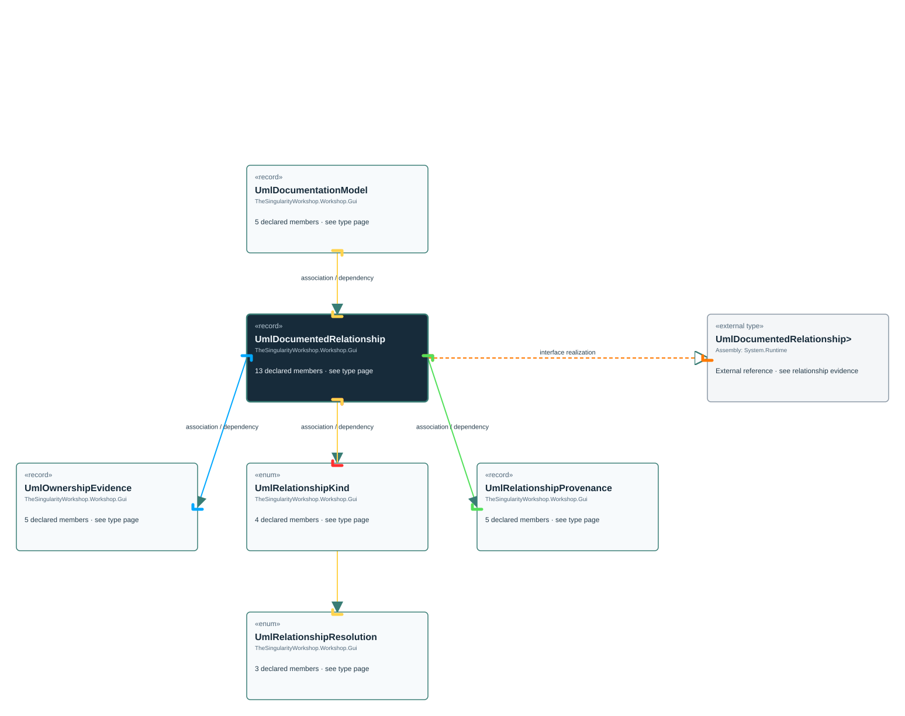

# TheSingularityWorkshop.Workshop.Gui.UmlDocumentedRelationship

> Generated from compiler-backed source analysis. Do not edit by hand.

- Repository: `TrentBest/TheSingularityWorkshop.GUI`
- Revision: [`35bb31b337c1340f8713babd0d411f86f0d602cd`](https://github.com/TrentBest/TheSingularityWorkshop.GUI/tree/35bb31b337c1340f8713babd0d411f86f0d602cd)
- Project: `src/Core/TheSingularityWorkshop.GUI.Core.csproj`
- Type ID: `type:TheSingularityWorkshop.GUI.Core, Version=0.1.0.0, Culture=neutral, PublicKeyToken=null:global::TheSingularityWorkshop.Workshop.Gui.UmlDocumentedRelationship`
- Metadata name: `UmlDocumentedRelationship`
- Kind: `record`
- Generic arity: 0

## UML diagram

## Source declarations

- [`src/Core/UmlDocumentationModel.cs:81-93`](https://github.com/TrentBest/TheSingularityWorkshop.GUI/blob/35bb31b337c1340f8713babd0d411f86f0d602cd/src/Core/UmlDocumentationModel.cs#L81-93)

## Members

| Kind | Signature | Source |
|---|---|---|
| `Property` | `TheSingularityWorkshop.Workshop.Gui.UmlDocumentedRelationship.Direction` | [`src/Core/UmlDocumentationModel.cs:89-89`](https://github.com/TrentBest/TheSingularityWorkshop.GUI/blob/35bb31b337c1340f8713babd0d411f86f0d602cd/src/Core/UmlDocumentationModel.cs#L89-89) |
| `Property` | `TheSingularityWorkshop.Workshop.Gui.UmlDocumentedRelationship.Id` | [`src/Core/UmlDocumentationModel.cs:82-82`](https://github.com/TrentBest/TheSingularityWorkshop.GUI/blob/35bb31b337c1340f8713babd0d411f86f0d602cd/src/Core/UmlDocumentationModel.cs#L82-82) |
| `Property` | `TheSingularityWorkshop.Workshop.Gui.UmlDocumentedRelationship.Kind` | [`src/Core/UmlDocumentationModel.cs:83-83`](https://github.com/TrentBest/TheSingularityWorkshop.GUI/blob/35bb31b337c1340f8713babd0d411f86f0d602cd/src/Core/UmlDocumentationModel.cs#L83-83) |
| `Property` | `TheSingularityWorkshop.Workshop.Gui.UmlDocumentedRelationship.Label` | [`src/Core/UmlDocumentationModel.cs:90-90`](https://github.com/TrentBest/TheSingularityWorkshop.GUI/blob/35bb31b337c1340f8713babd0d411f86f0d602cd/src/Core/UmlDocumentationModel.cs#L90-90) |
| `Property` | `TheSingularityWorkshop.Workshop.Gui.UmlDocumentedRelationship.Multiplicity` | [`src/Core/UmlDocumentationModel.cs:91-91`](https://github.com/TrentBest/TheSingularityWorkshop.GUI/blob/35bb31b337c1340f8713babd0d411f86f0d602cd/src/Core/UmlDocumentationModel.cs#L91-91) |
| `Property` | `TheSingularityWorkshop.Workshop.Gui.UmlDocumentedRelationship.OwnershipEvidence` | [`src/Core/UmlDocumentationModel.cs:92-92`](https://github.com/TrentBest/TheSingularityWorkshop.GUI/blob/35bb31b337c1340f8713babd0d411f86f0d602cd/src/Core/UmlDocumentationModel.cs#L92-92) |
| `Property` | `TheSingularityWorkshop.Workshop.Gui.UmlDocumentedRelationship.Provenance` | [`src/Core/UmlDocumentationModel.cs:93-93`](https://github.com/TrentBest/TheSingularityWorkshop.GUI/blob/35bb31b337c1340f8713babd0d411f86f0d602cd/src/Core/UmlDocumentationModel.cs#L93-93) |
| `Property` | `TheSingularityWorkshop.Workshop.Gui.UmlDocumentedRelationship.Resolution` | [`src/Core/UmlDocumentationModel.cs:87-87`](https://github.com/TrentBest/TheSingularityWorkshop.GUI/blob/35bb31b337c1340f8713babd0d411f86f0d602cd/src/Core/UmlDocumentationModel.cs#L87-87) |
| `Property` | `TheSingularityWorkshop.Workshop.Gui.UmlDocumentedRelationship.SourceTypeId` | [`src/Core/UmlDocumentationModel.cs:84-84`](https://github.com/TrentBest/TheSingularityWorkshop.GUI/blob/35bb31b337c1340f8713babd0d411f86f0d602cd/src/Core/UmlDocumentationModel.cs#L84-84) |
| `Property` | `TheSingularityWorkshop.Workshop.Gui.UmlDocumentedRelationship.TargetAssemblyIdentity` | [`src/Core/UmlDocumentationModel.cs:88-88`](https://github.com/TrentBest/TheSingularityWorkshop.GUI/blob/35bb31b337c1340f8713babd0d411f86f0d602cd/src/Core/UmlDocumentationModel.cs#L88-88) |
| `Property` | `TheSingularityWorkshop.Workshop.Gui.UmlDocumentedRelationship.TargetDisplayName` | [`src/Core/UmlDocumentationModel.cs:86-86`](https://github.com/TrentBest/TheSingularityWorkshop.GUI/blob/35bb31b337c1340f8713babd0d411f86f0d602cd/src/Core/UmlDocumentationModel.cs#L86-86) |
| `Property` | `TheSingularityWorkshop.Workshop.Gui.UmlDocumentedRelationship.TargetTypeId` | [`src/Core/UmlDocumentationModel.cs:85-85`](https://github.com/TrentBest/TheSingularityWorkshop.GUI/blob/35bb31b337c1340f8713babd0d411f86f0d602cd/src/Core/UmlDocumentationModel.cs#L85-85) |
| `Method` | `TheSingularityWorkshop.Workshop.Gui.UmlDocumentedRelationship.UmlDocumentedRelationship(string, TheSingularityWorkshop.Workshop.Gui.UmlRelationshipKind, string, string?, string, TheSingularityWorkshop.Workshop.Gui.UmlRelationshipResolution, string?, string, string, string?, TheSingularityWorkshop.Workshop.Gui.UmlOwnershipEvidence?, TheSingularityWorkshop.Workshop.Gui.UmlRelationshipProvenance)` | [`src/Core/UmlDocumentationModel.cs:81-93`](https://github.com/TrentBest/TheSingularityWorkshop.GUI/blob/35bb31b337c1340f8713babd0d411f86f0d602cd/src/Core/UmlDocumentationModel.cs#L81-93) |

## Relationships

| Direction | Kind | Related type | Resolution | Evidence |
|---|---|---|---|---|
| outgoing | `InterfaceRealization` | `global::System.IEquatable<global::TheSingularityWorkshop.Workshop.Gui.UmlDocumentedRelationship>` | `External` | [`src/Core/UmlDocumentationModel.cs:81-93`](https://github.com/TrentBest/TheSingularityWorkshop.GUI/blob/35bb31b337c1340f8713babd0d411f86f0d602cd/src/Core/UmlDocumentationModel.cs#L81-93) |
| incoming | `Association` | `TheSingularityWorkshop.Workshop.Gui.UmlDocumentationModel` | `Resolved` | [`src/Core/UmlDocumentationModel.cs:11-11`](https://github.com/TrentBest/TheSingularityWorkshop.GUI/blob/35bb31b337c1340f8713babd0d411f86f0d602cd/src/Core/UmlDocumentationModel.cs#L11-11) |
| outgoing | `Association` | `TheSingularityWorkshop.Workshop.Gui.UmlOwnershipEvidence` | `Resolved` | [`src/Core/UmlDocumentationModel.cs:92-92`](https://github.com/TrentBest/TheSingularityWorkshop.GUI/blob/35bb31b337c1340f8713babd0d411f86f0d602cd/src/Core/UmlDocumentationModel.cs#L92-92) |
| outgoing | `Association` | `TheSingularityWorkshop.Workshop.Gui.UmlRelationshipKind` | `Resolved` | [`src/Core/UmlDocumentationModel.cs:83-83`](https://github.com/TrentBest/TheSingularityWorkshop.GUI/blob/35bb31b337c1340f8713babd0d411f86f0d602cd/src/Core/UmlDocumentationModel.cs#L83-83) |
| outgoing | `Association` | `TheSingularityWorkshop.Workshop.Gui.UmlRelationshipProvenance` | `Resolved` | [`src/Core/UmlDocumentationModel.cs:93-93`](https://github.com/TrentBest/TheSingularityWorkshop.GUI/blob/35bb31b337c1340f8713babd0d411f86f0d602cd/src/Core/UmlDocumentationModel.cs#L93-93) |
| outgoing | `Association` | `TheSingularityWorkshop.Workshop.Gui.UmlRelationshipResolution` | `Resolved` | [`src/Core/UmlDocumentationModel.cs:87-87`](https://github.com/TrentBest/TheSingularityWorkshop.GUI/blob/35bb31b337c1340f8713babd0d411f86f0d602cd/src/Core/UmlDocumentationModel.cs#L87-87) |
| incoming | `Dependency` | `TheSingularityWorkshop.Workshop.Gui.UmlDocumentationModel` | `Resolved` | [`src/Core/UmlDocumentationModel.cs:7-11`](https://github.com/TrentBest/TheSingularityWorkshop.GUI/blob/35bb31b337c1340f8713babd0d411f86f0d602cd/src/Core/UmlDocumentationModel.cs#L7-11) |
| outgoing | `Dependency` | `TheSingularityWorkshop.Workshop.Gui.UmlOwnershipEvidence` | `Resolved` | [`src/Core/UmlDocumentationModel.cs:81-93`](https://github.com/TrentBest/TheSingularityWorkshop.GUI/blob/35bb31b337c1340f8713babd0d411f86f0d602cd/src/Core/UmlDocumentationModel.cs#L81-93) |
| outgoing | `Dependency` | `TheSingularityWorkshop.Workshop.Gui.UmlRelationshipKind` | `Resolved` | [`src/Core/UmlDocumentationModel.cs:81-93`](https://github.com/TrentBest/TheSingularityWorkshop.GUI/blob/35bb31b337c1340f8713babd0d411f86f0d602cd/src/Core/UmlDocumentationModel.cs#L81-93) |
| outgoing | `Dependency` | `TheSingularityWorkshop.Workshop.Gui.UmlRelationshipProvenance` | `Resolved` | [`src/Core/UmlDocumentationModel.cs:81-93`](https://github.com/TrentBest/TheSingularityWorkshop.GUI/blob/35bb31b337c1340f8713babd0d411f86f0d602cd/src/Core/UmlDocumentationModel.cs#L81-93) |
| outgoing | `Dependency` | `TheSingularityWorkshop.Workshop.Gui.UmlRelationshipResolution` | `Resolved` | [`src/Core/UmlDocumentationModel.cs:81-93`](https://github.com/TrentBest/TheSingularityWorkshop.GUI/blob/35bb31b337c1340f8713babd0d411f86f0d602cd/src/Core/UmlDocumentationModel.cs#L81-93) |

[Back to the generated type index](index.md)

