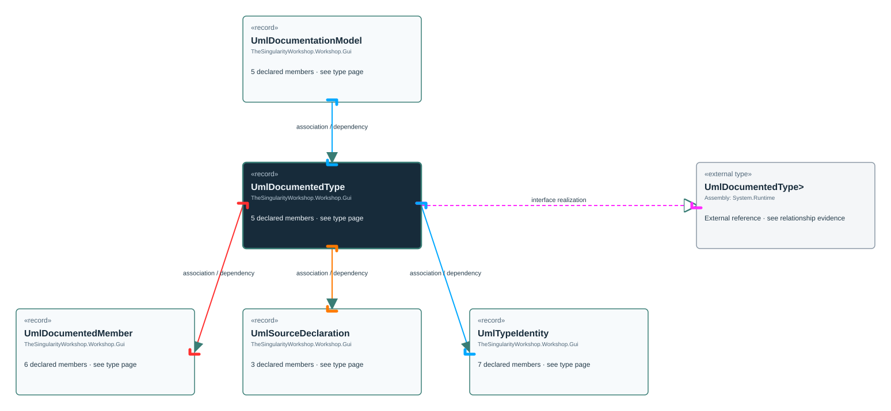

<!-- The Singularity Workshop moniker -->

# TheSingularityWorkshop.Workshop.Gui.UmlDocumentedType

> Generated from compiler-backed source analysis. Do not edit by hand.

- Repository: `TrentBest/TheSingularityWorkshop.GUI`
- Revision: [`f5c9a2817cdcb9c9ab1ec235e7b67502bcd3b732`](https://github.com/TrentBest/TheSingularityWorkshop.GUI/tree/f5c9a2817cdcb9c9ab1ec235e7b67502bcd3b732)
- Project: `src/Core/TheSingularityWorkshop.GUI.Core.csproj`
- Type ID: `type:TheSingularityWorkshop.GUI.Core, Version=0.1.0.0, Culture=neutral, PublicKeyToken=null:global::TheSingularityWorkshop.Workshop.Gui.UmlDocumentedType`
- Metadata name: `UmlDocumentedType`
- Kind: `record`
- Generic arity: 0

## UML diagram

## Source declarations

- [`src/Core/UmlDocumentationModel.cs:34-38`](https://github.com/TrentBest/TheSingularityWorkshop.GUI/blob/f5c9a2817cdcb9c9ab1ec235e7b67502bcd3b732/src/Core/UmlDocumentationModel.cs#L34-38)

## Members

| Kind | Signature | Source |
|---|---|---|
| `Property` | `TheSingularityWorkshop.Workshop.Gui.UmlDocumentedType.Id` | [`src/Core/UmlDocumentationModel.cs:35-35`](https://github.com/TrentBest/TheSingularityWorkshop.GUI/blob/f5c9a2817cdcb9c9ab1ec235e7b67502bcd3b732/src/Core/UmlDocumentationModel.cs#L35-35) |
| `Property` | `TheSingularityWorkshop.Workshop.Gui.UmlDocumentedType.Identity` | [`src/Core/UmlDocumentationModel.cs:36-36`](https://github.com/TrentBest/TheSingularityWorkshop.GUI/blob/f5c9a2817cdcb9c9ab1ec235e7b67502bcd3b732/src/Core/UmlDocumentationModel.cs#L36-36) |
| `Property` | `TheSingularityWorkshop.Workshop.Gui.UmlDocumentedType.Members` | [`src/Core/UmlDocumentationModel.cs:38-38`](https://github.com/TrentBest/TheSingularityWorkshop.GUI/blob/f5c9a2817cdcb9c9ab1ec235e7b67502bcd3b732/src/Core/UmlDocumentationModel.cs#L38-38) |
| `Property` | `TheSingularityWorkshop.Workshop.Gui.UmlDocumentedType.SourceDeclarations` | [`src/Core/UmlDocumentationModel.cs:37-37`](https://github.com/TrentBest/TheSingularityWorkshop.GUI/blob/f5c9a2817cdcb9c9ab1ec235e7b67502bcd3b732/src/Core/UmlDocumentationModel.cs#L37-37) |
| `Method` | `TheSingularityWorkshop.Workshop.Gui.UmlDocumentedType.UmlDocumentedType(string, TheSingularityWorkshop.Workshop.Gui.UmlTypeIdentity, System.Collections.Generic.IReadOnlyList<TheSingularityWorkshop.Workshop.Gui.UmlSourceDeclaration>, System.Collections.Generic.IReadOnlyList<TheSingularityWorkshop.Workshop.Gui.UmlDocumentedMember>)` | [`src/Core/UmlDocumentationModel.cs:34-38`](https://github.com/TrentBest/TheSingularityWorkshop.GUI/blob/f5c9a2817cdcb9c9ab1ec235e7b67502bcd3b732/src/Core/UmlDocumentationModel.cs#L34-38) |

## Relationships

| Direction | Kind | Related type | Resolution | Evidence |
|---|---|---|---|---|
| outgoing | `InterfaceRealization` | `global::System.IEquatable<global::TheSingularityWorkshop.Workshop.Gui.UmlDocumentedType>` | `External` | [`src/Core/UmlDocumentationModel.cs:34-38`](https://github.com/TrentBest/TheSingularityWorkshop.GUI/blob/f5c9a2817cdcb9c9ab1ec235e7b67502bcd3b732/src/Core/UmlDocumentationModel.cs#L34-38) |
| incoming | `Association` | `TheSingularityWorkshop.Workshop.Gui.UmlDocumentationModel` | `Resolved` | [`src/Core/UmlDocumentationModel.cs:10-10`](https://github.com/TrentBest/TheSingularityWorkshop.GUI/blob/f5c9a2817cdcb9c9ab1ec235e7b67502bcd3b732/src/Core/UmlDocumentationModel.cs#L10-10) |
| outgoing | `Association` | `TheSingularityWorkshop.Workshop.Gui.UmlDocumentedMember` | `Resolved` | [`src/Core/UmlDocumentationModel.cs:38-38`](https://github.com/TrentBest/TheSingularityWorkshop.GUI/blob/f5c9a2817cdcb9c9ab1ec235e7b67502bcd3b732/src/Core/UmlDocumentationModel.cs#L38-38) |
| outgoing | `Association` | `TheSingularityWorkshop.Workshop.Gui.UmlSourceDeclaration` | `Resolved` | [`src/Core/UmlDocumentationModel.cs:37-37`](https://github.com/TrentBest/TheSingularityWorkshop.GUI/blob/f5c9a2817cdcb9c9ab1ec235e7b67502bcd3b732/src/Core/UmlDocumentationModel.cs#L37-37) |
| outgoing | `Association` | `TheSingularityWorkshop.Workshop.Gui.UmlTypeIdentity` | `Resolved` | [`src/Core/UmlDocumentationModel.cs:36-36`](https://github.com/TrentBest/TheSingularityWorkshop.GUI/blob/f5c9a2817cdcb9c9ab1ec235e7b67502bcd3b732/src/Core/UmlDocumentationModel.cs#L36-36) |
| incoming | `Dependency` | `TheSingularityWorkshop.Workshop.Gui.UmlDocumentationModel` | `Resolved` | [`src/Core/UmlDocumentationModel.cs:7-11`](https://github.com/TrentBest/TheSingularityWorkshop.GUI/blob/f5c9a2817cdcb9c9ab1ec235e7b67502bcd3b732/src/Core/UmlDocumentationModel.cs#L7-11) |
| outgoing | `Dependency` | `TheSingularityWorkshop.Workshop.Gui.UmlDocumentedMember` | `Resolved` | [`src/Core/UmlDocumentationModel.cs:34-38`](https://github.com/TrentBest/TheSingularityWorkshop.GUI/blob/f5c9a2817cdcb9c9ab1ec235e7b67502bcd3b732/src/Core/UmlDocumentationModel.cs#L34-38) |
| outgoing | `Dependency` | `TheSingularityWorkshop.Workshop.Gui.UmlSourceDeclaration` | `Resolved` | [`src/Core/UmlDocumentationModel.cs:34-38`](https://github.com/TrentBest/TheSingularityWorkshop.GUI/blob/f5c9a2817cdcb9c9ab1ec235e7b67502bcd3b732/src/Core/UmlDocumentationModel.cs#L34-38) |
| outgoing | `Dependency` | `TheSingularityWorkshop.Workshop.Gui.UmlTypeIdentity` | `Resolved` | [`src/Core/UmlDocumentationModel.cs:34-38`](https://github.com/TrentBest/TheSingularityWorkshop.GUI/blob/f5c9a2817cdcb9c9ab1ec235e7b67502bcd3b732/src/Core/UmlDocumentationModel.cs#L34-38) |

[Back to the generated type index](index.md)

---

<!-- THE SINGULARITY WORKSHOP FOOTER -->

