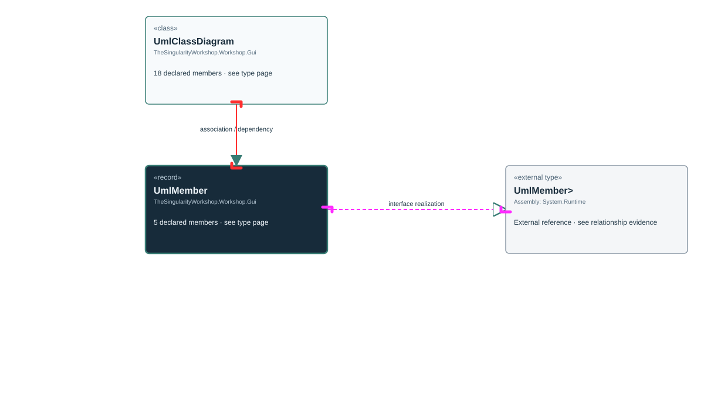

<!-- The Singularity Workshop moniker -->

# TheSingularityWorkshop.Workshop.Gui.UmlMember

> Generated from compiler-backed source analysis. Do not edit by hand.

- Repository: `TrentBest/TheSingularityWorkshop.GUI`
- Revision: [`f48dd15256521c88fad88371742c89d5fd1d326f`](https://github.com/TrentBest/TheSingularityWorkshop.GUI/tree/f48dd15256521c88fad88371742c89d5fd1d326f)
- Project: `src/Core/TheSingularityWorkshop.GUI.Core.csproj`
- Type ID: `type:TheSingularityWorkshop.GUI.Core, Version=0.1.0.0, Culture=neutral, PublicKeyToken=null:global::TheSingularityWorkshop.Workshop.Gui.UmlMember`
- Metadata name: `UmlMember`
- Kind: `record`
- Generic arity: 0

## UML diagram

## Source declarations

- [`src/Core/UmlClassDiagram.cs:57-57`](https://github.com/TrentBest/TheSingularityWorkshop.GUI/blob/f48dd15256521c88fad88371742c89d5fd1d326f/src/Core/UmlClassDiagram.cs#L57-57)

## Members

| Kind | Signature | Source |
|---|---|---|
| `Property` | `TheSingularityWorkshop.Workshop.Gui.UmlMember.IsStatic` | [`src/Core/UmlClassDiagram.cs:57-57`](https://github.com/TrentBest/TheSingularityWorkshop.GUI/blob/f48dd15256521c88fad88371742c89d5fd1d326f/src/Core/UmlClassDiagram.cs#L57-57) |
| `Property` | `TheSingularityWorkshop.Workshop.Gui.UmlMember.Name` | [`src/Core/UmlClassDiagram.cs:57-57`](https://github.com/TrentBest/TheSingularityWorkshop.GUI/blob/f48dd15256521c88fad88371742c89d5fd1d326f/src/Core/UmlClassDiagram.cs#L57-57) |
| `Property` | `TheSingularityWorkshop.Workshop.Gui.UmlMember.Signature` | [`src/Core/UmlClassDiagram.cs:57-57`](https://github.com/TrentBest/TheSingularityWorkshop.GUI/blob/f48dd15256521c88fad88371742c89d5fd1d326f/src/Core/UmlClassDiagram.cs#L57-57) |
| `Method` | `TheSingularityWorkshop.Workshop.Gui.UmlMember.UmlMember(string, string, string, bool)` | [`src/Core/UmlClassDiagram.cs:57-57`](https://github.com/TrentBest/TheSingularityWorkshop.GUI/blob/f48dd15256521c88fad88371742c89d5fd1d326f/src/Core/UmlClassDiagram.cs#L57-57) |
| `Property` | `TheSingularityWorkshop.Workshop.Gui.UmlMember.Visibility` | [`src/Core/UmlClassDiagram.cs:57-57`](https://github.com/TrentBest/TheSingularityWorkshop.GUI/blob/f48dd15256521c88fad88371742c89d5fd1d326f/src/Core/UmlClassDiagram.cs#L57-57) |

## Relationships

| Direction | Kind | Related type | Resolution | Evidence |
|---|---|---|---|---|
| outgoing | `InterfaceRealization` | `global::System.IEquatable<global::TheSingularityWorkshop.Workshop.Gui.UmlMember>` | `External` | [`src/Core/UmlClassDiagram.cs:57-57`](https://github.com/TrentBest/TheSingularityWorkshop.GUI/blob/f48dd15256521c88fad88371742c89d5fd1d326f/src/Core/UmlClassDiagram.cs#L57-57) |
| incoming | `Association` | `TheSingularityWorkshop.Workshop.Gui.UmlClassDiagram` | `Resolved` | [`src/Core/UmlClassDiagram.cs:45-45`](https://github.com/TrentBest/TheSingularityWorkshop.GUI/blob/f48dd15256521c88fad88371742c89d5fd1d326f/src/Core/UmlClassDiagram.cs#L45-45) |
| incoming | `Association` | `TheSingularityWorkshop.Workshop.Gui.UmlClassDiagram` | `Resolved` | [`src/Core/UmlClassDiagram.cs:47-47`](https://github.com/TrentBest/TheSingularityWorkshop.GUI/blob/f48dd15256521c88fad88371742c89d5fd1d326f/src/Core/UmlClassDiagram.cs#L47-47) |
| incoming | `Association` | `TheSingularityWorkshop.Workshop.Gui.UmlClassDiagram` | `Resolved` | [`src/Core/UmlClassDiagram.cs:46-46`](https://github.com/TrentBest/TheSingularityWorkshop.GUI/blob/f48dd15256521c88fad88371742c89d5fd1d326f/src/Core/UmlClassDiagram.cs#L46-46) |
| incoming | `Dependency` | `TheSingularityWorkshop.Workshop.Gui.UmlClassDiagram` | `Resolved` | [`src/Core/UmlClassDiagram.cs:11-40`](https://github.com/TrentBest/TheSingularityWorkshop.GUI/blob/f48dd15256521c88fad88371742c89d5fd1d326f/src/Core/UmlClassDiagram.cs#L11-40) |
| incoming | `Dependency` | `TheSingularityWorkshop.Workshop.Gui.UmlClassDiagram` | `Resolved` | [`src/Core/UmlClassDiagram.cs:52-53`](https://github.com/TrentBest/TheSingularityWorkshop.GUI/blob/f48dd15256521c88fad88371742c89d5fd1d326f/src/Core/UmlClassDiagram.cs#L52-53) |
| incoming | `Dependency` | `TheSingularityWorkshop.Workshop.Gui.UmlClassDiagram` | `Resolved` | [`src/Core/UmlClassDiagram.cs:11-40`](https://github.com/TrentBest/TheSingularityWorkshop.GUI/blob/f48dd15256521c88fad88371742c89d5fd1d326f/src/Core/UmlClassDiagram.cs#L11-40) |
| incoming | `Dependency` | `TheSingularityWorkshop.Workshop.Gui.UmlClassDiagram` | `Resolved` | [`src/Core/UmlClassDiagram.cs:11-40`](https://github.com/TrentBest/TheSingularityWorkshop.GUI/blob/f48dd15256521c88fad88371742c89d5fd1d326f/src/Core/UmlClassDiagram.cs#L11-40) |
| incoming | `Dependency` | `TheSingularityWorkshop.Workshop.Gui.UmlClassDiagram` | `Resolved` | [`src/Core/UmlClassDiagram.cs:52-53`](https://github.com/TrentBest/TheSingularityWorkshop.GUI/blob/f48dd15256521c88fad88371742c89d5fd1d326f/src/Core/UmlClassDiagram.cs#L52-53) |

[Back to the generated type index](index.md)

---

<!-- THE SINGULARITY WORKSHOP FOOTER -->

