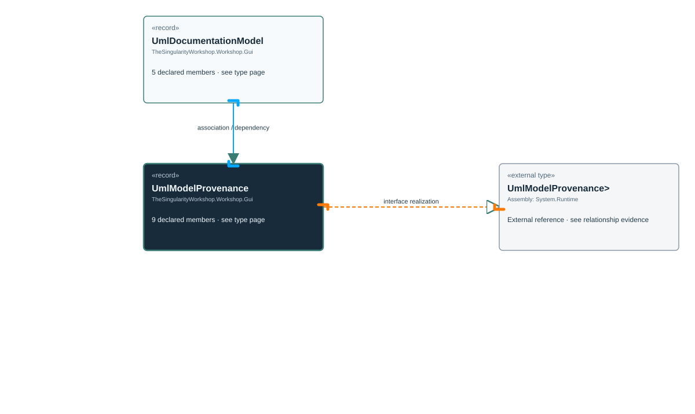

<!-- The Singularity Workshop moniker -->

# TheSingularityWorkshop.Workshop.Gui.UmlModelProvenance

> Generated from compiler-backed source analysis. Do not edit by hand.

- Repository: `TrentBest/TheSingularityWorkshop.GUI`
- Revision: [`f48dd15256521c88fad88371742c89d5fd1d326f`](https://github.com/TrentBest/TheSingularityWorkshop.GUI/tree/f48dd15256521c88fad88371742c89d5fd1d326f)
- Project: `src/Core/TheSingularityWorkshop.GUI.Core.csproj`
- Type ID: `type:TheSingularityWorkshop.GUI.Core, Version=0.1.0.0, Culture=neutral, PublicKeyToken=null:global::TheSingularityWorkshop.Workshop.Gui.UmlModelProvenance`
- Metadata name: `UmlModelProvenance`
- Kind: `record`
- Generic arity: 0

## UML diagram

## Source declarations

- [`src/Core/UmlDocumentationModel.cs:14-22`](https://github.com/TrentBest/TheSingularityWorkshop.GUI/blob/f48dd15256521c88fad88371742c89d5fd1d326f/src/Core/UmlDocumentationModel.cs#L14-22)

## Members

| Kind | Signature | Source |
|---|---|---|
| `Property` | `TheSingularityWorkshop.Workshop.Gui.UmlModelProvenance.AnalysisMode` | [`src/Core/UmlDocumentationModel.cs:21-21`](https://github.com/TrentBest/TheSingularityWorkshop.GUI/blob/f48dd15256521c88fad88371742c89d5fd1d326f/src/Core/UmlDocumentationModel.cs#L21-21) |
| `Property` | `TheSingularityWorkshop.Workshop.Gui.UmlModelProvenance.AssemblyIdentity` | [`src/Core/UmlDocumentationModel.cs:18-18`](https://github.com/TrentBest/TheSingularityWorkshop.GUI/blob/f48dd15256521c88fad88371742c89d5fd1d326f/src/Core/UmlDocumentationModel.cs#L18-18) |
| `Property` | `TheSingularityWorkshop.Workshop.Gui.UmlModelProvenance.BuiltAssemblySha256` | [`src/Core/UmlDocumentationModel.cs:22-22`](https://github.com/TrentBest/TheSingularityWorkshop.GUI/blob/f48dd15256521c88fad88371742c89d5fd1d326f/src/Core/UmlDocumentationModel.cs#L22-22) |
| `Property` | `TheSingularityWorkshop.Workshop.Gui.UmlModelProvenance.Configuration` | [`src/Core/UmlDocumentationModel.cs:20-20`](https://github.com/TrentBest/TheSingularityWorkshop.GUI/blob/f48dd15256521c88fad88371742c89d5fd1d326f/src/Core/UmlDocumentationModel.cs#L20-20) |
| `Property` | `TheSingularityWorkshop.Workshop.Gui.UmlModelProvenance.ProjectPath` | [`src/Core/UmlDocumentationModel.cs:17-17`](https://github.com/TrentBest/TheSingularityWorkshop.GUI/blob/f48dd15256521c88fad88371742c89d5fd1d326f/src/Core/UmlDocumentationModel.cs#L17-17) |
| `Property` | `TheSingularityWorkshop.Workshop.Gui.UmlModelProvenance.Repository` | [`src/Core/UmlDocumentationModel.cs:15-15`](https://github.com/TrentBest/TheSingularityWorkshop.GUI/blob/f48dd15256521c88fad88371742c89d5fd1d326f/src/Core/UmlDocumentationModel.cs#L15-15) |
| `Property` | `TheSingularityWorkshop.Workshop.Gui.UmlModelProvenance.SourceRevision` | [`src/Core/UmlDocumentationModel.cs:16-16`](https://github.com/TrentBest/TheSingularityWorkshop.GUI/blob/f48dd15256521c88fad88371742c89d5fd1d326f/src/Core/UmlDocumentationModel.cs#L16-16) |
| `Property` | `TheSingularityWorkshop.Workshop.Gui.UmlModelProvenance.TargetFramework` | [`src/Core/UmlDocumentationModel.cs:19-19`](https://github.com/TrentBest/TheSingularityWorkshop.GUI/blob/f48dd15256521c88fad88371742c89d5fd1d326f/src/Core/UmlDocumentationModel.cs#L19-19) |
| `Method` | `TheSingularityWorkshop.Workshop.Gui.UmlModelProvenance.UmlModelProvenance(string, string, string, string?, string?, string, string, string?)` | [`src/Core/UmlDocumentationModel.cs:14-22`](https://github.com/TrentBest/TheSingularityWorkshop.GUI/blob/f48dd15256521c88fad88371742c89d5fd1d326f/src/Core/UmlDocumentationModel.cs#L14-22) |

## Relationships

| Direction | Kind | Related type | Resolution | Evidence |
|---|---|---|---|---|
| outgoing | `InterfaceRealization` | `global::System.IEquatable<global::TheSingularityWorkshop.Workshop.Gui.UmlModelProvenance>` | `External` | [`src/Core/UmlDocumentationModel.cs:14-22`](https://github.com/TrentBest/TheSingularityWorkshop.GUI/blob/f48dd15256521c88fad88371742c89d5fd1d326f/src/Core/UmlDocumentationModel.cs#L14-22) |
| incoming | `Association` | `TheSingularityWorkshop.Workshop.Gui.UmlDocumentationModel` | `Resolved` | [`src/Core/UmlDocumentationModel.cs:9-9`](https://github.com/TrentBest/TheSingularityWorkshop.GUI/blob/f48dd15256521c88fad88371742c89d5fd1d326f/src/Core/UmlDocumentationModel.cs#L9-9) |
| incoming | `Dependency` | `TheSingularityWorkshop.Workshop.Gui.UmlDocumentationModel` | `Resolved` | [`src/Core/UmlDocumentationModel.cs:7-11`](https://github.com/TrentBest/TheSingularityWorkshop.GUI/blob/f48dd15256521c88fad88371742c89d5fd1d326f/src/Core/UmlDocumentationModel.cs#L7-11) |

[Back to the generated type index](index.md)

---

<!-- THE SINGULARITY WORKSHOP FOOTER -->

