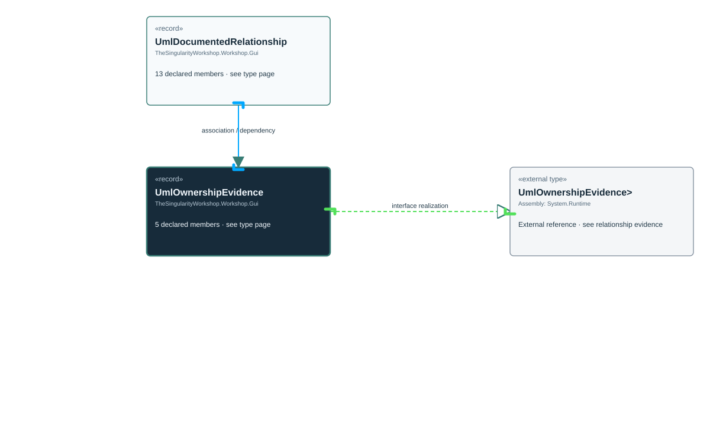

<!-- The Singularity Workshop moniker -->

# TheSingularityWorkshop.Workshop.Gui.UmlOwnershipEvidence

> Generated from compiler-backed source analysis. Do not edit by hand.

- Repository: `TrentBest/TheSingularityWorkshop.GUI`
- Revision: [`d01597026d83f798e62a2a144bfd9400a3cd44a8`](https://github.com/TrentBest/TheSingularityWorkshop.GUI/tree/d01597026d83f798e62a2a144bfd9400a3cd44a8)
- Project: `src/Core/TheSingularityWorkshop.GUI.Core.csproj`
- Type ID: `type:TheSingularityWorkshop.GUI.Core, Version=0.1.0.0, Culture=neutral, PublicKeyToken=null:global::TheSingularityWorkshop.Workshop.Gui.UmlOwnershipEvidence`
- Metadata name: `UmlOwnershipEvidence`
- Kind: `record`
- Generic arity: 0

## UML diagram

## Source declarations

- [`src/Core/UmlDocumentationModel.cs:99-103`](https://github.com/TrentBest/TheSingularityWorkshop.GUI/blob/d01597026d83f798e62a2a144bfd9400a3cd44a8/src/Core/UmlDocumentationModel.cs#L99-103)

## Members

| Kind | Signature | Source |
|---|---|---|
| `Property` | `TheSingularityWorkshop.Workshop.Gui.UmlOwnershipEvidence.EvidenceKind` | [`src/Core/UmlDocumentationModel.cs:100-100`](https://github.com/TrentBest/TheSingularityWorkshop.GUI/blob/d01597026d83f798e62a2a144bfd9400a3cd44a8/src/Core/UmlDocumentationModel.cs#L100-100) |
| `Property` | `TheSingularityWorkshop.Workshop.Gui.UmlOwnershipEvidence.EvidenceReference` | [`src/Core/UmlDocumentationModel.cs:101-101`](https://github.com/TrentBest/TheSingularityWorkshop.GUI/blob/d01597026d83f798e62a2a144bfd9400a3cd44a8/src/Core/UmlDocumentationModel.cs#L101-101) |
| `Property` | `TheSingularityWorkshop.Workshop.Gui.UmlOwnershipEvidence.ReviewState` | [`src/Core/UmlDocumentationModel.cs:102-102`](https://github.com/TrentBest/TheSingularityWorkshop.GUI/blob/d01597026d83f798e62a2a144bfd9400a3cd44a8/src/Core/UmlDocumentationModel.cs#L102-102) |
| `Property` | `TheSingularityWorkshop.Workshop.Gui.UmlOwnershipEvidence.Reviewer` | [`src/Core/UmlDocumentationModel.cs:103-103`](https://github.com/TrentBest/TheSingularityWorkshop.GUI/blob/d01597026d83f798e62a2a144bfd9400a3cd44a8/src/Core/UmlDocumentationModel.cs#L103-103) |
| `Method` | `TheSingularityWorkshop.Workshop.Gui.UmlOwnershipEvidence.UmlOwnershipEvidence(string, string, string, string?)` | [`src/Core/UmlDocumentationModel.cs:99-103`](https://github.com/TrentBest/TheSingularityWorkshop.GUI/blob/d01597026d83f798e62a2a144bfd9400a3cd44a8/src/Core/UmlDocumentationModel.cs#L99-103) |

## Relationships

| Direction | Kind | Related type | Resolution | Evidence |
|---|---|---|---|---|
| outgoing | `InterfaceRealization` | `global::System.IEquatable<global::TheSingularityWorkshop.Workshop.Gui.UmlOwnershipEvidence>` | `External` | [`src/Core/UmlDocumentationModel.cs:99-103`](https://github.com/TrentBest/TheSingularityWorkshop.GUI/blob/d01597026d83f798e62a2a144bfd9400a3cd44a8/src/Core/UmlDocumentationModel.cs#L99-103) |
| incoming | `Association` | `TheSingularityWorkshop.Workshop.Gui.UmlDocumentedRelationship` | `Resolved` | [`src/Core/UmlDocumentationModel.cs:92-92`](https://github.com/TrentBest/TheSingularityWorkshop.GUI/blob/d01597026d83f798e62a2a144bfd9400a3cd44a8/src/Core/UmlDocumentationModel.cs#L92-92) |
| incoming | `Dependency` | `TheSingularityWorkshop.Workshop.Gui.UmlDocumentedRelationship` | `Resolved` | [`src/Core/UmlDocumentationModel.cs:81-93`](https://github.com/TrentBest/TheSingularityWorkshop.GUI/blob/d01597026d83f798e62a2a144bfd9400a3cd44a8/src/Core/UmlDocumentationModel.cs#L81-93) |

[Back to the generated type index](index.md)

---

<!-- THE SINGULARITY WORKSHOP FOOTER -->

