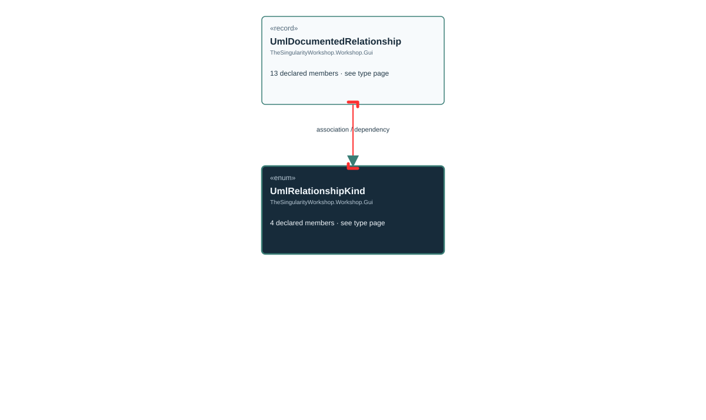

# TheSingularityWorkshop.Workshop.Gui.UmlRelationshipKind

> Generated from compiler-backed source analysis. Do not edit by hand.

- Repository: `TrentBest/TheSingularityWorkshop.GUI`
- Revision: [`8d11c5f449b73b519cfb1819c9c3942307f717c6`](https://github.com/TrentBest/TheSingularityWorkshop.GUI/tree/8d11c5f449b73b519cfb1819c9c3942307f717c6)
- Project: `src/Core/TheSingularityWorkshop.GUI.Core.csproj`
- Type ID: `type:TheSingularityWorkshop.GUI.Core, Version=0.1.0.0, Culture=neutral, PublicKeyToken=null:global::TheSingularityWorkshop.Workshop.Gui.UmlRelationshipKind`
- Metadata name: `UmlRelationshipKind`
- Kind: `enum`
- Generic arity: 0

## UML diagram

## Source declarations

- [`src/Core/UmlDocumentationModel.cs:61-67`](https://github.com/TrentBest/TheSingularityWorkshop.GUI/blob/8d11c5f449b73b519cfb1819c9c3942307f717c6/src/Core/UmlDocumentationModel.cs#L61-67)

## Members

| Kind | Signature | Source |
|---|---|---|
| `Field` | `TheSingularityWorkshop.Workshop.Gui.UmlRelationshipKind.Association` | [`src/Core/UmlDocumentationModel.cs:65-65`](https://github.com/TrentBest/TheSingularityWorkshop.GUI/blob/8d11c5f449b73b519cfb1819c9c3942307f717c6/src/Core/UmlDocumentationModel.cs#L65-65) |
| `Field` | `TheSingularityWorkshop.Workshop.Gui.UmlRelationshipKind.Dependency` | [`src/Core/UmlDocumentationModel.cs:66-66`](https://github.com/TrentBest/TheSingularityWorkshop.GUI/blob/8d11c5f449b73b519cfb1819c9c3942307f717c6/src/Core/UmlDocumentationModel.cs#L66-66) |
| `Field` | `TheSingularityWorkshop.Workshop.Gui.UmlRelationshipKind.Inheritance` | [`src/Core/UmlDocumentationModel.cs:63-63`](https://github.com/TrentBest/TheSingularityWorkshop.GUI/blob/8d11c5f449b73b519cfb1819c9c3942307f717c6/src/Core/UmlDocumentationModel.cs#L63-63) |
| `Field` | `TheSingularityWorkshop.Workshop.Gui.UmlRelationshipKind.InterfaceRealization` | [`src/Core/UmlDocumentationModel.cs:64-64`](https://github.com/TrentBest/TheSingularityWorkshop.GUI/blob/8d11c5f449b73b519cfb1819c9c3942307f717c6/src/Core/UmlDocumentationModel.cs#L64-64) |

## Relationships

| Direction | Kind | Related type | Resolution | Evidence |
|---|---|---|---|---|
| incoming | `Association` | `TheSingularityWorkshop.Workshop.Gui.UmlDocumentedRelationship` | `Resolved` | [`src/Core/UmlDocumentationModel.cs:83-83`](https://github.com/TrentBest/TheSingularityWorkshop.GUI/blob/8d11c5f449b73b519cfb1819c9c3942307f717c6/src/Core/UmlDocumentationModel.cs#L83-83) |
| incoming | `Dependency` | `TheSingularityWorkshop.Workshop.Gui.UmlDocumentedRelationship` | `Resolved` | [`src/Core/UmlDocumentationModel.cs:81-93`](https://github.com/TrentBest/TheSingularityWorkshop.GUI/blob/8d11c5f449b73b519cfb1819c9c3942307f717c6/src/Core/UmlDocumentationModel.cs#L81-93) |

[Back to the generated type index](index.md)

