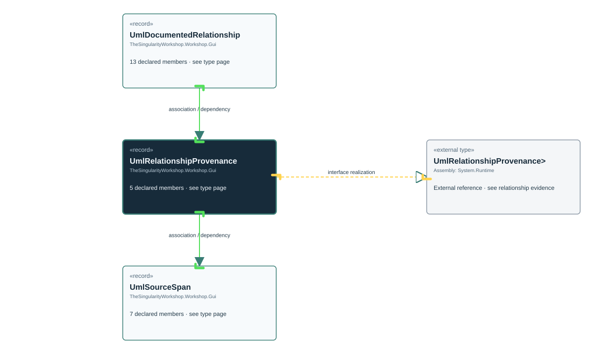

# TheSingularityWorkshop.Workshop.Gui.UmlRelationshipProvenance

> Generated from compiler-backed source analysis. Do not edit by hand.

- Repository: `TrentBest/TheSingularityWorkshop.GUI`
- Revision: [`3844b48b1a30f678cb8aa80c2a21aaaceed9348b`](https://github.com/TrentBest/TheSingularityWorkshop.GUI/tree/3844b48b1a30f678cb8aa80c2a21aaaceed9348b)
- Project: `src/Core/TheSingularityWorkshop.GUI.Core.csproj`
- Type ID: `type:TheSingularityWorkshop.GUI.Core, Version=0.1.0.0, Culture=neutral, PublicKeyToken=null:global::TheSingularityWorkshop.Workshop.Gui.UmlRelationshipProvenance`
- Metadata name: `UmlRelationshipProvenance`
- Kind: `record`
- Generic arity: 0

## UML diagram

## Source declarations

- [`src/Core/UmlDocumentationModel.cs:106-110`](https://github.com/TrentBest/TheSingularityWorkshop.GUI/blob/3844b48b1a30f678cb8aa80c2a21aaaceed9348b/src/Core/UmlDocumentationModel.cs#L106-110)

## Members

| Kind | Signature | Source |
|---|---|---|
| `Property` | `TheSingularityWorkshop.Workshop.Gui.UmlRelationshipProvenance.Kind` | [`src/Core/UmlDocumentationModel.cs:107-107`](https://github.com/TrentBest/TheSingularityWorkshop.GUI/blob/3844b48b1a30f678cb8aa80c2a21aaaceed9348b/src/Core/UmlDocumentationModel.cs#L107-107) |
| `Property` | `TheSingularityWorkshop.Workshop.Gui.UmlRelationshipProvenance.SourcePath` | [`src/Core/UmlDocumentationModel.cs:108-108`](https://github.com/TrentBest/TheSingularityWorkshop.GUI/blob/3844b48b1a30f678cb8aa80c2a21aaaceed9348b/src/Core/UmlDocumentationModel.cs#L108-108) |
| `Property` | `TheSingularityWorkshop.Workshop.Gui.UmlRelationshipProvenance.Span` | [`src/Core/UmlDocumentationModel.cs:109-109`](https://github.com/TrentBest/TheSingularityWorkshop.GUI/blob/3844b48b1a30f678cb8aa80c2a21aaaceed9348b/src/Core/UmlDocumentationModel.cs#L109-109) |
| `Property` | `TheSingularityWorkshop.Workshop.Gui.UmlRelationshipProvenance.SymbolDisplay` | [`src/Core/UmlDocumentationModel.cs:110-110`](https://github.com/TrentBest/TheSingularityWorkshop.GUI/blob/3844b48b1a30f678cb8aa80c2a21aaaceed9348b/src/Core/UmlDocumentationModel.cs#L110-110) |
| `Method` | `TheSingularityWorkshop.Workshop.Gui.UmlRelationshipProvenance.UmlRelationshipProvenance(string, string?, TheSingularityWorkshop.Workshop.Gui.UmlSourceSpan?, string?)` | [`src/Core/UmlDocumentationModel.cs:106-110`](https://github.com/TrentBest/TheSingularityWorkshop.GUI/blob/3844b48b1a30f678cb8aa80c2a21aaaceed9348b/src/Core/UmlDocumentationModel.cs#L106-110) |

## Relationships

| Direction | Kind | Related type | Resolution | Evidence |
|---|---|---|---|---|
| outgoing | `InterfaceRealization` | `global::System.IEquatable<global::TheSingularityWorkshop.Workshop.Gui.UmlRelationshipProvenance>` | `External` | [`src/Core/UmlDocumentationModel.cs:106-110`](https://github.com/TrentBest/TheSingularityWorkshop.GUI/blob/3844b48b1a30f678cb8aa80c2a21aaaceed9348b/src/Core/UmlDocumentationModel.cs#L106-110) |
| incoming | `Association` | `TheSingularityWorkshop.Workshop.Gui.UmlDocumentedRelationship` | `Resolved` | [`src/Core/UmlDocumentationModel.cs:93-93`](https://github.com/TrentBest/TheSingularityWorkshop.GUI/blob/3844b48b1a30f678cb8aa80c2a21aaaceed9348b/src/Core/UmlDocumentationModel.cs#L93-93) |
| outgoing | `Association` | `TheSingularityWorkshop.Workshop.Gui.UmlSourceSpan` | `Resolved` | [`src/Core/UmlDocumentationModel.cs:109-109`](https://github.com/TrentBest/TheSingularityWorkshop.GUI/blob/3844b48b1a30f678cb8aa80c2a21aaaceed9348b/src/Core/UmlDocumentationModel.cs#L109-109) |
| incoming | `Dependency` | `TheSingularityWorkshop.Workshop.Gui.UmlDocumentedRelationship` | `Resolved` | [`src/Core/UmlDocumentationModel.cs:81-93`](https://github.com/TrentBest/TheSingularityWorkshop.GUI/blob/3844b48b1a30f678cb8aa80c2a21aaaceed9348b/src/Core/UmlDocumentationModel.cs#L81-93) |
| outgoing | `Dependency` | `TheSingularityWorkshop.Workshop.Gui.UmlSourceSpan` | `Resolved` | [`src/Core/UmlDocumentationModel.cs:106-110`](https://github.com/TrentBest/TheSingularityWorkshop.GUI/blob/3844b48b1a30f678cb8aa80c2a21aaaceed9348b/src/Core/UmlDocumentationModel.cs#L106-110) |

[Back to the generated type index](index.md)

