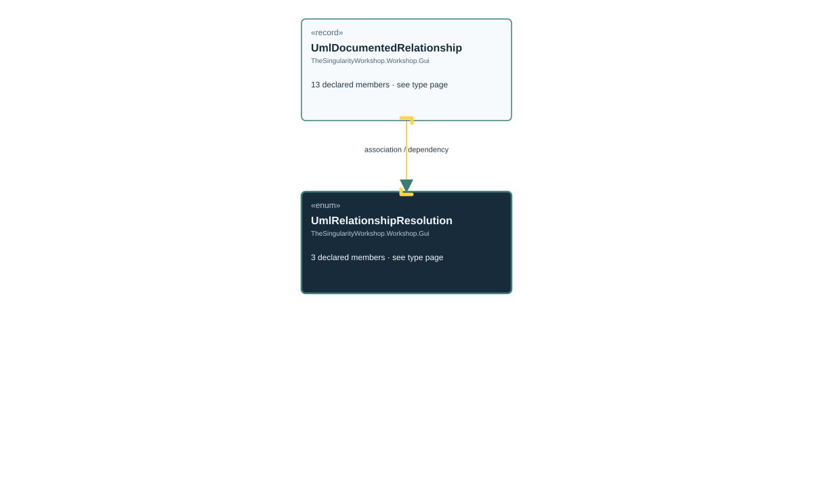

# TheSingularityWorkshop.Workshop.Gui.UmlRelationshipResolution

> Generated from compiler-backed source analysis. Do not edit by hand.

- Repository: `TrentBest/TheSingularityWorkshop.GUI`
- Revision: [`3844b48b1a30f678cb8aa80c2a21aaaceed9348b`](https://github.com/TrentBest/TheSingularityWorkshop.GUI/tree/3844b48b1a30f678cb8aa80c2a21aaaceed9348b)
- Project: `src/Core/TheSingularityWorkshop.GUI.Core.csproj`
- Type ID: `type:TheSingularityWorkshop.GUI.Core, Version=0.1.0.0, Culture=neutral, PublicKeyToken=null:global::TheSingularityWorkshop.Workshop.Gui.UmlRelationshipResolution`
- Metadata name: `UmlRelationshipResolution`
- Kind: `enum`
- Generic arity: 0

## UML diagram

## Source declarations

- [`src/Core/UmlDocumentationModel.cs:70-75`](https://github.com/TrentBest/TheSingularityWorkshop.GUI/blob/3844b48b1a30f678cb8aa80c2a21aaaceed9348b/src/Core/UmlDocumentationModel.cs#L70-75)

## Members

| Kind | Signature | Source |
|---|---|---|
| `Field` | `TheSingularityWorkshop.Workshop.Gui.UmlRelationshipResolution.External` | [`src/Core/UmlDocumentationModel.cs:73-73`](https://github.com/TrentBest/TheSingularityWorkshop.GUI/blob/3844b48b1a30f678cb8aa80c2a21aaaceed9348b/src/Core/UmlDocumentationModel.cs#L73-73) |
| `Field` | `TheSingularityWorkshop.Workshop.Gui.UmlRelationshipResolution.Resolved` | [`src/Core/UmlDocumentationModel.cs:72-72`](https://github.com/TrentBest/TheSingularityWorkshop.GUI/blob/3844b48b1a30f678cb8aa80c2a21aaaceed9348b/src/Core/UmlDocumentationModel.cs#L72-72) |
| `Field` | `TheSingularityWorkshop.Workshop.Gui.UmlRelationshipResolution.Unresolved` | [`src/Core/UmlDocumentationModel.cs:74-74`](https://github.com/TrentBest/TheSingularityWorkshop.GUI/blob/3844b48b1a30f678cb8aa80c2a21aaaceed9348b/src/Core/UmlDocumentationModel.cs#L74-74) |

## Relationships

| Direction | Kind | Related type | Resolution | Evidence |
|---|---|---|---|---|
| incoming | `Association` | `TheSingularityWorkshop.Workshop.Gui.UmlDocumentedRelationship` | `Resolved` | [`src/Core/UmlDocumentationModel.cs:87-87`](https://github.com/TrentBest/TheSingularityWorkshop.GUI/blob/3844b48b1a30f678cb8aa80c2a21aaaceed9348b/src/Core/UmlDocumentationModel.cs#L87-87) |
| incoming | `Dependency` | `TheSingularityWorkshop.Workshop.Gui.UmlDocumentedRelationship` | `Resolved` | [`src/Core/UmlDocumentationModel.cs:81-93`](https://github.com/TrentBest/TheSingularityWorkshop.GUI/blob/3844b48b1a30f678cb8aa80c2a21aaaceed9348b/src/Core/UmlDocumentationModel.cs#L81-93) |

[Back to the generated type index](index.md)

