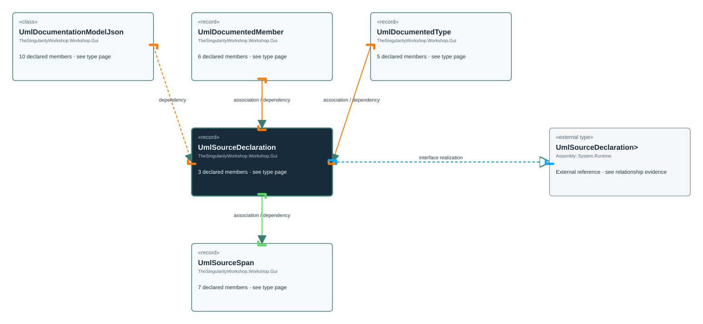

<!-- The Singularity Workshop moniker -->

# TheSingularityWorkshop.Workshop.Gui.UmlSourceDeclaration

> Generated from compiler-backed source analysis. Do not edit by hand.

- Repository: `TrentBest/TheSingularityWorkshop.GUI`
- Revision: [`0f256ace8cf4a63c92d5edefcf667f2ee0238ee4`](https://github.com/TrentBest/TheSingularityWorkshop.GUI/tree/0f256ace8cf4a63c92d5edefcf667f2ee0238ee4)
- Project: `src/Core/TheSingularityWorkshop.GUI.Core.csproj`
- Type ID: `type:TheSingularityWorkshop.GUI.Core, Version=0.1.0.0, Culture=neutral, PublicKeyToken=null:global::TheSingularityWorkshop.Workshop.Gui.UmlSourceDeclaration`
- Metadata name: `UmlSourceDeclaration`
- Kind: `record`
- Generic arity: 0

## UML diagram

## Source declarations

- [`src/Core/UmlDocumentationModel.cs:49-49`](https://github.com/TrentBest/TheSingularityWorkshop.GUI/blob/0f256ace8cf4a63c92d5edefcf667f2ee0238ee4/src/Core/UmlDocumentationModel.cs#L49-49)

## Members

| Kind | Signature | Source |
|---|---|---|
| `Property` | `TheSingularityWorkshop.Workshop.Gui.UmlSourceDeclaration.Path` | [`src/Core/UmlDocumentationModel.cs:49-49`](https://github.com/TrentBest/TheSingularityWorkshop.GUI/blob/0f256ace8cf4a63c92d5edefcf667f2ee0238ee4/src/Core/UmlDocumentationModel.cs#L49-49) |
| `Property` | `TheSingularityWorkshop.Workshop.Gui.UmlSourceDeclaration.Span` | [`src/Core/UmlDocumentationModel.cs:49-49`](https://github.com/TrentBest/TheSingularityWorkshop.GUI/blob/0f256ace8cf4a63c92d5edefcf667f2ee0238ee4/src/Core/UmlDocumentationModel.cs#L49-49) |
| `Method` | `TheSingularityWorkshop.Workshop.Gui.UmlSourceDeclaration.UmlSourceDeclaration(string, TheSingularityWorkshop.Workshop.Gui.UmlSourceSpan)` | [`src/Core/UmlDocumentationModel.cs:49-49`](https://github.com/TrentBest/TheSingularityWorkshop.GUI/blob/0f256ace8cf4a63c92d5edefcf667f2ee0238ee4/src/Core/UmlDocumentationModel.cs#L49-49) |

## Relationships

| Direction | Kind | Related type | Resolution | Evidence |
|---|---|---|---|---|
| outgoing | `InterfaceRealization` | `global::System.IEquatable<global::TheSingularityWorkshop.Workshop.Gui.UmlSourceDeclaration>` | `External` | [`src/Core/UmlDocumentationModel.cs:49-49`](https://github.com/TrentBest/TheSingularityWorkshop.GUI/blob/0f256ace8cf4a63c92d5edefcf667f2ee0238ee4/src/Core/UmlDocumentationModel.cs#L49-49) |
| incoming | `Association` | `TheSingularityWorkshop.Workshop.Gui.UmlDocumentedMember` | `Resolved` | [`src/Core/UmlDocumentationModel.cs:46-46`](https://github.com/TrentBest/TheSingularityWorkshop.GUI/blob/0f256ace8cf4a63c92d5edefcf667f2ee0238ee4/src/Core/UmlDocumentationModel.cs#L46-46) |
| incoming | `Association` | `TheSingularityWorkshop.Workshop.Gui.UmlDocumentedType` | `Resolved` | [`src/Core/UmlDocumentationModel.cs:37-37`](https://github.com/TrentBest/TheSingularityWorkshop.GUI/blob/0f256ace8cf4a63c92d5edefcf667f2ee0238ee4/src/Core/UmlDocumentationModel.cs#L37-37) |
| outgoing | `Association` | `TheSingularityWorkshop.Workshop.Gui.UmlSourceSpan` | `Resolved` | [`src/Core/UmlDocumentationModel.cs:49-49`](https://github.com/TrentBest/TheSingularityWorkshop.GUI/blob/0f256ace8cf4a63c92d5edefcf667f2ee0238ee4/src/Core/UmlDocumentationModel.cs#L49-49) |
| incoming | `Dependency` | `TheSingularityWorkshop.Workshop.Gui.UmlDocumentationModelJson` | `Resolved` | [`src/Core/UmlDocumentationModel.cs:270-275`](https://github.com/TrentBest/TheSingularityWorkshop.GUI/blob/0f256ace8cf4a63c92d5edefcf667f2ee0238ee4/src/Core/UmlDocumentationModel.cs#L270-275) |
| incoming | `Dependency` | `TheSingularityWorkshop.Workshop.Gui.UmlDocumentedMember` | `Resolved` | [`src/Core/UmlDocumentationModel.cs:41-46`](https://github.com/TrentBest/TheSingularityWorkshop.GUI/blob/0f256ace8cf4a63c92d5edefcf667f2ee0238ee4/src/Core/UmlDocumentationModel.cs#L41-46) |
| incoming | `Dependency` | `TheSingularityWorkshop.Workshop.Gui.UmlDocumentedType` | `Resolved` | [`src/Core/UmlDocumentationModel.cs:34-38`](https://github.com/TrentBest/TheSingularityWorkshop.GUI/blob/0f256ace8cf4a63c92d5edefcf667f2ee0238ee4/src/Core/UmlDocumentationModel.cs#L34-38) |
| outgoing | `Dependency` | `TheSingularityWorkshop.Workshop.Gui.UmlSourceSpan` | `Resolved` | [`src/Core/UmlDocumentationModel.cs:49-49`](https://github.com/TrentBest/TheSingularityWorkshop.GUI/blob/0f256ace8cf4a63c92d5edefcf667f2ee0238ee4/src/Core/UmlDocumentationModel.cs#L49-49) |

[Back to the generated type index](index.md)

---

<!-- THE SINGULARITY WORKSHOP FOOTER -->

