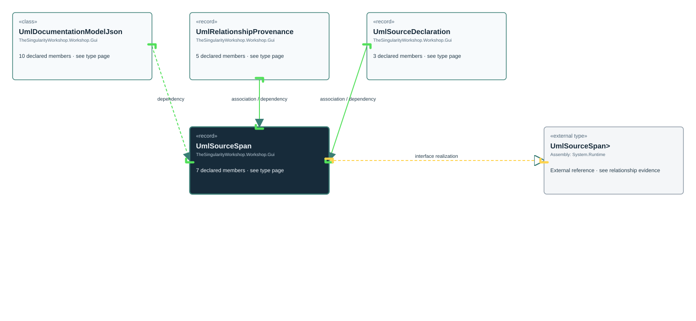

# TheSingularityWorkshop.Workshop.Gui.UmlSourceSpan

> Generated from compiler-backed source analysis. Do not edit by hand.

- Repository: `TrentBest/TheSingularityWorkshop.GUI`
- Revision: [`35bb31b337c1340f8713babd0d411f86f0d602cd`](https://github.com/TrentBest/TheSingularityWorkshop.GUI/tree/35bb31b337c1340f8713babd0d411f86f0d602cd)
- Project: `src/Core/TheSingularityWorkshop.GUI.Core.csproj`
- Type ID: `type:TheSingularityWorkshop.GUI.Core, Version=0.1.0.0, Culture=neutral, PublicKeyToken=null:global::TheSingularityWorkshop.Workshop.Gui.UmlSourceSpan`
- Metadata name: `UmlSourceSpan`
- Kind: `record`
- Generic arity: 0

## UML diagram

## Source declarations

- [`src/Core/UmlDocumentationModel.cs:52-58`](https://github.com/TrentBest/TheSingularityWorkshop.GUI/blob/35bb31b337c1340f8713babd0d411f86f0d602cd/src/Core/UmlDocumentationModel.cs#L52-58)

## Members

| Kind | Signature | Source |
|---|---|---|
| `Property` | `TheSingularityWorkshop.Workshop.Gui.UmlSourceSpan.EndColumn` | [`src/Core/UmlDocumentationModel.cs:58-58`](https://github.com/TrentBest/TheSingularityWorkshop.GUI/blob/35bb31b337c1340f8713babd0d411f86f0d602cd/src/Core/UmlDocumentationModel.cs#L58-58) |
| `Property` | `TheSingularityWorkshop.Workshop.Gui.UmlSourceSpan.EndLine` | [`src/Core/UmlDocumentationModel.cs:57-57`](https://github.com/TrentBest/TheSingularityWorkshop.GUI/blob/35bb31b337c1340f8713babd0d411f86f0d602cd/src/Core/UmlDocumentationModel.cs#L57-57) |
| `Property` | `TheSingularityWorkshop.Workshop.Gui.UmlSourceSpan.Length` | [`src/Core/UmlDocumentationModel.cs:54-54`](https://github.com/TrentBest/TheSingularityWorkshop.GUI/blob/35bb31b337c1340f8713babd0d411f86f0d602cd/src/Core/UmlDocumentationModel.cs#L54-54) |
| `Property` | `TheSingularityWorkshop.Workshop.Gui.UmlSourceSpan.Start` | [`src/Core/UmlDocumentationModel.cs:53-53`](https://github.com/TrentBest/TheSingularityWorkshop.GUI/blob/35bb31b337c1340f8713babd0d411f86f0d602cd/src/Core/UmlDocumentationModel.cs#L53-53) |
| `Property` | `TheSingularityWorkshop.Workshop.Gui.UmlSourceSpan.StartColumn` | [`src/Core/UmlDocumentationModel.cs:56-56`](https://github.com/TrentBest/TheSingularityWorkshop.GUI/blob/35bb31b337c1340f8713babd0d411f86f0d602cd/src/Core/UmlDocumentationModel.cs#L56-56) |
| `Property` | `TheSingularityWorkshop.Workshop.Gui.UmlSourceSpan.StartLine` | [`src/Core/UmlDocumentationModel.cs:55-55`](https://github.com/TrentBest/TheSingularityWorkshop.GUI/blob/35bb31b337c1340f8713babd0d411f86f0d602cd/src/Core/UmlDocumentationModel.cs#L55-55) |
| `Method` | `TheSingularityWorkshop.Workshop.Gui.UmlSourceSpan.UmlSourceSpan(int, int, int, int, int, int)` | [`src/Core/UmlDocumentationModel.cs:52-58`](https://github.com/TrentBest/TheSingularityWorkshop.GUI/blob/35bb31b337c1340f8713babd0d411f86f0d602cd/src/Core/UmlDocumentationModel.cs#L52-58) |

## Relationships

| Direction | Kind | Related type | Resolution | Evidence |
|---|---|---|---|---|
| outgoing | `InterfaceRealization` | `global::System.IEquatable<global::TheSingularityWorkshop.Workshop.Gui.UmlSourceSpan>` | `External` | [`src/Core/UmlDocumentationModel.cs:52-58`](https://github.com/TrentBest/TheSingularityWorkshop.GUI/blob/35bb31b337c1340f8713babd0d411f86f0d602cd/src/Core/UmlDocumentationModel.cs#L52-58) |
| incoming | `Association` | `TheSingularityWorkshop.Workshop.Gui.UmlRelationshipProvenance` | `Resolved` | [`src/Core/UmlDocumentationModel.cs:109-109`](https://github.com/TrentBest/TheSingularityWorkshop.GUI/blob/35bb31b337c1340f8713babd0d411f86f0d602cd/src/Core/UmlDocumentationModel.cs#L109-109) |
| incoming | `Association` | `TheSingularityWorkshop.Workshop.Gui.UmlSourceDeclaration` | `Resolved` | [`src/Core/UmlDocumentationModel.cs:49-49`](https://github.com/TrentBest/TheSingularityWorkshop.GUI/blob/35bb31b337c1340f8713babd0d411f86f0d602cd/src/Core/UmlDocumentationModel.cs#L49-49) |
| incoming | `Dependency` | `TheSingularityWorkshop.Workshop.Gui.UmlDocumentationModelJson` | `Resolved` | [`src/Core/UmlDocumentationModel.cs:277-285`](https://github.com/TrentBest/TheSingularityWorkshop.GUI/blob/35bb31b337c1340f8713babd0d411f86f0d602cd/src/Core/UmlDocumentationModel.cs#L277-285) |
| incoming | `Dependency` | `TheSingularityWorkshop.Workshop.Gui.UmlRelationshipProvenance` | `Resolved` | [`src/Core/UmlDocumentationModel.cs:106-110`](https://github.com/TrentBest/TheSingularityWorkshop.GUI/blob/35bb31b337c1340f8713babd0d411f86f0d602cd/src/Core/UmlDocumentationModel.cs#L106-110) |
| incoming | `Dependency` | `TheSingularityWorkshop.Workshop.Gui.UmlSourceDeclaration` | `Resolved` | [`src/Core/UmlDocumentationModel.cs:49-49`](https://github.com/TrentBest/TheSingularityWorkshop.GUI/blob/35bb31b337c1340f8713babd0d411f86f0d602cd/src/Core/UmlDocumentationModel.cs#L49-49) |

[Back to the generated type index](index.md)

