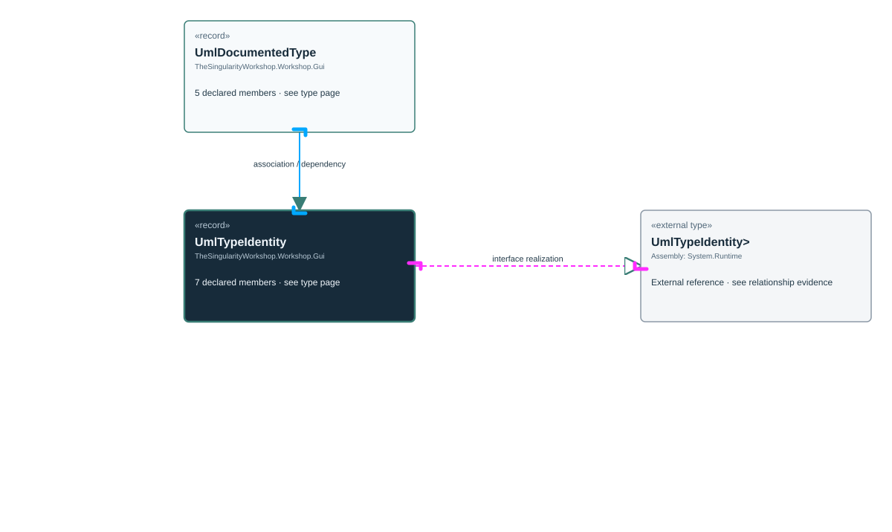

<!-- The Singularity Workshop moniker -->

# TheSingularityWorkshop.Workshop.Gui.UmlTypeIdentity

> Generated from compiler-backed source analysis. Do not edit by hand.

- Repository: `TrentBest/TheSingularityWorkshop.GUI`
- Revision: [`f5c9a2817cdcb9c9ab1ec235e7b67502bcd3b732`](https://github.com/TrentBest/TheSingularityWorkshop.GUI/tree/f5c9a2817cdcb9c9ab1ec235e7b67502bcd3b732)
- Project: `src/Core/TheSingularityWorkshop.GUI.Core.csproj`
- Type ID: `type:TheSingularityWorkshop.GUI.Core, Version=0.1.0.0, Culture=neutral, PublicKeyToken=null:global::TheSingularityWorkshop.Workshop.Gui.UmlTypeIdentity`
- Metadata name: `UmlTypeIdentity`
- Kind: `record`
- Generic arity: 0

## UML diagram

## Source declarations

- [`src/Core/UmlDocumentationModel.cs:25-31`](https://github.com/TrentBest/TheSingularityWorkshop.GUI/blob/f5c9a2817cdcb9c9ab1ec235e7b67502bcd3b732/src/Core/UmlDocumentationModel.cs#L25-31)

## Members

| Kind | Signature | Source |
|---|---|---|
| `Property` | `TheSingularityWorkshop.Workshop.Gui.UmlTypeIdentity.AssemblyIdentity` | [`src/Core/UmlDocumentationModel.cs:26-26`](https://github.com/TrentBest/TheSingularityWorkshop.GUI/blob/f5c9a2817cdcb9c9ab1ec235e7b67502bcd3b732/src/Core/UmlDocumentationModel.cs#L26-26) |
| `Property` | `TheSingularityWorkshop.Workshop.Gui.UmlTypeIdentity.ContainingTypes` | [`src/Core/UmlDocumentationModel.cs:28-28`](https://github.com/TrentBest/TheSingularityWorkshop.GUI/blob/f5c9a2817cdcb9c9ab1ec235e7b67502bcd3b732/src/Core/UmlDocumentationModel.cs#L28-28) |
| `Property` | `TheSingularityWorkshop.Workshop.Gui.UmlTypeIdentity.GenericArity` | [`src/Core/UmlDocumentationModel.cs:30-30`](https://github.com/TrentBest/TheSingularityWorkshop.GUI/blob/f5c9a2817cdcb9c9ab1ec235e7b67502bcd3b732/src/Core/UmlDocumentationModel.cs#L30-30) |
| `Property` | `TheSingularityWorkshop.Workshop.Gui.UmlTypeIdentity.Kind` | [`src/Core/UmlDocumentationModel.cs:31-31`](https://github.com/TrentBest/TheSingularityWorkshop.GUI/blob/f5c9a2817cdcb9c9ab1ec235e7b67502bcd3b732/src/Core/UmlDocumentationModel.cs#L31-31) |
| `Property` | `TheSingularityWorkshop.Workshop.Gui.UmlTypeIdentity.MetadataName` | [`src/Core/UmlDocumentationModel.cs:29-29`](https://github.com/TrentBest/TheSingularityWorkshop.GUI/blob/f5c9a2817cdcb9c9ab1ec235e7b67502bcd3b732/src/Core/UmlDocumentationModel.cs#L29-29) |
| `Property` | `TheSingularityWorkshop.Workshop.Gui.UmlTypeIdentity.Namespace` | [`src/Core/UmlDocumentationModel.cs:27-27`](https://github.com/TrentBest/TheSingularityWorkshop.GUI/blob/f5c9a2817cdcb9c9ab1ec235e7b67502bcd3b732/src/Core/UmlDocumentationModel.cs#L27-27) |
| `Method` | `TheSingularityWorkshop.Workshop.Gui.UmlTypeIdentity.UmlTypeIdentity(string, string, System.Collections.Generic.IReadOnlyList<string>, string, int, string)` | [`src/Core/UmlDocumentationModel.cs:25-31`](https://github.com/TrentBest/TheSingularityWorkshop.GUI/blob/f5c9a2817cdcb9c9ab1ec235e7b67502bcd3b732/src/Core/UmlDocumentationModel.cs#L25-31) |

## Relationships

| Direction | Kind | Related type | Resolution | Evidence |
|---|---|---|---|---|
| outgoing | `InterfaceRealization` | `global::System.IEquatable<global::TheSingularityWorkshop.Workshop.Gui.UmlTypeIdentity>` | `External` | [`src/Core/UmlDocumentationModel.cs:25-31`](https://github.com/TrentBest/TheSingularityWorkshop.GUI/blob/f5c9a2817cdcb9c9ab1ec235e7b67502bcd3b732/src/Core/UmlDocumentationModel.cs#L25-31) |
| incoming | `Association` | `TheSingularityWorkshop.Workshop.Gui.UmlDocumentedType` | `Resolved` | [`src/Core/UmlDocumentationModel.cs:36-36`](https://github.com/TrentBest/TheSingularityWorkshop.GUI/blob/f5c9a2817cdcb9c9ab1ec235e7b67502bcd3b732/src/Core/UmlDocumentationModel.cs#L36-36) |
| incoming | `Dependency` | `TheSingularityWorkshop.Workshop.Gui.UmlDocumentedType` | `Resolved` | [`src/Core/UmlDocumentationModel.cs:34-38`](https://github.com/TrentBest/TheSingularityWorkshop.GUI/blob/f5c9a2817cdcb9c9ab1ec235e7b67502bcd3b732/src/Core/UmlDocumentationModel.cs#L34-38) |

[Back to the generated type index](index.md)

---

<!-- THE SINGULARITY WORKSHOP FOOTER -->

