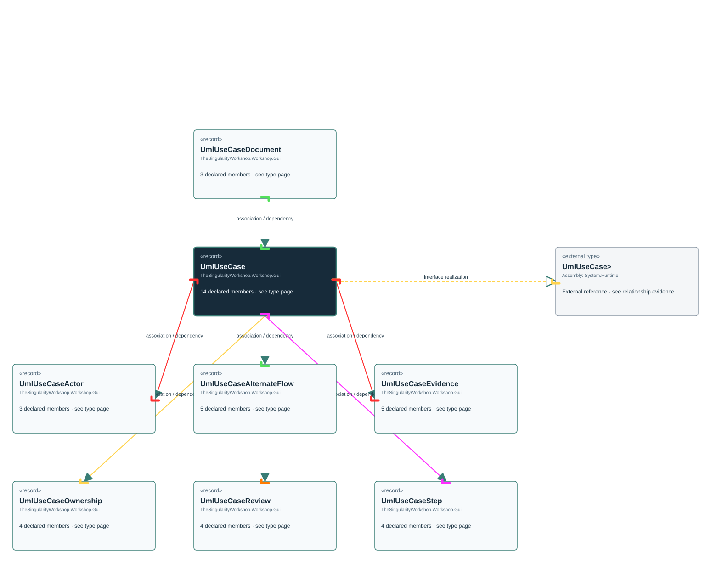

# TheSingularityWorkshop.Workshop.Gui.UmlUseCase

> Generated from compiler-backed source analysis. Do not edit by hand.

- Repository: `TrentBest/TheSingularityWorkshop.GUI`
- Revision: [`8d11c5f449b73b519cfb1819c9c3942307f717c6`](https://github.com/TrentBest/TheSingularityWorkshop.GUI/tree/8d11c5f449b73b519cfb1819c9c3942307f717c6)
- Project: `src/Core/TheSingularityWorkshop.GUI.Core.csproj`
- Type ID: `type:TheSingularityWorkshop.GUI.Core, Version=0.1.0.0, Culture=neutral, PublicKeyToken=null:global::TheSingularityWorkshop.Workshop.Gui.UmlUseCase`
- Metadata name: `UmlUseCase`
- Kind: `record`
- Generic arity: 0

## UML diagram

## Source declarations

- [`src/Core/UmlDocumentationModel.cs:121-134`](https://github.com/TrentBest/TheSingularityWorkshop.GUI/blob/8d11c5f449b73b519cfb1819c9c3942307f717c6/src/Core/UmlDocumentationModel.cs#L121-134)

## Members

| Kind | Signature | Source |
|---|---|---|
| `Property` | `TheSingularityWorkshop.Workshop.Gui.UmlUseCase.Actor` | [`src/Core/UmlDocumentationModel.cs:124-124`](https://github.com/TrentBest/TheSingularityWorkshop.GUI/blob/8d11c5f449b73b519cfb1819c9c3942307f717c6/src/Core/UmlDocumentationModel.cs#L124-124) |
| `Property` | `TheSingularityWorkshop.Workshop.Gui.UmlUseCase.AlternateFlows` | [`src/Core/UmlDocumentationModel.cs:129-129`](https://github.com/TrentBest/TheSingularityWorkshop.GUI/blob/8d11c5f449b73b519cfb1819c9c3942307f717c6/src/Core/UmlDocumentationModel.cs#L129-129) |
| `Property` | `TheSingularityWorkshop.Workshop.Gui.UmlUseCase.Evidence` | [`src/Core/UmlDocumentationModel.cs:132-132`](https://github.com/TrentBest/TheSingularityWorkshop.GUI/blob/8d11c5f449b73b519cfb1819c9c3942307f717c6/src/Core/UmlDocumentationModel.cs#L132-132) |
| `Property` | `TheSingularityWorkshop.Workshop.Gui.UmlUseCase.Goal` | [`src/Core/UmlDocumentationModel.cs:125-125`](https://github.com/TrentBest/TheSingularityWorkshop.GUI/blob/8d11c5f449b73b519cfb1819c9c3942307f717c6/src/Core/UmlDocumentationModel.cs#L125-125) |
| `Property` | `TheSingularityWorkshop.Workshop.Gui.UmlUseCase.Id` | [`src/Core/UmlDocumentationModel.cs:122-122`](https://github.com/TrentBest/TheSingularityWorkshop.GUI/blob/8d11c5f449b73b519cfb1819c9c3942307f717c6/src/Core/UmlDocumentationModel.cs#L122-122) |
| `Property` | `TheSingularityWorkshop.Workshop.Gui.UmlUseCase.MainFlow` | [`src/Core/UmlDocumentationModel.cs:128-128`](https://github.com/TrentBest/TheSingularityWorkshop.GUI/blob/8d11c5f449b73b519cfb1819c9c3942307f717c6/src/Core/UmlDocumentationModel.cs#L128-128) |
| `Property` | `TheSingularityWorkshop.Workshop.Gui.UmlUseCase.Ownership` | [`src/Core/UmlDocumentationModel.cs:134-134`](https://github.com/TrentBest/TheSingularityWorkshop.GUI/blob/8d11c5f449b73b519cfb1819c9c3942307f717c6/src/Core/UmlDocumentationModel.cs#L134-134) |
| `Property` | `TheSingularityWorkshop.Workshop.Gui.UmlUseCase.Postconditions` | [`src/Core/UmlDocumentationModel.cs:130-130`](https://github.com/TrentBest/TheSingularityWorkshop.GUI/blob/8d11c5f449b73b519cfb1819c9c3942307f717c6/src/Core/UmlDocumentationModel.cs#L130-130) |
| `Property` | `TheSingularityWorkshop.Workshop.Gui.UmlUseCase.Preconditions` | [`src/Core/UmlDocumentationModel.cs:127-127`](https://github.com/TrentBest/TheSingularityWorkshop.GUI/blob/8d11c5f449b73b519cfb1819c9c3942307f717c6/src/Core/UmlDocumentationModel.cs#L127-127) |
| `Property` | `TheSingularityWorkshop.Workshop.Gui.UmlUseCase.RelatedTypeIds` | [`src/Core/UmlDocumentationModel.cs:131-131`](https://github.com/TrentBest/TheSingularityWorkshop.GUI/blob/8d11c5f449b73b519cfb1819c9c3942307f717c6/src/Core/UmlDocumentationModel.cs#L131-131) |
| `Property` | `TheSingularityWorkshop.Workshop.Gui.UmlUseCase.Review` | [`src/Core/UmlDocumentationModel.cs:133-133`](https://github.com/TrentBest/TheSingularityWorkshop.GUI/blob/8d11c5f449b73b519cfb1819c9c3942307f717c6/src/Core/UmlDocumentationModel.cs#L133-133) |
| `Property` | `TheSingularityWorkshop.Workshop.Gui.UmlUseCase.Title` | [`src/Core/UmlDocumentationModel.cs:123-123`](https://github.com/TrentBest/TheSingularityWorkshop.GUI/blob/8d11c5f449b73b519cfb1819c9c3942307f717c6/src/Core/UmlDocumentationModel.cs#L123-123) |
| `Property` | `TheSingularityWorkshop.Workshop.Gui.UmlUseCase.Trigger` | [`src/Core/UmlDocumentationModel.cs:126-126`](https://github.com/TrentBest/TheSingularityWorkshop.GUI/blob/8d11c5f449b73b519cfb1819c9c3942307f717c6/src/Core/UmlDocumentationModel.cs#L126-126) |
| `Method` | `TheSingularityWorkshop.Workshop.Gui.UmlUseCase.UmlUseCase(string, string, TheSingularityWorkshop.Workshop.Gui.UmlUseCaseActor, string, string, System.Collections.Generic.IReadOnlyList<string>, System.Collections.Generic.IReadOnlyList<TheSingularityWorkshop.Workshop.Gui.UmlUseCaseStep>, System.Collections.Generic.IReadOnlyList<TheSingularityWorkshop.Workshop.Gui.UmlUseCaseAlternateFlow>, System.Collections.Generic.IReadOnlyList<string>, System.Collections.Generic.IReadOnlyList<string>, System.Collections.Generic.IReadOnlyList<TheSingularityWorkshop.Workshop.Gui.UmlUseCaseEvidence>, TheSingularityWorkshop.Workshop.Gui.UmlUseCaseReview, TheSingularityWorkshop.Workshop.Gui.UmlUseCaseOwnership)` | [`src/Core/UmlDocumentationModel.cs:121-134`](https://github.com/TrentBest/TheSingularityWorkshop.GUI/blob/8d11c5f449b73b519cfb1819c9c3942307f717c6/src/Core/UmlDocumentationModel.cs#L121-134) |

## Relationships

| Direction | Kind | Related type | Resolution | Evidence |
|---|---|---|---|---|
| outgoing | `InterfaceRealization` | `global::System.IEquatable<global::TheSingularityWorkshop.Workshop.Gui.UmlUseCase>` | `External` | [`src/Core/UmlDocumentationModel.cs:121-134`](https://github.com/TrentBest/TheSingularityWorkshop.GUI/blob/8d11c5f449b73b519cfb1819c9c3942307f717c6/src/Core/UmlDocumentationModel.cs#L121-134) |
| outgoing | `Association` | `TheSingularityWorkshop.Workshop.Gui.UmlUseCaseActor` | `Resolved` | [`src/Core/UmlDocumentationModel.cs:124-124`](https://github.com/TrentBest/TheSingularityWorkshop.GUI/blob/8d11c5f449b73b519cfb1819c9c3942307f717c6/src/Core/UmlDocumentationModel.cs#L124-124) |
| outgoing | `Association` | `TheSingularityWorkshop.Workshop.Gui.UmlUseCaseAlternateFlow` | `Resolved` | [`src/Core/UmlDocumentationModel.cs:129-129`](https://github.com/TrentBest/TheSingularityWorkshop.GUI/blob/8d11c5f449b73b519cfb1819c9c3942307f717c6/src/Core/UmlDocumentationModel.cs#L129-129) |
| outgoing | `Association` | `TheSingularityWorkshop.Workshop.Gui.UmlUseCaseEvidence` | `Resolved` | [`src/Core/UmlDocumentationModel.cs:132-132`](https://github.com/TrentBest/TheSingularityWorkshop.GUI/blob/8d11c5f449b73b519cfb1819c9c3942307f717c6/src/Core/UmlDocumentationModel.cs#L132-132) |
| outgoing | `Association` | `TheSingularityWorkshop.Workshop.Gui.UmlUseCaseOwnership` | `Resolved` | [`src/Core/UmlDocumentationModel.cs:134-134`](https://github.com/TrentBest/TheSingularityWorkshop.GUI/blob/8d11c5f449b73b519cfb1819c9c3942307f717c6/src/Core/UmlDocumentationModel.cs#L134-134) |
| outgoing | `Association` | `TheSingularityWorkshop.Workshop.Gui.UmlUseCaseReview` | `Resolved` | [`src/Core/UmlDocumentationModel.cs:133-133`](https://github.com/TrentBest/TheSingularityWorkshop.GUI/blob/8d11c5f449b73b519cfb1819c9c3942307f717c6/src/Core/UmlDocumentationModel.cs#L133-133) |
| outgoing | `Association` | `TheSingularityWorkshop.Workshop.Gui.UmlUseCaseStep` | `Resolved` | [`src/Core/UmlDocumentationModel.cs:128-128`](https://github.com/TrentBest/TheSingularityWorkshop.GUI/blob/8d11c5f449b73b519cfb1819c9c3942307f717c6/src/Core/UmlDocumentationModel.cs#L128-128) |
| incoming | `Association` | `TheSingularityWorkshop.Workshop.Gui.UmlUseCaseDocument` | `Resolved` | [`src/Core/UmlDocumentationModel.cs:118-118`](https://github.com/TrentBest/TheSingularityWorkshop.GUI/blob/8d11c5f449b73b519cfb1819c9c3942307f717c6/src/Core/UmlDocumentationModel.cs#L118-118) |
| outgoing | `Dependency` | `TheSingularityWorkshop.Workshop.Gui.UmlUseCaseActor` | `Resolved` | [`src/Core/UmlDocumentationModel.cs:121-134`](https://github.com/TrentBest/TheSingularityWorkshop.GUI/blob/8d11c5f449b73b519cfb1819c9c3942307f717c6/src/Core/UmlDocumentationModel.cs#L121-134) |
| outgoing | `Dependency` | `TheSingularityWorkshop.Workshop.Gui.UmlUseCaseAlternateFlow` | `Resolved` | [`src/Core/UmlDocumentationModel.cs:121-134`](https://github.com/TrentBest/TheSingularityWorkshop.GUI/blob/8d11c5f449b73b519cfb1819c9c3942307f717c6/src/Core/UmlDocumentationModel.cs#L121-134) |
| outgoing | `Dependency` | `TheSingularityWorkshop.Workshop.Gui.UmlUseCaseEvidence` | `Resolved` | [`src/Core/UmlDocumentationModel.cs:121-134`](https://github.com/TrentBest/TheSingularityWorkshop.GUI/blob/8d11c5f449b73b519cfb1819c9c3942307f717c6/src/Core/UmlDocumentationModel.cs#L121-134) |
| outgoing | `Dependency` | `TheSingularityWorkshop.Workshop.Gui.UmlUseCaseOwnership` | `Resolved` | [`src/Core/UmlDocumentationModel.cs:121-134`](https://github.com/TrentBest/TheSingularityWorkshop.GUI/blob/8d11c5f449b73b519cfb1819c9c3942307f717c6/src/Core/UmlDocumentationModel.cs#L121-134) |
| outgoing | `Dependency` | `TheSingularityWorkshop.Workshop.Gui.UmlUseCaseReview` | `Resolved` | [`src/Core/UmlDocumentationModel.cs:121-134`](https://github.com/TrentBest/TheSingularityWorkshop.GUI/blob/8d11c5f449b73b519cfb1819c9c3942307f717c6/src/Core/UmlDocumentationModel.cs#L121-134) |
| outgoing | `Dependency` | `TheSingularityWorkshop.Workshop.Gui.UmlUseCaseStep` | `Resolved` | [`src/Core/UmlDocumentationModel.cs:121-134`](https://github.com/TrentBest/TheSingularityWorkshop.GUI/blob/8d11c5f449b73b519cfb1819c9c3942307f717c6/src/Core/UmlDocumentationModel.cs#L121-134) |
| incoming | `Dependency` | `TheSingularityWorkshop.Workshop.Gui.UmlUseCaseDocument` | `Resolved` | [`src/Core/UmlDocumentationModel.cs:116-118`](https://github.com/TrentBest/TheSingularityWorkshop.GUI/blob/8d11c5f449b73b519cfb1819c9c3942307f717c6/src/Core/UmlDocumentationModel.cs#L116-118) |

[Back to the generated type index](index.md)

