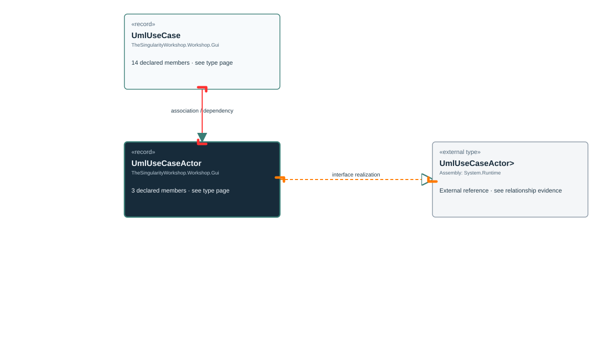

<!-- The Singularity Workshop moniker -->

# TheSingularityWorkshop.Workshop.Gui.UmlUseCaseActor

> Generated from compiler-backed source analysis. Do not edit by hand.

- Repository: `TrentBest/TheSingularityWorkshop.GUI`
- Revision: [`f5c9a2817cdcb9c9ab1ec235e7b67502bcd3b732`](https://github.com/TrentBest/TheSingularityWorkshop.GUI/tree/f5c9a2817cdcb9c9ab1ec235e7b67502bcd3b732)
- Project: `src/Core/TheSingularityWorkshop.GUI.Core.csproj`
- Type ID: `type:TheSingularityWorkshop.GUI.Core, Version=0.1.0.0, Culture=neutral, PublicKeyToken=null:global::TheSingularityWorkshop.Workshop.Gui.UmlUseCaseActor`
- Metadata name: `UmlUseCaseActor`
- Kind: `record`
- Generic arity: 0

## UML diagram

## Source declarations

- [`src/Core/UmlDocumentationModel.cs:136-136`](https://github.com/TrentBest/TheSingularityWorkshop.GUI/blob/f5c9a2817cdcb9c9ab1ec235e7b67502bcd3b732/src/Core/UmlDocumentationModel.cs#L136-136)

## Members

| Kind | Signature | Source |
|---|---|---|
| `Property` | `TheSingularityWorkshop.Workshop.Gui.UmlUseCaseActor.Kind` | [`src/Core/UmlDocumentationModel.cs:136-136`](https://github.com/TrentBest/TheSingularityWorkshop.GUI/blob/f5c9a2817cdcb9c9ab1ec235e7b67502bcd3b732/src/Core/UmlDocumentationModel.cs#L136-136) |
| `Property` | `TheSingularityWorkshop.Workshop.Gui.UmlUseCaseActor.Name` | [`src/Core/UmlDocumentationModel.cs:136-136`](https://github.com/TrentBest/TheSingularityWorkshop.GUI/blob/f5c9a2817cdcb9c9ab1ec235e7b67502bcd3b732/src/Core/UmlDocumentationModel.cs#L136-136) |
| `Method` | `TheSingularityWorkshop.Workshop.Gui.UmlUseCaseActor.UmlUseCaseActor(string, string)` | [`src/Core/UmlDocumentationModel.cs:136-136`](https://github.com/TrentBest/TheSingularityWorkshop.GUI/blob/f5c9a2817cdcb9c9ab1ec235e7b67502bcd3b732/src/Core/UmlDocumentationModel.cs#L136-136) |

## Relationships

| Direction | Kind | Related type | Resolution | Evidence |
|---|---|---|---|---|
| outgoing | `InterfaceRealization` | `global::System.IEquatable<global::TheSingularityWorkshop.Workshop.Gui.UmlUseCaseActor>` | `External` | [`src/Core/UmlDocumentationModel.cs:136-136`](https://github.com/TrentBest/TheSingularityWorkshop.GUI/blob/f5c9a2817cdcb9c9ab1ec235e7b67502bcd3b732/src/Core/UmlDocumentationModel.cs#L136-136) |
| incoming | `Association` | `TheSingularityWorkshop.Workshop.Gui.UmlUseCase` | `Resolved` | [`src/Core/UmlDocumentationModel.cs:124-124`](https://github.com/TrentBest/TheSingularityWorkshop.GUI/blob/f5c9a2817cdcb9c9ab1ec235e7b67502bcd3b732/src/Core/UmlDocumentationModel.cs#L124-124) |
| incoming | `Dependency` | `TheSingularityWorkshop.Workshop.Gui.UmlUseCase` | `Resolved` | [`src/Core/UmlDocumentationModel.cs:121-134`](https://github.com/TrentBest/TheSingularityWorkshop.GUI/blob/f5c9a2817cdcb9c9ab1ec235e7b67502bcd3b732/src/Core/UmlDocumentationModel.cs#L121-134) |

[Back to the generated type index](index.md)

---

<!-- THE SINGULARITY WORKSHOP FOOTER -->

