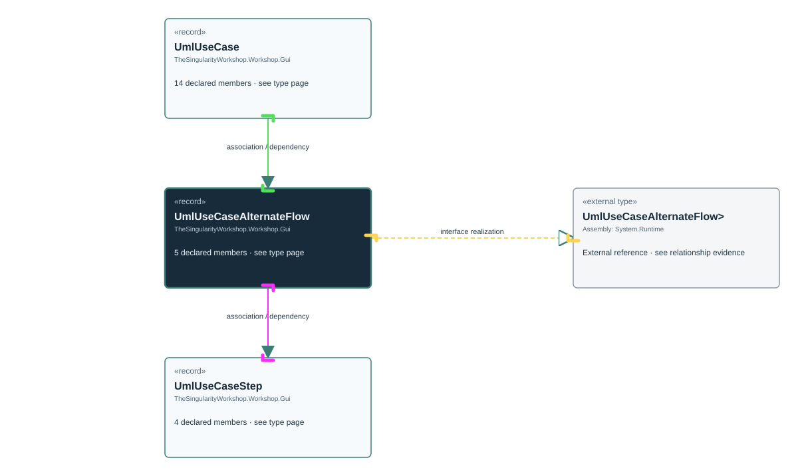

<!-- The Singularity Workshop moniker -->

# TheSingularityWorkshop.Workshop.Gui.UmlUseCaseAlternateFlow

> Generated from compiler-backed source analysis. Do not edit by hand.

- Repository: `TrentBest/TheSingularityWorkshop.GUI`
- Revision: [`f48dd15256521c88fad88371742c89d5fd1d326f`](https://github.com/TrentBest/TheSingularityWorkshop.GUI/tree/f48dd15256521c88fad88371742c89d5fd1d326f)
- Project: `src/Core/TheSingularityWorkshop.GUI.Core.csproj`
- Type ID: `type:TheSingularityWorkshop.GUI.Core, Version=0.1.0.0, Culture=neutral, PublicKeyToken=null:global::TheSingularityWorkshop.Workshop.Gui.UmlUseCaseAlternateFlow`
- Metadata name: `UmlUseCaseAlternateFlow`
- Kind: `record`
- Generic arity: 0

## UML diagram

## Source declarations

- [`src/Core/UmlDocumentationModel.cs:140-144`](https://github.com/TrentBest/TheSingularityWorkshop.GUI/blob/f48dd15256521c88fad88371742c89d5fd1d326f/src/Core/UmlDocumentationModel.cs#L140-144)

## Members

| Kind | Signature | Source |
|---|---|---|
| `Property` | `TheSingularityWorkshop.Workshop.Gui.UmlUseCaseAlternateFlow.Condition` | [`src/Core/UmlDocumentationModel.cs:142-142`](https://github.com/TrentBest/TheSingularityWorkshop.GUI/blob/f48dd15256521c88fad88371742c89d5fd1d326f/src/Core/UmlDocumentationModel.cs#L142-142) |
| `Property` | `TheSingularityWorkshop.Workshop.Gui.UmlUseCaseAlternateFlow.EvidenceIds` | [`src/Core/UmlDocumentationModel.cs:144-144`](https://github.com/TrentBest/TheSingularityWorkshop.GUI/blob/f48dd15256521c88fad88371742c89d5fd1d326f/src/Core/UmlDocumentationModel.cs#L144-144) |
| `Property` | `TheSingularityWorkshop.Workshop.Gui.UmlUseCaseAlternateFlow.Id` | [`src/Core/UmlDocumentationModel.cs:141-141`](https://github.com/TrentBest/TheSingularityWorkshop.GUI/blob/f48dd15256521c88fad88371742c89d5fd1d326f/src/Core/UmlDocumentationModel.cs#L141-141) |
| `Property` | `TheSingularityWorkshop.Workshop.Gui.UmlUseCaseAlternateFlow.Steps` | [`src/Core/UmlDocumentationModel.cs:143-143`](https://github.com/TrentBest/TheSingularityWorkshop.GUI/blob/f48dd15256521c88fad88371742c89d5fd1d326f/src/Core/UmlDocumentationModel.cs#L143-143) |
| `Method` | `TheSingularityWorkshop.Workshop.Gui.UmlUseCaseAlternateFlow.UmlUseCaseAlternateFlow(string, string, System.Collections.Generic.IReadOnlyList<TheSingularityWorkshop.Workshop.Gui.UmlUseCaseStep>, System.Collections.Generic.IReadOnlyList<string>)` | [`src/Core/UmlDocumentationModel.cs:140-144`](https://github.com/TrentBest/TheSingularityWorkshop.GUI/blob/f48dd15256521c88fad88371742c89d5fd1d326f/src/Core/UmlDocumentationModel.cs#L140-144) |

## Relationships

| Direction | Kind | Related type | Resolution | Evidence |
|---|---|---|---|---|
| outgoing | `InterfaceRealization` | `global::System.IEquatable<global::TheSingularityWorkshop.Workshop.Gui.UmlUseCaseAlternateFlow>` | `External` | [`src/Core/UmlDocumentationModel.cs:140-144`](https://github.com/TrentBest/TheSingularityWorkshop.GUI/blob/f48dd15256521c88fad88371742c89d5fd1d326f/src/Core/UmlDocumentationModel.cs#L140-144) |
| incoming | `Association` | `TheSingularityWorkshop.Workshop.Gui.UmlUseCase` | `Resolved` | [`src/Core/UmlDocumentationModel.cs:129-129`](https://github.com/TrentBest/TheSingularityWorkshop.GUI/blob/f48dd15256521c88fad88371742c89d5fd1d326f/src/Core/UmlDocumentationModel.cs#L129-129) |
| outgoing | `Association` | `TheSingularityWorkshop.Workshop.Gui.UmlUseCaseStep` | `Resolved` | [`src/Core/UmlDocumentationModel.cs:143-143`](https://github.com/TrentBest/TheSingularityWorkshop.GUI/blob/f48dd15256521c88fad88371742c89d5fd1d326f/src/Core/UmlDocumentationModel.cs#L143-143) |
| incoming | `Dependency` | `TheSingularityWorkshop.Workshop.Gui.UmlUseCase` | `Resolved` | [`src/Core/UmlDocumentationModel.cs:121-134`](https://github.com/TrentBest/TheSingularityWorkshop.GUI/blob/f48dd15256521c88fad88371742c89d5fd1d326f/src/Core/UmlDocumentationModel.cs#L121-134) |
| outgoing | `Dependency` | `TheSingularityWorkshop.Workshop.Gui.UmlUseCaseStep` | `Resolved` | [`src/Core/UmlDocumentationModel.cs:140-144`](https://github.com/TrentBest/TheSingularityWorkshop.GUI/blob/f48dd15256521c88fad88371742c89d5fd1d326f/src/Core/UmlDocumentationModel.cs#L140-144) |

[Back to the generated type index](index.md)

---

<!-- THE SINGULARITY WORKSHOP FOOTER -->

