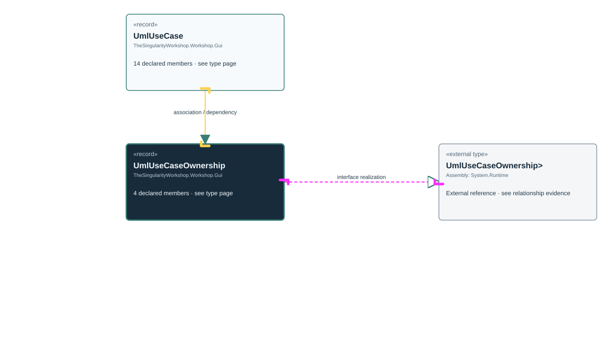

# TheSingularityWorkshop.Workshop.Gui.UmlUseCaseOwnership

> Generated from compiler-backed source analysis. Do not edit by hand.

- Repository: `TrentBest/TheSingularityWorkshop.GUI`
- Revision: [`a25acf387b1e24b6dba0a927e763c0b55c8b9b3e`](https://github.com/TrentBest/TheSingularityWorkshop.GUI/tree/a25acf387b1e24b6dba0a927e763c0b55c8b9b3e)
- Project: `src/Core/TheSingularityWorkshop.GUI.Core.csproj`
- Type ID: `type:TheSingularityWorkshop.GUI.Core, Version=0.1.0.0, Culture=neutral, PublicKeyToken=null:global::TheSingularityWorkshop.Workshop.Gui.UmlUseCaseOwnership`
- Metadata name: `UmlUseCaseOwnership`
- Kind: `record`
- Generic arity: 0

## UML diagram

## Source declarations

- [`src/Core/UmlDocumentationModel.cs:150-150`](https://github.com/TrentBest/TheSingularityWorkshop.GUI/blob/a25acf387b1e24b6dba0a927e763c0b55c8b9b3e/src/Core/UmlDocumentationModel.cs#L150-150)

## Members

| Kind | Signature | Source |
|---|---|---|
| `Property` | `TheSingularityWorkshop.Workshop.Gui.UmlUseCaseOwnership.Assumptions` | [`src/Core/UmlDocumentationModel.cs:150-150`](https://github.com/TrentBest/TheSingularityWorkshop.GUI/blob/a25acf387b1e24b6dba0a927e763c0b55c8b9b3e/src/Core/UmlDocumentationModel.cs#L150-150) |
| `Property` | `TheSingularityWorkshop.Workshop.Gui.UmlUseCaseOwnership.Origin` | [`src/Core/UmlDocumentationModel.cs:150-150`](https://github.com/TrentBest/TheSingularityWorkshop.GUI/blob/a25acf387b1e24b6dba0a927e763c0b55c8b9b3e/src/Core/UmlDocumentationModel.cs#L150-150) |
| `Property` | `TheSingularityWorkshop.Workshop.Gui.UmlUseCaseOwnership.Owner` | [`src/Core/UmlDocumentationModel.cs:150-150`](https://github.com/TrentBest/TheSingularityWorkshop.GUI/blob/a25acf387b1e24b6dba0a927e763c0b55c8b9b3e/src/Core/UmlDocumentationModel.cs#L150-150) |
| `Method` | `TheSingularityWorkshop.Workshop.Gui.UmlUseCaseOwnership.UmlUseCaseOwnership(string, string, System.Collections.Generic.IReadOnlyList<string>)` | [`src/Core/UmlDocumentationModel.cs:150-150`](https://github.com/TrentBest/TheSingularityWorkshop.GUI/blob/a25acf387b1e24b6dba0a927e763c0b55c8b9b3e/src/Core/UmlDocumentationModel.cs#L150-150) |

## Relationships

| Direction | Kind | Related type | Resolution | Evidence |
|---|---|---|---|---|
| outgoing | `InterfaceRealization` | `global::System.IEquatable<global::TheSingularityWorkshop.Workshop.Gui.UmlUseCaseOwnership>` | `External` | [`src/Core/UmlDocumentationModel.cs:150-150`](https://github.com/TrentBest/TheSingularityWorkshop.GUI/blob/a25acf387b1e24b6dba0a927e763c0b55c8b9b3e/src/Core/UmlDocumentationModel.cs#L150-150) |
| incoming | `Association` | `TheSingularityWorkshop.Workshop.Gui.UmlUseCase` | `Resolved` | [`src/Core/UmlDocumentationModel.cs:134-134`](https://github.com/TrentBest/TheSingularityWorkshop.GUI/blob/a25acf387b1e24b6dba0a927e763c0b55c8b9b3e/src/Core/UmlDocumentationModel.cs#L134-134) |
| incoming | `Dependency` | `TheSingularityWorkshop.Workshop.Gui.UmlUseCase` | `Resolved` | [`src/Core/UmlDocumentationModel.cs:121-134`](https://github.com/TrentBest/TheSingularityWorkshop.GUI/blob/a25acf387b1e24b6dba0a927e763c0b55c8b9b3e/src/Core/UmlDocumentationModel.cs#L121-134) |

[Back to the generated type index](index.md)

