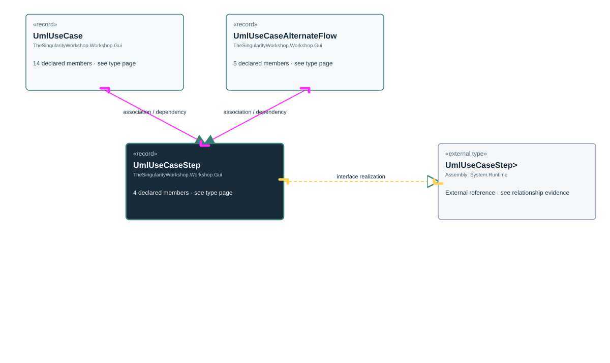

<!-- The Singularity Workshop moniker -->

# TheSingularityWorkshop.Workshop.Gui.UmlUseCaseStep

> Generated from compiler-backed source analysis. Do not edit by hand.

- Repository: `TrentBest/TheSingularityWorkshop.GUI`
- Revision: [`0f256ace8cf4a63c92d5edefcf667f2ee0238ee4`](https://github.com/TrentBest/TheSingularityWorkshop.GUI/tree/0f256ace8cf4a63c92d5edefcf667f2ee0238ee4)
- Project: `src/Core/TheSingularityWorkshop.GUI.Core.csproj`
- Type ID: `type:TheSingularityWorkshop.GUI.Core, Version=0.1.0.0, Culture=neutral, PublicKeyToken=null:global::TheSingularityWorkshop.Workshop.Gui.UmlUseCaseStep`
- Metadata name: `UmlUseCaseStep`
- Kind: `record`
- Generic arity: 0

## UML diagram

## Source declarations

- [`src/Core/UmlDocumentationModel.cs:138-138`](https://github.com/TrentBest/TheSingularityWorkshop.GUI/blob/0f256ace8cf4a63c92d5edefcf667f2ee0238ee4/src/Core/UmlDocumentationModel.cs#L138-138)

## Members

| Kind | Signature | Source |
|---|---|---|
| `Property` | `TheSingularityWorkshop.Workshop.Gui.UmlUseCaseStep.EvidenceIds` | [`src/Core/UmlDocumentationModel.cs:138-138`](https://github.com/TrentBest/TheSingularityWorkshop.GUI/blob/0f256ace8cf4a63c92d5edefcf667f2ee0238ee4/src/Core/UmlDocumentationModel.cs#L138-138) |
| `Property` | `TheSingularityWorkshop.Workshop.Gui.UmlUseCaseStep.Step` | [`src/Core/UmlDocumentationModel.cs:138-138`](https://github.com/TrentBest/TheSingularityWorkshop.GUI/blob/0f256ace8cf4a63c92d5edefcf667f2ee0238ee4/src/Core/UmlDocumentationModel.cs#L138-138) |
| `Property` | `TheSingularityWorkshop.Workshop.Gui.UmlUseCaseStep.Text` | [`src/Core/UmlDocumentationModel.cs:138-138`](https://github.com/TrentBest/TheSingularityWorkshop.GUI/blob/0f256ace8cf4a63c92d5edefcf667f2ee0238ee4/src/Core/UmlDocumentationModel.cs#L138-138) |
| `Method` | `TheSingularityWorkshop.Workshop.Gui.UmlUseCaseStep.UmlUseCaseStep(int, string, System.Collections.Generic.IReadOnlyList<string>)` | [`src/Core/UmlDocumentationModel.cs:138-138`](https://github.com/TrentBest/TheSingularityWorkshop.GUI/blob/0f256ace8cf4a63c92d5edefcf667f2ee0238ee4/src/Core/UmlDocumentationModel.cs#L138-138) |

## Relationships

| Direction | Kind | Related type | Resolution | Evidence |
|---|---|---|---|---|
| outgoing | `InterfaceRealization` | `global::System.IEquatable<global::TheSingularityWorkshop.Workshop.Gui.UmlUseCaseStep>` | `External` | [`src/Core/UmlDocumentationModel.cs:138-138`](https://github.com/TrentBest/TheSingularityWorkshop.GUI/blob/0f256ace8cf4a63c92d5edefcf667f2ee0238ee4/src/Core/UmlDocumentationModel.cs#L138-138) |
| incoming | `Association` | `TheSingularityWorkshop.Workshop.Gui.UmlUseCase` | `Resolved` | [`src/Core/UmlDocumentationModel.cs:128-128`](https://github.com/TrentBest/TheSingularityWorkshop.GUI/blob/0f256ace8cf4a63c92d5edefcf667f2ee0238ee4/src/Core/UmlDocumentationModel.cs#L128-128) |
| incoming | `Association` | `TheSingularityWorkshop.Workshop.Gui.UmlUseCaseAlternateFlow` | `Resolved` | [`src/Core/UmlDocumentationModel.cs:143-143`](https://github.com/TrentBest/TheSingularityWorkshop.GUI/blob/0f256ace8cf4a63c92d5edefcf667f2ee0238ee4/src/Core/UmlDocumentationModel.cs#L143-143) |
| incoming | `Dependency` | `TheSingularityWorkshop.Workshop.Gui.UmlUseCase` | `Resolved` | [`src/Core/UmlDocumentationModel.cs:121-134`](https://github.com/TrentBest/TheSingularityWorkshop.GUI/blob/0f256ace8cf4a63c92d5edefcf667f2ee0238ee4/src/Core/UmlDocumentationModel.cs#L121-134) |
| incoming | `Dependency` | `TheSingularityWorkshop.Workshop.Gui.UmlUseCaseAlternateFlow` | `Resolved` | [`src/Core/UmlDocumentationModel.cs:140-144`](https://github.com/TrentBest/TheSingularityWorkshop.GUI/blob/0f256ace8cf4a63c92d5edefcf667f2ee0238ee4/src/Core/UmlDocumentationModel.cs#L140-144) |

[Back to the generated type index](index.md)

---

<!-- THE SINGULARITY WORKSHOP FOOTER -->

