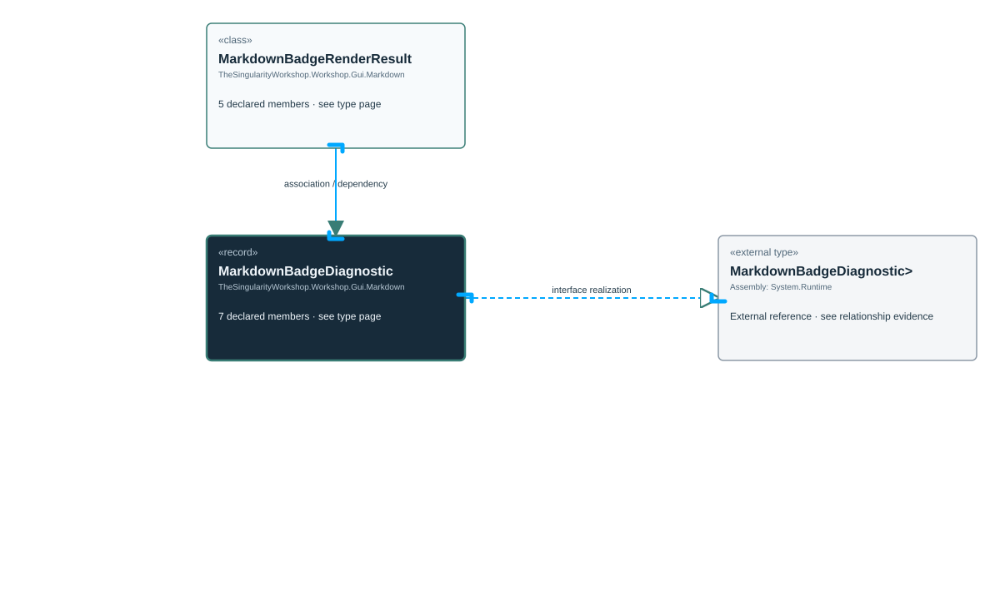

<!-- The Singularity Workshop moniker -->

# TheSingularityWorkshop.Workshop.Gui.Markdown.MarkdownBadgeDiagnostic

> Generated from compiler-backed source analysis. Do not edit by hand.

- Repository: `TrentBest/TheSingularityWorkshop.GUI`
- Revision: [`2c52512270bae4fa255ce922a2352852e35a6189`](https://github.com/TrentBest/TheSingularityWorkshop.GUI/tree/2c52512270bae4fa255ce922a2352852e35a6189)
- Project: `src/Markdown/TheSingularityWorkshop.GUI.Markdown.csproj`
- Type ID: `type:TheSingularityWorkshop.GUI.Markdown, Version=0.1.0.0, Culture=neutral, PublicKeyToken=null:global::TheSingularityWorkshop.Workshop.Gui.Markdown.MarkdownBadgeDiagnostic`
- Metadata name: `MarkdownBadgeDiagnostic`
- Kind: `record`
- Generic arity: 0

## UML diagram

## Source declarations

- [`src/Markdown/MarkdownBadgeRenderer.cs:9-25`](https://github.com/TrentBest/TheSingularityWorkshop.GUI/blob/2c52512270bae4fa255ce922a2352852e35a6189/src/Markdown/MarkdownBadgeRenderer.cs#L9-25)

## Members

| Kind | Signature | Source |
|---|---|---|
| `Property` | `TheSingularityWorkshop.Workshop.Gui.Markdown.MarkdownBadgeDiagnostic.Code` | [`src/Markdown/MarkdownBadgeRenderer.cs:20-20`](https://github.com/TrentBest/TheSingularityWorkshop.GUI/blob/2c52512270bae4fa255ce922a2352852e35a6189/src/Markdown/MarkdownBadgeRenderer.cs#L20-20) |
| `Method` | `TheSingularityWorkshop.Workshop.Gui.Markdown.MarkdownBadgeDiagnostic.Code.get` | [`src/Markdown/MarkdownBadgeRenderer.cs:20-20`](https://github.com/TrentBest/TheSingularityWorkshop.GUI/blob/2c52512270bae4fa255ce922a2352852e35a6189/src/Markdown/MarkdownBadgeRenderer.cs#L20-20) |
| `Method` | `TheSingularityWorkshop.Workshop.Gui.Markdown.MarkdownBadgeDiagnostic.MarkdownBadgeDiagnostic(string, string, string)` | [`src/Markdown/MarkdownBadgeRenderer.cs:12-17`](https://github.com/TrentBest/TheSingularityWorkshop.GUI/blob/2c52512270bae4fa255ce922a2352852e35a6189/src/Markdown/MarkdownBadgeRenderer.cs#L12-17) |
| `Property` | `TheSingularityWorkshop.Workshop.Gui.Markdown.MarkdownBadgeDiagnostic.Message` | [`src/Markdown/MarkdownBadgeRenderer.cs:22-22`](https://github.com/TrentBest/TheSingularityWorkshop.GUI/blob/2c52512270bae4fa255ce922a2352852e35a6189/src/Markdown/MarkdownBadgeRenderer.cs#L22-22) |
| `Method` | `TheSingularityWorkshop.Workshop.Gui.Markdown.MarkdownBadgeDiagnostic.Message.get` | [`src/Markdown/MarkdownBadgeRenderer.cs:22-22`](https://github.com/TrentBest/TheSingularityWorkshop.GUI/blob/2c52512270bae4fa255ce922a2352852e35a6189/src/Markdown/MarkdownBadgeRenderer.cs#L22-22) |
| `Property` | `TheSingularityWorkshop.Workshop.Gui.Markdown.MarkdownBadgeDiagnostic.ResourcePath` | [`src/Markdown/MarkdownBadgeRenderer.cs:24-24`](https://github.com/TrentBest/TheSingularityWorkshop.GUI/blob/2c52512270bae4fa255ce922a2352852e35a6189/src/Markdown/MarkdownBadgeRenderer.cs#L24-24) |
| `Method` | `TheSingularityWorkshop.Workshop.Gui.Markdown.MarkdownBadgeDiagnostic.ResourcePath.get` | [`src/Markdown/MarkdownBadgeRenderer.cs:24-24`](https://github.com/TrentBest/TheSingularityWorkshop.GUI/blob/2c52512270bae4fa255ce922a2352852e35a6189/src/Markdown/MarkdownBadgeRenderer.cs#L24-24) |

## Relationships

| Direction | Kind | Related type | Resolution | Evidence |
|---|---|---|---|---|
| outgoing | `InterfaceRealization` | `global::System.IEquatable<global::TheSingularityWorkshop.Workshop.Gui.Markdown.MarkdownBadgeDiagnostic>` | `External` | [`src/Markdown/MarkdownBadgeRenderer.cs:9-25`](https://github.com/TrentBest/TheSingularityWorkshop.GUI/blob/2c52512270bae4fa255ce922a2352852e35a6189/src/Markdown/MarkdownBadgeRenderer.cs#L9-25) |
| incoming | `Association` | `TheSingularityWorkshop.Workshop.Gui.Markdown.MarkdownBadgeRenderResult` | `Resolved` | [`src/Markdown/MarkdownBadgeRenderer.cs:38-38`](https://github.com/TrentBest/TheSingularityWorkshop.GUI/blob/2c52512270bae4fa255ce922a2352852e35a6189/src/Markdown/MarkdownBadgeRenderer.cs#L38-38) |
| incoming | `Dependency` | `TheSingularityWorkshop.Workshop.Gui.Markdown.MarkdownBadgeRenderResult` | `Resolved` | [`src/Markdown/MarkdownBadgeRenderer.cs:31-35`](https://github.com/TrentBest/TheSingularityWorkshop.GUI/blob/2c52512270bae4fa255ce922a2352852e35a6189/src/Markdown/MarkdownBadgeRenderer.cs#L31-35) |

[Back to the generated type index](index.md)

---

<!-- THE SINGULARITY WORKSHOP FOOTER -->

