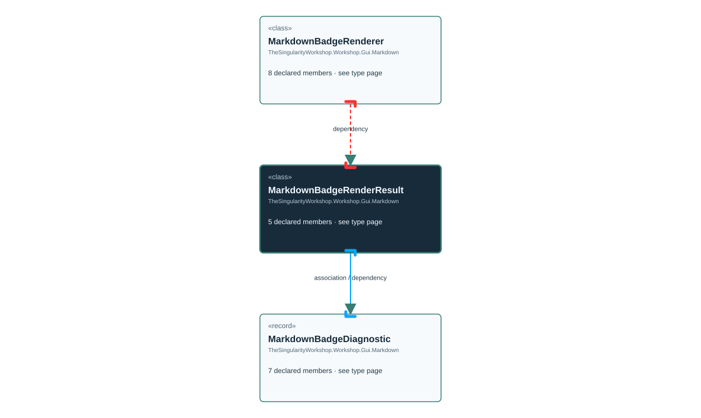

<!-- The Singularity Workshop moniker -->

# TheSingularityWorkshop.Workshop.Gui.Markdown.MarkdownBadgeRenderResult

> Generated from compiler-backed source analysis. Do not edit by hand.

- Repository: `TrentBest/TheSingularityWorkshop.GUI`
- Revision: [`f43434399731a230d7e2b21db24ebf1e0a58dafd`](https://github.com/TrentBest/TheSingularityWorkshop.GUI/tree/f43434399731a230d7e2b21db24ebf1e0a58dafd)
- Project: `src/Markdown/TheSingularityWorkshop.GUI.Markdown.csproj`
- Type ID: `type:TheSingularityWorkshop.GUI.Markdown, Version=0.1.0.0, Culture=neutral, PublicKeyToken=null:global::TheSingularityWorkshop.Workshop.Gui.Markdown.MarkdownBadgeRenderResult`
- Metadata name: `MarkdownBadgeRenderResult`
- Kind: `class`
- Generic arity: 0

## UML diagram

## Source declarations

- [`src/Markdown/MarkdownBadgeRenderer.cs:28-39`](https://github.com/TrentBest/TheSingularityWorkshop.GUI/blob/f43434399731a230d7e2b21db24ebf1e0a58dafd/src/Markdown/MarkdownBadgeRenderer.cs#L28-39)

## Members

| Kind | Signature | Source |
|---|---|---|
| `Property` | `TheSingularityWorkshop.Workshop.Gui.Markdown.MarkdownBadgeRenderResult.Diagnostics` | [`src/Markdown/MarkdownBadgeRenderer.cs:38-38`](https://github.com/TrentBest/TheSingularityWorkshop.GUI/blob/f43434399731a230d7e2b21db24ebf1e0a58dafd/src/Markdown/MarkdownBadgeRenderer.cs#L38-38) |
| `Method` | `TheSingularityWorkshop.Workshop.Gui.Markdown.MarkdownBadgeRenderResult.Diagnostics.get` | [`src/Markdown/MarkdownBadgeRenderer.cs:38-38`](https://github.com/TrentBest/TheSingularityWorkshop.GUI/blob/f43434399731a230d7e2b21db24ebf1e0a58dafd/src/Markdown/MarkdownBadgeRenderer.cs#L38-38) |
| `Property` | `TheSingularityWorkshop.Workshop.Gui.Markdown.MarkdownBadgeRenderResult.Markdown` | [`src/Markdown/MarkdownBadgeRenderer.cs:37-37`](https://github.com/TrentBest/TheSingularityWorkshop.GUI/blob/f43434399731a230d7e2b21db24ebf1e0a58dafd/src/Markdown/MarkdownBadgeRenderer.cs#L37-37) |
| `Method` | `TheSingularityWorkshop.Workshop.Gui.Markdown.MarkdownBadgeRenderResult.Markdown.get` | [`src/Markdown/MarkdownBadgeRenderer.cs:37-37`](https://github.com/TrentBest/TheSingularityWorkshop.GUI/blob/f43434399731a230d7e2b21db24ebf1e0a58dafd/src/Markdown/MarkdownBadgeRenderer.cs#L37-37) |
| `Method` | `TheSingularityWorkshop.Workshop.Gui.Markdown.MarkdownBadgeRenderResult.MarkdownBadgeRenderResult(string, System.Collections.Generic.IEnumerable<TheSingularityWorkshop.Workshop.Gui.Markdown.MarkdownBadgeDiagnostic>)` | [`src/Markdown/MarkdownBadgeRenderer.cs:31-35`](https://github.com/TrentBest/TheSingularityWorkshop.GUI/blob/f43434399731a230d7e2b21db24ebf1e0a58dafd/src/Markdown/MarkdownBadgeRenderer.cs#L31-35) |

## Relationships

| Direction | Kind | Related type | Resolution | Evidence |
|---|---|---|---|---|
| outgoing | `Association` | `TheSingularityWorkshop.Workshop.Gui.Markdown.MarkdownBadgeDiagnostic` | `Resolved` | [`src/Markdown/MarkdownBadgeRenderer.cs:38-38`](https://github.com/TrentBest/TheSingularityWorkshop.GUI/blob/f43434399731a230d7e2b21db24ebf1e0a58dafd/src/Markdown/MarkdownBadgeRenderer.cs#L38-38) |
| outgoing | `Dependency` | `TheSingularityWorkshop.Workshop.Gui.Markdown.MarkdownBadgeDiagnostic` | `Resolved` | [`src/Markdown/MarkdownBadgeRenderer.cs:31-35`](https://github.com/TrentBest/TheSingularityWorkshop.GUI/blob/f43434399731a230d7e2b21db24ebf1e0a58dafd/src/Markdown/MarkdownBadgeRenderer.cs#L31-35) |
| incoming | `Dependency` | `TheSingularityWorkshop.Workshop.Gui.Markdown.MarkdownBadgeRenderer` | `Resolved` | [`src/Markdown/MarkdownBadgeRenderer.cs:53-99`](https://github.com/TrentBest/TheSingularityWorkshop.GUI/blob/f43434399731a230d7e2b21db24ebf1e0a58dafd/src/Markdown/MarkdownBadgeRenderer.cs#L53-99) |

[Back to the generated type index](index.md)

---

<!-- THE SINGULARITY WORKSHOP FOOTER -->

