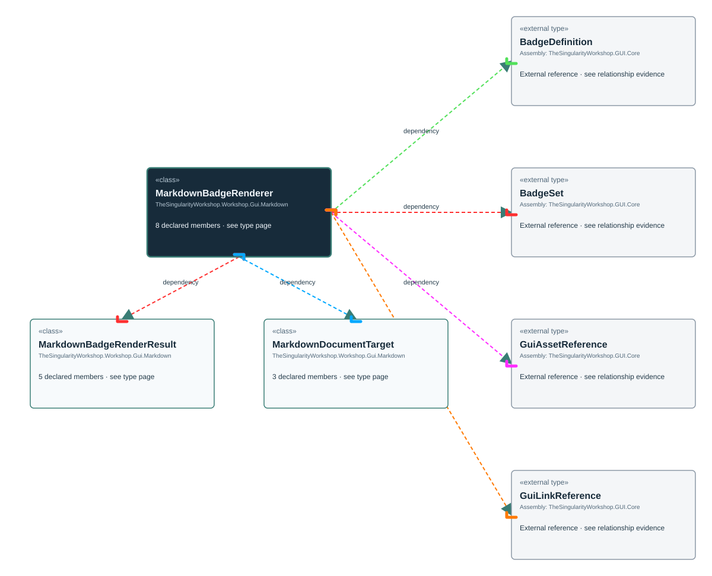

<!-- The Singularity Workshop moniker -->

# TheSingularityWorkshop.Workshop.Gui.Markdown.MarkdownBadgeRenderer

> Generated from compiler-backed source analysis. Do not edit by hand.

- Repository: `TrentBest/TheSingularityWorkshop.GUI`
- Revision: [`644c7a0c58665f16199da7181b392162475c99f8`](https://github.com/TrentBest/TheSingularityWorkshop.GUI/tree/644c7a0c58665f16199da7181b392162475c99f8)
- Project: `src/Markdown/TheSingularityWorkshop.GUI.Markdown.csproj`
- Type ID: `type:TheSingularityWorkshop.GUI.Markdown, Version=0.1.0.0, Culture=neutral, PublicKeyToken=null:global::TheSingularityWorkshop.Workshop.Gui.Markdown.MarkdownBadgeRenderer`
- Metadata name: `MarkdownBadgeRenderer`
- Kind: `class`
- Generic arity: 0

## UML diagram

## Source declarations

- [`src/Markdown/MarkdownBadgeRenderer.cs:46-167`](https://github.com/TrentBest/TheSingularityWorkshop.GUI/blob/644c7a0c58665f16199da7181b392162475c99f8/src/Markdown/MarkdownBadgeRenderer.cs#L46-167)

## Members

| Kind | Signature | Source |
|---|---|---|
| `Method` | `TheSingularityWorkshop.Workshop.Gui.Markdown.MarkdownBadgeRenderer.EscapeMarkdownAlt(string)` | [`src/Markdown/MarkdownBadgeRenderer.cs:149-152`](https://github.com/TrentBest/TheSingularityWorkshop.GUI/blob/644c7a0c58665f16199da7181b392162475c99f8/src/Markdown/MarkdownBadgeRenderer.cs#L149-152) |
| `Method` | `TheSingularityWorkshop.Workshop.Gui.Markdown.MarkdownBadgeRenderer.EscapeMarkdownText(string)` | [`src/Markdown/MarkdownBadgeRenderer.cs:160-166`](https://github.com/TrentBest/TheSingularityWorkshop.GUI/blob/644c7a0c58665f16199da7181b392162475c99f8/src/Markdown/MarkdownBadgeRenderer.cs#L160-166) |
| `Method` | `TheSingularityWorkshop.Workshop.Gui.Markdown.MarkdownBadgeRenderer.EscapeMarkdownTitle(string)` | [`src/Markdown/MarkdownBadgeRenderer.cs:154-158`](https://github.com/TrentBest/TheSingularityWorkshop.GUI/blob/644c7a0c58665f16199da7181b392162475c99f8/src/Markdown/MarkdownBadgeRenderer.cs#L154-158) |
| `Method` | `TheSingularityWorkshop.Workshop.Gui.Markdown.MarkdownBadgeRenderer.Render(TheSingularityWorkshop.Workshop.Gui.BadgeSet, TheSingularityWorkshop.Workshop.Gui.Markdown.MarkdownDocumentTarget, System.Collections.Generic.IEnumerable<string>?)` | [`src/Markdown/MarkdownBadgeRenderer.cs:53-99`](https://github.com/TrentBest/TheSingularityWorkshop.GUI/blob/644c7a0c58665f16199da7181b392162475c99f8/src/Markdown/MarkdownBadgeRenderer.cs#L53-99) |
| `Method` | `TheSingularityWorkshop.Workshop.Gui.Markdown.MarkdownBadgeRenderer.RenderImage(TheSingularityWorkshop.Workshop.Gui.BadgeDefinition, string)` | [`src/Markdown/MarkdownBadgeRenderer.cs:123-129`](https://github.com/TrentBest/TheSingularityWorkshop.GUI/blob/644c7a0c58665f16199da7181b392162475c99f8/src/Markdown/MarkdownBadgeRenderer.cs#L123-129) |
| `Method` | `TheSingularityWorkshop.Workshop.Gui.Markdown.MarkdownBadgeRenderer.ResolveAsset(TheSingularityWorkshop.Workshop.Gui.GuiAssetReference, TheSingularityWorkshop.Workshop.Gui.Markdown.MarkdownDocumentTarget)` | [`src/Markdown/MarkdownBadgeRenderer.cs:101-111`](https://github.com/TrentBest/TheSingularityWorkshop.GUI/blob/644c7a0c58665f16199da7181b392162475c99f8/src/Markdown/MarkdownBadgeRenderer.cs#L101-111) |
| `Method` | `TheSingularityWorkshop.Workshop.Gui.Markdown.MarkdownBadgeRenderer.ResolveLink(TheSingularityWorkshop.Workshop.Gui.GuiLinkReference, TheSingularityWorkshop.Workshop.Gui.Markdown.MarkdownDocumentTarget)` | [`src/Markdown/MarkdownBadgeRenderer.cs:113-121`](https://github.com/TrentBest/TheSingularityWorkshop.GUI/blob/644c7a0c58665f16199da7181b392162475c99f8/src/Markdown/MarkdownBadgeRenderer.cs#L113-121) |
| `Method` | `TheSingularityWorkshop.Workshop.Gui.Markdown.MarkdownBadgeRenderer.ResolveRelativePath(string, string)` | [`src/Markdown/MarkdownBadgeRenderer.cs:131-147`](https://github.com/TrentBest/TheSingularityWorkshop.GUI/blob/644c7a0c58665f16199da7181b392162475c99f8/src/Markdown/MarkdownBadgeRenderer.cs#L131-147) |

## Relationships

| Direction | Kind | Related type | Resolution | Evidence |
|---|---|---|---|---|
| outgoing | `Dependency` | `global::TheSingularityWorkshop.Workshop.Gui.BadgeDefinition` | `External` | [`src/Markdown/MarkdownBadgeRenderer.cs:123-129`](https://github.com/TrentBest/TheSingularityWorkshop.GUI/blob/644c7a0c58665f16199da7181b392162475c99f8/src/Markdown/MarkdownBadgeRenderer.cs#L123-129) |
| outgoing | `Dependency` | `global::TheSingularityWorkshop.Workshop.Gui.BadgeSet` | `External` | [`src/Markdown/MarkdownBadgeRenderer.cs:53-99`](https://github.com/TrentBest/TheSingularityWorkshop.GUI/blob/644c7a0c58665f16199da7181b392162475c99f8/src/Markdown/MarkdownBadgeRenderer.cs#L53-99) |
| outgoing | `Dependency` | `global::TheSingularityWorkshop.Workshop.Gui.GuiAssetReference` | `External` | [`src/Markdown/MarkdownBadgeRenderer.cs:101-111`](https://github.com/TrentBest/TheSingularityWorkshop.GUI/blob/644c7a0c58665f16199da7181b392162475c99f8/src/Markdown/MarkdownBadgeRenderer.cs#L101-111) |
| outgoing | `Dependency` | `global::TheSingularityWorkshop.Workshop.Gui.GuiLinkReference` | `External` | [`src/Markdown/MarkdownBadgeRenderer.cs:113-121`](https://github.com/TrentBest/TheSingularityWorkshop.GUI/blob/644c7a0c58665f16199da7181b392162475c99f8/src/Markdown/MarkdownBadgeRenderer.cs#L113-121) |
| outgoing | `Dependency` | `TheSingularityWorkshop.Workshop.Gui.Markdown.MarkdownBadgeRenderResult` | `Resolved` | [`src/Markdown/MarkdownBadgeRenderer.cs:53-99`](https://github.com/TrentBest/TheSingularityWorkshop.GUI/blob/644c7a0c58665f16199da7181b392162475c99f8/src/Markdown/MarkdownBadgeRenderer.cs#L53-99) |
| outgoing | `Dependency` | `TheSingularityWorkshop.Workshop.Gui.Markdown.MarkdownDocumentTarget` | `Resolved` | [`src/Markdown/MarkdownBadgeRenderer.cs:53-99`](https://github.com/TrentBest/TheSingularityWorkshop.GUI/blob/644c7a0c58665f16199da7181b392162475c99f8/src/Markdown/MarkdownBadgeRenderer.cs#L53-99) |
| outgoing | `Dependency` | `TheSingularityWorkshop.Workshop.Gui.Markdown.MarkdownDocumentTarget` | `Resolved` | [`src/Markdown/MarkdownBadgeRenderer.cs:101-111`](https://github.com/TrentBest/TheSingularityWorkshop.GUI/blob/644c7a0c58665f16199da7181b392162475c99f8/src/Markdown/MarkdownBadgeRenderer.cs#L101-111) |
| outgoing | `Dependency` | `TheSingularityWorkshop.Workshop.Gui.Markdown.MarkdownDocumentTarget` | `Resolved` | [`src/Markdown/MarkdownBadgeRenderer.cs:113-121`](https://github.com/TrentBest/TheSingularityWorkshop.GUI/blob/644c7a0c58665f16199da7181b392162475c99f8/src/Markdown/MarkdownBadgeRenderer.cs#L113-121) |

[Back to the generated type index](index.md)

---

<!-- THE SINGULARITY WORKSHOP FOOTER -->

