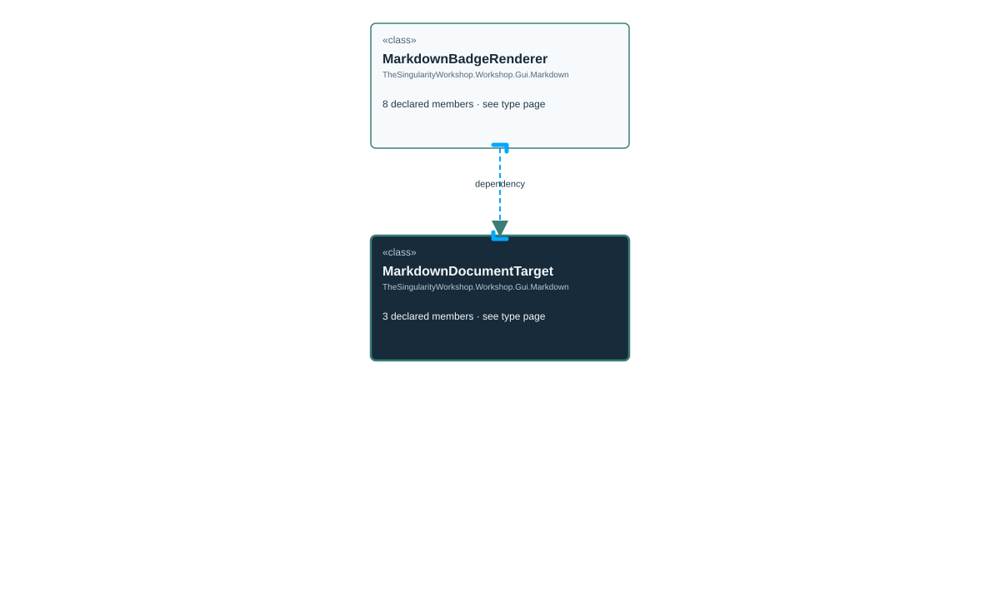

<!-- The Singularity Workshop moniker -->

# TheSingularityWorkshop.Workshop.Gui.Markdown.MarkdownDocumentTarget

> Generated from compiler-backed source analysis. Do not edit by hand.

- Repository: `TrentBest/TheSingularityWorkshop.GUI`
- Revision: [`f43434399731a230d7e2b21db24ebf1e0a58dafd`](https://github.com/TrentBest/TheSingularityWorkshop.GUI/tree/f43434399731a230d7e2b21db24ebf1e0a58dafd)
- Project: `src/Markdown/TheSingularityWorkshop.GUI.Markdown.csproj`
- Type ID: `type:TheSingularityWorkshop.GUI.Markdown, Version=0.1.0.0, Culture=neutral, PublicKeyToken=null:global::TheSingularityWorkshop.Workshop.Gui.Markdown.MarkdownDocumentTarget`
- Metadata name: `MarkdownDocumentTarget`
- Kind: `class`
- Generic arity: 0

## UML diagram

## Source declarations

- [`src/Markdown/MarkdownDocumentTarget.cs:8-24`](https://github.com/TrentBest/TheSingularityWorkshop.GUI/blob/f43434399731a230d7e2b21db24ebf1e0a58dafd/src/Markdown/MarkdownDocumentTarget.cs#L8-24)

## Members

| Kind | Signature | Source |
|---|---|---|
| `Method` | `TheSingularityWorkshop.Workshop.Gui.Markdown.MarkdownDocumentTarget.MarkdownDocumentTarget(string)` | [`src/Markdown/MarkdownDocumentTarget.cs:11-20`](https://github.com/TrentBest/TheSingularityWorkshop.GUI/blob/f43434399731a230d7e2b21db24ebf1e0a58dafd/src/Markdown/MarkdownDocumentTarget.cs#L11-20) |
| `Property` | `TheSingularityWorkshop.Workshop.Gui.Markdown.MarkdownDocumentTarget.RepositoryRelativePath` | [`src/Markdown/MarkdownDocumentTarget.cs:23-23`](https://github.com/TrentBest/TheSingularityWorkshop.GUI/blob/f43434399731a230d7e2b21db24ebf1e0a58dafd/src/Markdown/MarkdownDocumentTarget.cs#L23-23) |
| `Method` | `TheSingularityWorkshop.Workshop.Gui.Markdown.MarkdownDocumentTarget.RepositoryRelativePath.get` | [`src/Markdown/MarkdownDocumentTarget.cs:23-23`](https://github.com/TrentBest/TheSingularityWorkshop.GUI/blob/f43434399731a230d7e2b21db24ebf1e0a58dafd/src/Markdown/MarkdownDocumentTarget.cs#L23-23) |

## Relationships

| Direction | Kind | Related type | Resolution | Evidence |
|---|---|---|---|---|
| incoming | `Dependency` | `TheSingularityWorkshop.Workshop.Gui.Markdown.MarkdownBadgeRenderer` | `Resolved` | [`src/Markdown/MarkdownBadgeRenderer.cs:53-99`](https://github.com/TrentBest/TheSingularityWorkshop.GUI/blob/f43434399731a230d7e2b21db24ebf1e0a58dafd/src/Markdown/MarkdownBadgeRenderer.cs#L53-99) |
| incoming | `Dependency` | `TheSingularityWorkshop.Workshop.Gui.Markdown.MarkdownBadgeRenderer` | `Resolved` | [`src/Markdown/MarkdownBadgeRenderer.cs:101-111`](https://github.com/TrentBest/TheSingularityWorkshop.GUI/blob/f43434399731a230d7e2b21db24ebf1e0a58dafd/src/Markdown/MarkdownBadgeRenderer.cs#L101-111) |
| incoming | `Dependency` | `TheSingularityWorkshop.Workshop.Gui.Markdown.MarkdownBadgeRenderer` | `Resolved` | [`src/Markdown/MarkdownBadgeRenderer.cs:113-121`](https://github.com/TrentBest/TheSingularityWorkshop.GUI/blob/f43434399731a230d7e2b21db24ebf1e0a58dafd/src/Markdown/MarkdownBadgeRenderer.cs#L113-121) |

[Back to the generated type index](index.md)

---

<!-- THE SINGULARITY WORKSHOP FOOTER -->

