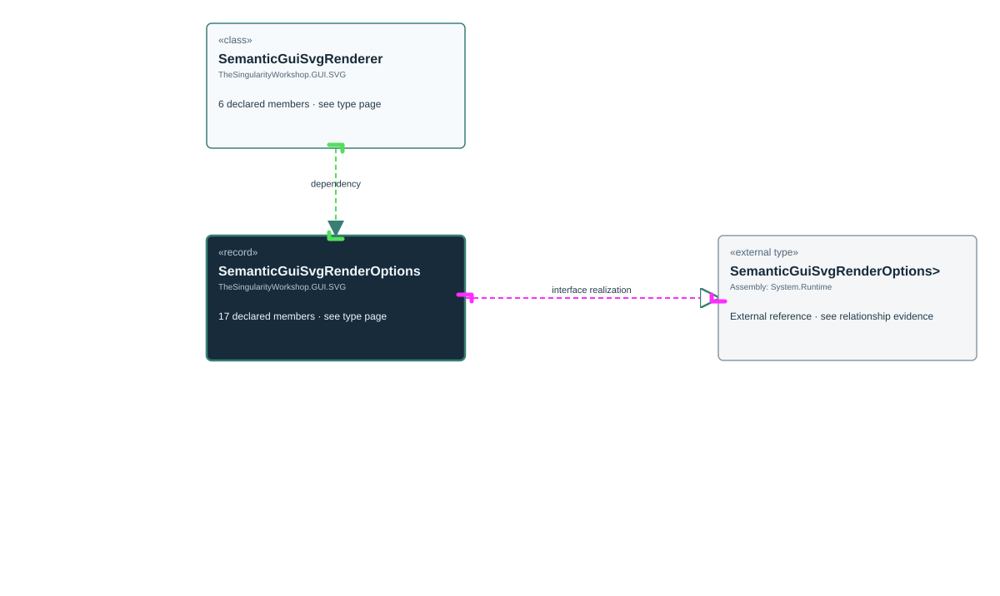

# TheSingularityWorkshop.GUI.SVG.SemanticGuiSvgRenderOptions

> Generated from compiler-backed source analysis. Do not edit by hand.

- Repository: `TrentBest/TheSingularityWorkshop.GUI`
- Revision: [`a25acf387b1e24b6dba0a927e763c0b55c8b9b3e`](https://github.com/TrentBest/TheSingularityWorkshop.GUI/tree/a25acf387b1e24b6dba0a927e763c0b55c8b9b3e)
- Project: `src/SVG/TheSingularityWorkshop.GUI.SVG.csproj`
- Type ID: `type:TheSingularityWorkshop.GUI.SVG, Version=0.1.0.0, Culture=neutral, PublicKeyToken=null:global::TheSingularityWorkshop.GUI.SVG.SemanticGuiSvgRenderOptions`
- Metadata name: `SemanticGuiSvgRenderOptions`
- Kind: `record`
- Generic arity: 0

## UML diagram

## Source declarations

- [`src/SVG/SemanticGuiSvgRenderOptions.cs:4-36`](https://github.com/TrentBest/TheSingularityWorkshop.GUI/blob/a25acf387b1e24b6dba0a927e763c0b55c8b9b3e/src/SVG/SemanticGuiSvgRenderOptions.cs#L4-36)

## Members

| Kind | Signature | Source |
|---|---|---|
| `Property` | `TheSingularityWorkshop.GUI.SVG.SemanticGuiSvgRenderOptions.Background` | [`src/SVG/SemanticGuiSvgRenderOptions.cs:19-19`](https://github.com/TrentBest/TheSingularityWorkshop.GUI/blob/a25acf387b1e24b6dba0a927e763c0b55c8b9b3e/src/SVG/SemanticGuiSvgRenderOptions.cs#L19-19) |
| `Method` | `TheSingularityWorkshop.GUI.SVG.SemanticGuiSvgRenderOptions.Background.get` | [`src/SVG/SemanticGuiSvgRenderOptions.cs:19-19`](https://github.com/TrentBest/TheSingularityWorkshop.GUI/blob/a25acf387b1e24b6dba0a927e763c0b55c8b9b3e/src/SVG/SemanticGuiSvgRenderOptions.cs#L19-19) |
| `Method` | `TheSingularityWorkshop.GUI.SVG.SemanticGuiSvgRenderOptions.Background.init` | [`src/SVG/SemanticGuiSvgRenderOptions.cs:19-19`](https://github.com/TrentBest/TheSingularityWorkshop.GUI/blob/a25acf387b1e24b6dba0a927e763c0b55c8b9b3e/src/SVG/SemanticGuiSvgRenderOptions.cs#L19-19) |
| `Property` | `TheSingularityWorkshop.GUI.SVG.SemanticGuiSvgRenderOptions.Description` | [`src/SVG/SemanticGuiSvgRenderOptions.cs:10-10`](https://github.com/TrentBest/TheSingularityWorkshop.GUI/blob/a25acf387b1e24b6dba0a927e763c0b55c8b9b3e/src/SVG/SemanticGuiSvgRenderOptions.cs#L10-10) |
| `Method` | `TheSingularityWorkshop.GUI.SVG.SemanticGuiSvgRenderOptions.Description.get` | [`src/SVG/SemanticGuiSvgRenderOptions.cs:10-10`](https://github.com/TrentBest/TheSingularityWorkshop.GUI/blob/a25acf387b1e24b6dba0a927e763c0b55c8b9b3e/src/SVG/SemanticGuiSvgRenderOptions.cs#L10-10) |
| `Method` | `TheSingularityWorkshop.GUI.SVG.SemanticGuiSvgRenderOptions.Description.init` | [`src/SVG/SemanticGuiSvgRenderOptions.cs:10-10`](https://github.com/TrentBest/TheSingularityWorkshop.GUI/blob/a25acf387b1e24b6dba0a927e763c0b55c8b9b3e/src/SVG/SemanticGuiSvgRenderOptions.cs#L10-10) |
| `Property` | `TheSingularityWorkshop.GUI.SVG.SemanticGuiSvgRenderOptions.Height` | [`src/SVG/SemanticGuiSvgRenderOptions.cs:16-16`](https://github.com/TrentBest/TheSingularityWorkshop.GUI/blob/a25acf387b1e24b6dba0a927e763c0b55c8b9b3e/src/SVG/SemanticGuiSvgRenderOptions.cs#L16-16) |
| `Method` | `TheSingularityWorkshop.GUI.SVG.SemanticGuiSvgRenderOptions.Height.get` | [`src/SVG/SemanticGuiSvgRenderOptions.cs:16-16`](https://github.com/TrentBest/TheSingularityWorkshop.GUI/blob/a25acf387b1e24b6dba0a927e763c0b55c8b9b3e/src/SVG/SemanticGuiSvgRenderOptions.cs#L16-16) |
| `Method` | `TheSingularityWorkshop.GUI.SVG.SemanticGuiSvgRenderOptions.Height.init` | [`src/SVG/SemanticGuiSvgRenderOptions.cs:16-16`](https://github.com/TrentBest/TheSingularityWorkshop.GUI/blob/a25acf387b1e24b6dba0a927e763c0b55c8b9b3e/src/SVG/SemanticGuiSvgRenderOptions.cs#L16-16) |
| `Method` | `TheSingularityWorkshop.GUI.SVG.SemanticGuiSvgRenderOptions.IsSafeColor(string)` | [`src/SVG/SemanticGuiSvgRenderOptions.cs:30-35`](https://github.com/TrentBest/TheSingularityWorkshop.GUI/blob/a25acf387b1e24b6dba0a927e763c0b55c8b9b3e/src/SVG/SemanticGuiSvgRenderOptions.cs#L30-35) |
| `Property` | `TheSingularityWorkshop.GUI.SVG.SemanticGuiSvgRenderOptions.Title` | [`src/SVG/SemanticGuiSvgRenderOptions.cs:7-7`](https://github.com/TrentBest/TheSingularityWorkshop.GUI/blob/a25acf387b1e24b6dba0a927e763c0b55c8b9b3e/src/SVG/SemanticGuiSvgRenderOptions.cs#L7-7) |
| `Method` | `TheSingularityWorkshop.GUI.SVG.SemanticGuiSvgRenderOptions.Title.get` | [`src/SVG/SemanticGuiSvgRenderOptions.cs:7-7`](https://github.com/TrentBest/TheSingularityWorkshop.GUI/blob/a25acf387b1e24b6dba0a927e763c0b55c8b9b3e/src/SVG/SemanticGuiSvgRenderOptions.cs#L7-7) |
| `Method` | `TheSingularityWorkshop.GUI.SVG.SemanticGuiSvgRenderOptions.Title.init` | [`src/SVG/SemanticGuiSvgRenderOptions.cs:7-7`](https://github.com/TrentBest/TheSingularityWorkshop.GUI/blob/a25acf387b1e24b6dba0a927e763c0b55c8b9b3e/src/SVG/SemanticGuiSvgRenderOptions.cs#L7-7) |
| `Method` | `TheSingularityWorkshop.GUI.SVG.SemanticGuiSvgRenderOptions.Validate()` | [`src/SVG/SemanticGuiSvgRenderOptions.cs:22-28`](https://github.com/TrentBest/TheSingularityWorkshop.GUI/blob/a25acf387b1e24b6dba0a927e763c0b55c8b9b3e/src/SVG/SemanticGuiSvgRenderOptions.cs#L22-28) |
| `Property` | `TheSingularityWorkshop.GUI.SVG.SemanticGuiSvgRenderOptions.Width` | [`src/SVG/SemanticGuiSvgRenderOptions.cs:13-13`](https://github.com/TrentBest/TheSingularityWorkshop.GUI/blob/a25acf387b1e24b6dba0a927e763c0b55c8b9b3e/src/SVG/SemanticGuiSvgRenderOptions.cs#L13-13) |
| `Method` | `TheSingularityWorkshop.GUI.SVG.SemanticGuiSvgRenderOptions.Width.get` | [`src/SVG/SemanticGuiSvgRenderOptions.cs:13-13`](https://github.com/TrentBest/TheSingularityWorkshop.GUI/blob/a25acf387b1e24b6dba0a927e763c0b55c8b9b3e/src/SVG/SemanticGuiSvgRenderOptions.cs#L13-13) |
| `Method` | `TheSingularityWorkshop.GUI.SVG.SemanticGuiSvgRenderOptions.Width.init` | [`src/SVG/SemanticGuiSvgRenderOptions.cs:13-13`](https://github.com/TrentBest/TheSingularityWorkshop.GUI/blob/a25acf387b1e24b6dba0a927e763c0b55c8b9b3e/src/SVG/SemanticGuiSvgRenderOptions.cs#L13-13) |

## Relationships

| Direction | Kind | Related type | Resolution | Evidence |
|---|---|---|---|---|
| outgoing | `InterfaceRealization` | `global::System.IEquatable<global::TheSingularityWorkshop.GUI.SVG.SemanticGuiSvgRenderOptions>` | `External` | [`src/SVG/SemanticGuiSvgRenderOptions.cs:4-36`](https://github.com/TrentBest/TheSingularityWorkshop.GUI/blob/a25acf387b1e24b6dba0a927e763c0b55c8b9b3e/src/SVG/SemanticGuiSvgRenderOptions.cs#L4-36) |
| incoming | `Dependency` | `TheSingularityWorkshop.GUI.SVG.SemanticGuiSvgRenderer` | `Resolved` | [`src/SVG/SemanticGuiSvgRenderer.cs:15-43`](https://github.com/TrentBest/TheSingularityWorkshop.GUI/blob/a25acf387b1e24b6dba0a927e763c0b55c8b9b3e/src/SVG/SemanticGuiSvgRenderer.cs#L15-43) |

[Back to the generated type index](index.md)

