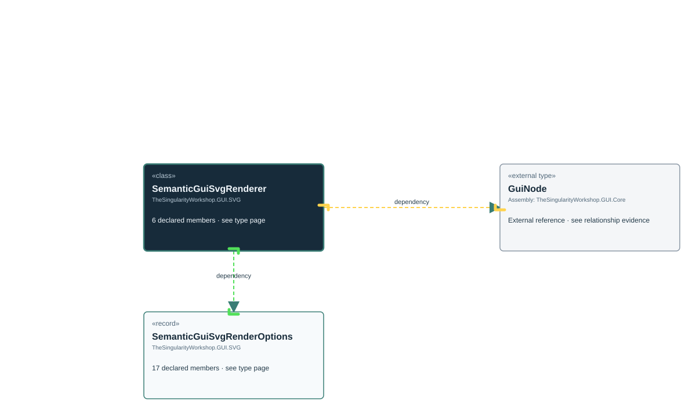

<!-- The Singularity Workshop moniker -->

# TheSingularityWorkshop.GUI.SVG.SemanticGuiSvgRenderer

> Generated from compiler-backed source analysis. Do not edit by hand.

- Repository: `TrentBest/TheSingularityWorkshop.GUI`
- Revision: [`f48dd15256521c88fad88371742c89d5fd1d326f`](https://github.com/TrentBest/TheSingularityWorkshop.GUI/tree/f48dd15256521c88fad88371742c89d5fd1d326f)
- Project: `src/SVG/TheSingularityWorkshop.GUI.SVG.csproj`
- Type ID: `type:TheSingularityWorkshop.GUI.SVG, Version=0.1.0.0, Culture=neutral, PublicKeyToken=null:global::TheSingularityWorkshop.GUI.SVG.SemanticGuiSvgRenderer`
- Metadata name: `SemanticGuiSvgRenderer`
- Kind: `class`
- Generic arity: 0

## UML diagram

## Source declarations

- [`src/SVG/SemanticGuiSvgRenderer.cs:12-212`](https://github.com/TrentBest/TheSingularityWorkshop.GUI/blob/f48dd15256521c88fad88371742c89d5fd1d326f/src/SVG/SemanticGuiSvgRenderer.cs#L12-212)

## Members

| Kind | Signature | Source |
|---|---|---|
| `Method` | `TheSingularityWorkshop.GUI.SVG.SemanticGuiSvgRenderer.E(string?)` | [`src/SVG/SemanticGuiSvgRenderer.cs:211-211`](https://github.com/TrentBest/TheSingularityWorkshop.GUI/blob/f48dd15256521c88fad88371742c89d5fd1d326f/src/SVG/SemanticGuiSvgRenderer.cs#L211-211) |
| `Method` | `TheSingularityWorkshop.GUI.SVG.SemanticGuiSvgRenderer.MeasureSubtreeHeight(TheSingularityWorkshop.Workshop.Gui.GuiNode)` | [`src/SVG/SemanticGuiSvgRenderer.cs:180-208`](https://github.com/TrentBest/TheSingularityWorkshop.GUI/blob/f48dd15256521c88fad88371742c89d5fd1d326f/src/SVG/SemanticGuiSvgRenderer.cs#L180-208) |
| `Method` | `TheSingularityWorkshop.GUI.SVG.SemanticGuiSvgRenderer.N(int)` | [`src/SVG/SemanticGuiSvgRenderer.cs:210-210`](https://github.com/TrentBest/TheSingularityWorkshop.GUI/blob/f48dd15256521c88fad88371742c89d5fd1d326f/src/SVG/SemanticGuiSvgRenderer.cs#L210-210) |
| `Method` | `TheSingularityWorkshop.GUI.SVG.SemanticGuiSvgRenderer.Render(TheSingularityWorkshop.Workshop.Gui.GuiNode, TheSingularityWorkshop.GUI.SVG.SemanticGuiSvgRenderOptions?)` | [`src/SVG/SemanticGuiSvgRenderer.cs:15-43`](https://github.com/TrentBest/TheSingularityWorkshop.GUI/blob/f48dd15256521c88fad88371742c89d5fd1d326f/src/SVG/SemanticGuiSvgRenderer.cs#L15-43) |
| `Method` | `TheSingularityWorkshop.GUI.SVG.SemanticGuiSvgRenderer.RenderNode(System.Text.StringBuilder, TheSingularityWorkshop.Workshop.Gui.GuiNode, int, int, int, int)` | [`src/SVG/SemanticGuiSvgRenderer.cs:46-169`](https://github.com/TrentBest/TheSingularityWorkshop.GUI/blob/f48dd15256521c88fad88371742c89d5fd1d326f/src/SVG/SemanticGuiSvgRenderer.cs#L46-169) |
| `Method` | `TheSingularityWorkshop.GUI.SVG.SemanticGuiSvgRenderer.UsesHorizontalLayout(TheSingularityWorkshop.Workshop.Gui.GuiNode)` | [`src/SVG/SemanticGuiSvgRenderer.cs:171-175`](https://github.com/TrentBest/TheSingularityWorkshop.GUI/blob/f48dd15256521c88fad88371742c89d5fd1d326f/src/SVG/SemanticGuiSvgRenderer.cs#L171-175) |

## Relationships

| Direction | Kind | Related type | Resolution | Evidence |
|---|---|---|---|---|
| outgoing | `Dependency` | `TheSingularityWorkshop.GUI.SVG.SemanticGuiSvgRenderOptions` | `Resolved` | [`src/SVG/SemanticGuiSvgRenderer.cs:15-43`](https://github.com/TrentBest/TheSingularityWorkshop.GUI/blob/f48dd15256521c88fad88371742c89d5fd1d326f/src/SVG/SemanticGuiSvgRenderer.cs#L15-43) |
| outgoing | `Dependency` | `global::TheSingularityWorkshop.Workshop.Gui.GuiNode` | `External` | [`src/SVG/SemanticGuiSvgRenderer.cs:180-208`](https://github.com/TrentBest/TheSingularityWorkshop.GUI/blob/f48dd15256521c88fad88371742c89d5fd1d326f/src/SVG/SemanticGuiSvgRenderer.cs#L180-208) |
| outgoing | `Dependency` | `global::TheSingularityWorkshop.Workshop.Gui.GuiNode` | `External` | [`src/SVG/SemanticGuiSvgRenderer.cs:46-169`](https://github.com/TrentBest/TheSingularityWorkshop.GUI/blob/f48dd15256521c88fad88371742c89d5fd1d326f/src/SVG/SemanticGuiSvgRenderer.cs#L46-169) |
| outgoing | `Dependency` | `global::TheSingularityWorkshop.Workshop.Gui.GuiNode` | `External` | [`src/SVG/SemanticGuiSvgRenderer.cs:171-175`](https://github.com/TrentBest/TheSingularityWorkshop.GUI/blob/f48dd15256521c88fad88371742c89d5fd1d326f/src/SVG/SemanticGuiSvgRenderer.cs#L171-175) |
| outgoing | `Dependency` | `global::TheSingularityWorkshop.Workshop.Gui.GuiNode` | `External` | [`src/SVG/SemanticGuiSvgRenderer.cs:15-43`](https://github.com/TrentBest/TheSingularityWorkshop.GUI/blob/f48dd15256521c88fad88371742c89d5fd1d326f/src/SVG/SemanticGuiSvgRenderer.cs#L15-43) |

[Back to the generated type index](index.md)

---

<!-- THE SINGULARITY WORKSHOP FOOTER -->

