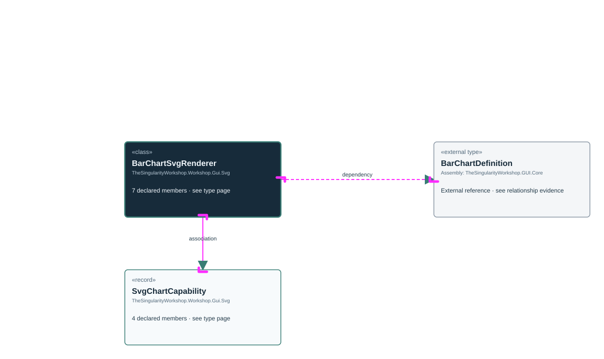

<!-- The Singularity Workshop moniker -->

# TheSingularityWorkshop.Workshop.Gui.Svg.BarChartSvgRenderer

> Generated from compiler-backed source analysis. Do not edit by hand.

- Repository: `TrentBest/TheSingularityWorkshop.GUI`
- Revision: [`bc09e46232d87c88d70bca98588662eabd2911ea`](https://github.com/TrentBest/TheSingularityWorkshop.GUI/tree/bc09e46232d87c88d70bca98588662eabd2911ea)
- Project: `src/SVG/TheSingularityWorkshop.GUI.SVG.csproj`
- Type ID: `type:TheSingularityWorkshop.GUI.SVG, Version=0.1.0.0, Culture=neutral, PublicKeyToken=null:global::TheSingularityWorkshop.Workshop.Gui.Svg.BarChartSvgRenderer`
- Metadata name: `BarChartSvgRenderer`
- Kind: `class`
- Generic arity: 0

## UML diagram

## Source declarations

- [`src/SVG/BarChartSvgRenderer.cs:13-183`](https://github.com/TrentBest/TheSingularityWorkshop.GUI/blob/bc09e46232d87c88d70bca98588662eabd2911ea/src/SVG/BarChartSvgRenderer.cs#L13-183)

## Members

| Kind | Signature | Source |
|---|---|---|
| `Property` | `TheSingularityWorkshop.Workshop.Gui.Svg.BarChartSvgRenderer.Capabilities` | [`src/SVG/BarChartSvgRenderer.cs:18-28`](https://github.com/TrentBest/TheSingularityWorkshop.GUI/blob/bc09e46232d87c88d70bca98588662eabd2911ea/src/SVG/BarChartSvgRenderer.cs#L18-28) |
| `Method` | `TheSingularityWorkshop.Workshop.Gui.Svg.BarChartSvgRenderer.Capabilities.get` | [`src/SVG/BarChartSvgRenderer.cs:18-18`](https://github.com/TrentBest/TheSingularityWorkshop.GUI/blob/bc09e46232d87c88d70bca98588662eabd2911ea/src/SVG/BarChartSvgRenderer.cs#L18-18) |
| `Method` | `TheSingularityWorkshop.Workshop.Gui.Svg.BarChartSvgRenderer.Document(System.Xml.Linq.XElement)` | [`src/SVG/BarChartSvgRenderer.cs:177-178`](https://github.com/TrentBest/TheSingularityWorkshop.GUI/blob/bc09e46232d87c88d70bca98588662eabd2911ea/src/SVG/BarChartSvgRenderer.cs#L177-178) |
| `Method` | `TheSingularityWorkshop.Workshop.Gui.Svg.BarChartSvgRenderer.F(double)` | [`src/SVG/BarChartSvgRenderer.cs:180-180`](https://github.com/TrentBest/TheSingularityWorkshop.GUI/blob/bc09e46232d87c88d70bca98588662eabd2911ea/src/SVG/BarChartSvgRenderer.cs#L180-180) |
| `Method` | `TheSingularityWorkshop.Workshop.Gui.Svg.BarChartSvgRenderer.Render(TheSingularityWorkshop.Workshop.Gui.BarChartDefinition, int, int)` | [`src/SVG/BarChartSvgRenderer.cs:31-175`](https://github.com/TrentBest/TheSingularityWorkshop.GUI/blob/bc09e46232d87c88d70bca98588662eabd2911ea/src/SVG/BarChartSvgRenderer.cs#L31-175) |
| `Field` | `TheSingularityWorkshop.Workshop.Gui.Svg.BarChartSvgRenderer.Svg` | [`src/SVG/BarChartSvgRenderer.cs:15-15`](https://github.com/TrentBest/TheSingularityWorkshop.GUI/blob/bc09e46232d87c88d70bca98588662eabd2911ea/src/SVG/BarChartSvgRenderer.cs#L15-15) |
| `Method` | `TheSingularityWorkshop.Workshop.Gui.Svg.BarChartSvgRenderer.UnitSuffix(string?)` | [`src/SVG/BarChartSvgRenderer.cs:182-182`](https://github.com/TrentBest/TheSingularityWorkshop.GUI/blob/bc09e46232d87c88d70bca98588662eabd2911ea/src/SVG/BarChartSvgRenderer.cs#L182-182) |

## Relationships

| Direction | Kind | Related type | Resolution | Evidence |
|---|---|---|---|---|
| outgoing | `Association` | `TheSingularityWorkshop.Workshop.Gui.Svg.SvgChartCapability` | `Resolved` | [`src/SVG/BarChartSvgRenderer.cs:18-28`](https://github.com/TrentBest/TheSingularityWorkshop.GUI/blob/bc09e46232d87c88d70bca98588662eabd2911ea/src/SVG/BarChartSvgRenderer.cs#L18-28) |
| outgoing | `Dependency` | `global::TheSingularityWorkshop.Workshop.Gui.BarChartDefinition` | `External` | [`src/SVG/BarChartSvgRenderer.cs:31-175`](https://github.com/TrentBest/TheSingularityWorkshop.GUI/blob/bc09e46232d87c88d70bca98588662eabd2911ea/src/SVG/BarChartSvgRenderer.cs#L31-175) |

[Back to the generated type index](index.md)

---

<!-- THE SINGULARITY WORKSHOP FOOTER -->

