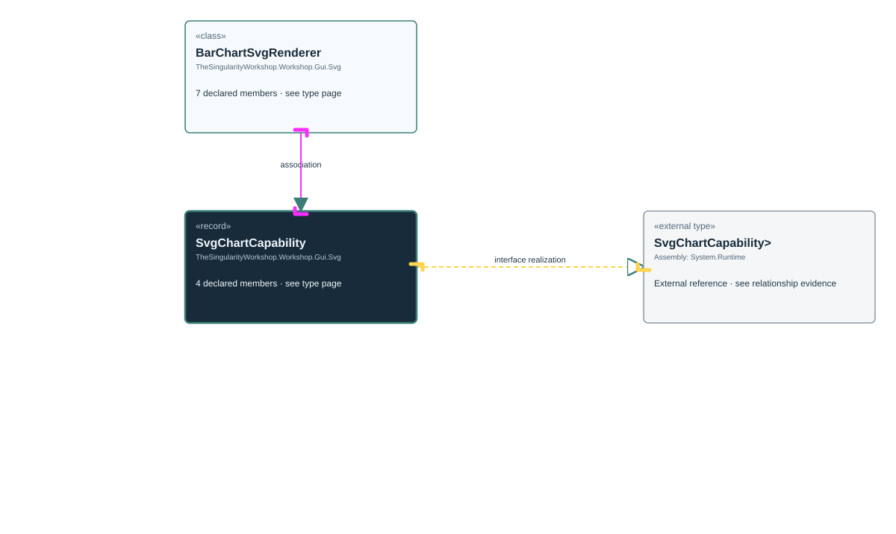

<!-- The Singularity Workshop moniker -->

# TheSingularityWorkshop.Workshop.Gui.Svg.SvgChartCapability

> Generated from compiler-backed source analysis. Do not edit by hand.

- Repository: `TrentBest/TheSingularityWorkshop.GUI`
- Revision: [`9716d4dd70d9d5eb65bd00df2fcd9632f316828d`](https://github.com/TrentBest/TheSingularityWorkshop.GUI/tree/9716d4dd70d9d5eb65bd00df2fcd9632f316828d)
- Project: `src/SVG/TheSingularityWorkshop.GUI.SVG.csproj`
- Type ID: `type:TheSingularityWorkshop.GUI.SVG, Version=0.1.0.0, Culture=neutral, PublicKeyToken=null:global::TheSingularityWorkshop.Workshop.Gui.Svg.SvgChartCapability`
- Metadata name: `SvgChartCapability`
- Kind: `record`
- Generic arity: 0

## UML diagram

## Source declarations

- [`src/SVG/SvgChartCapability.cs:7-7`](https://github.com/TrentBest/TheSingularityWorkshop.GUI/blob/9716d4dd70d9d5eb65bd00df2fcd9632f316828d/src/SVG/SvgChartCapability.cs#L7-7)

## Members

| Kind | Signature | Source |
|---|---|---|
| `Property` | `TheSingularityWorkshop.Workshop.Gui.Svg.SvgChartCapability.ChartKind` | [`src/SVG/SvgChartCapability.cs:7-7`](https://github.com/TrentBest/TheSingularityWorkshop.GUI/blob/9716d4dd70d9d5eb65bd00df2fcd9632f316828d/src/SVG/SvgChartCapability.cs#L7-7) |
| `Property` | `TheSingularityWorkshop.Workshop.Gui.Svg.SvgChartCapability.Constraint` | [`src/SVG/SvgChartCapability.cs:7-7`](https://github.com/TrentBest/TheSingularityWorkshop.GUI/blob/9716d4dd70d9d5eb65bd00df2fcd9632f316828d/src/SVG/SvgChartCapability.cs#L7-7) |
| `Property` | `TheSingularityWorkshop.Workshop.Gui.Svg.SvgChartCapability.IsSupported` | [`src/SVG/SvgChartCapability.cs:7-7`](https://github.com/TrentBest/TheSingularityWorkshop.GUI/blob/9716d4dd70d9d5eb65bd00df2fcd9632f316828d/src/SVG/SvgChartCapability.cs#L7-7) |
| `Method` | `TheSingularityWorkshop.Workshop.Gui.Svg.SvgChartCapability.SvgChartCapability(string, bool, string)` | [`src/SVG/SvgChartCapability.cs:7-7`](https://github.com/TrentBest/TheSingularityWorkshop.GUI/blob/9716d4dd70d9d5eb65bd00df2fcd9632f316828d/src/SVG/SvgChartCapability.cs#L7-7) |

## Relationships

| Direction | Kind | Related type | Resolution | Evidence |
|---|---|---|---|---|
| outgoing | `InterfaceRealization` | `global::System.IEquatable<global::TheSingularityWorkshop.Workshop.Gui.Svg.SvgChartCapability>` | `External` | [`src/SVG/SvgChartCapability.cs:7-7`](https://github.com/TrentBest/TheSingularityWorkshop.GUI/blob/9716d4dd70d9d5eb65bd00df2fcd9632f316828d/src/SVG/SvgChartCapability.cs#L7-7) |
| incoming | `Association` | `TheSingularityWorkshop.Workshop.Gui.Svg.BarChartSvgRenderer` | `Resolved` | [`src/SVG/BarChartSvgRenderer.cs:19-29`](https://github.com/TrentBest/TheSingularityWorkshop.GUI/blob/9716d4dd70d9d5eb65bd00df2fcd9632f316828d/src/SVG/BarChartSvgRenderer.cs#L19-29) |

[Back to the generated type index](index.md)

---

<!-- THE SINGULARITY WORKSHOP FOOTER -->

