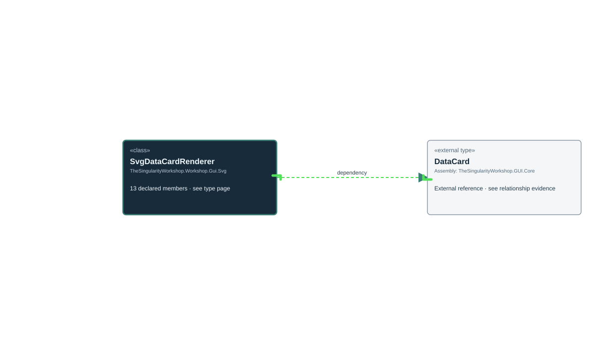

<!-- The Singularity Workshop moniker -->

# TheSingularityWorkshop.Workshop.Gui.Svg.SvgDataCardRenderer

> Generated from compiler-backed source analysis. Do not edit by hand.

- Repository: `TrentBest/TheSingularityWorkshop.GUI`
- Revision: [`59362b4a57a60809f338977e3e978b9eb3ee5099`](https://github.com/TrentBest/TheSingularityWorkshop.GUI/tree/59362b4a57a60809f338977e3e978b9eb3ee5099)
- Project: `src/SVG/TheSingularityWorkshop.GUI.SVG.csproj`
- Type ID: `type:TheSingularityWorkshop.GUI.SVG, Version=0.1.0.0, Culture=neutral, PublicKeyToken=null:global::TheSingularityWorkshop.Workshop.Gui.Svg.SvgDataCardRenderer`
- Metadata name: `SvgDataCardRenderer`
- Kind: `class`
- Generic arity: 0

## UML diagram

## Source declarations

- [`src/SVG/SvgDataCardRenderer.cs:13-147`](https://github.com/TrentBest/TheSingularityWorkshop.GUI/blob/59362b4a57a60809f338977e3e978b9eb3ee5099/src/SVG/SvgDataCardRenderer.cs#L13-147)

## Members

| Kind | Signature | Source |
|---|---|---|
| `Field` | `TheSingularityWorkshop.Workshop.Gui.Svg.SvgDataCardRenderer.BottomPadding` | [`src/SVG/SvgDataCardRenderer.cs:21-21`](https://github.com/TrentBest/TheSingularityWorkshop.GUI/blob/59362b4a57a60809f338977e3e978b9eb3ee5099/src/SVG/SvgDataCardRenderer.cs#L21-21) |
| `Field` | `TheSingularityWorkshop.Workshop.Gui.Svg.SvgDataCardRenderer.ChildGap` | [`src/SVG/SvgDataCardRenderer.cs:19-19`](https://github.com/TrentBest/TheSingularityWorkshop.GUI/blob/59362b4a57a60809f338977e3e978b9eb3ee5099/src/SVG/SvgDataCardRenderer.cs#L19-19) |
| `Method` | `TheSingularityWorkshop.Workshop.Gui.Svg.SvgDataCardRenderer.DrawCard(System.Xml.Linq.XElement, TheSingularityWorkshop.Workshop.Gui.DataCard, double, double, double, int, bool, System.Collections.Generic.IReadOnlyDictionary<string, bool>?)` | [`src/SVG/SvgDataCardRenderer.cs:69-139`](https://github.com/TrentBest/TheSingularityWorkshop.GUI/blob/59362b4a57a60809f338977e3e978b9eb3ee5099/src/SVG/SvgDataCardRenderer.cs#L69-139) |
| `Method` | `TheSingularityWorkshop.Workshop.Gui.Svg.SvgDataCardRenderer.F(double)` | [`src/SVG/SvgDataCardRenderer.cs:146-146`](https://github.com/TrentBest/TheSingularityWorkshop.GUI/blob/59362b4a57a60809f338977e3e978b9eb3ee5099/src/SVG/SvgDataCardRenderer.cs#L146-146) |
| `Field` | `TheSingularityWorkshop.Workshop.Gui.Svg.SvgDataCardRenderer.HeaderHeight` | [`src/SVG/SvgDataCardRenderer.cs:18-18`](https://github.com/TrentBest/TheSingularityWorkshop.GUI/blob/59362b4a57a60809f338977e3e978b9eb3ee5099/src/SVG/SvgDataCardRenderer.cs#L18-18) |
| `Method` | `TheSingularityWorkshop.Workshop.Gui.Svg.SvgDataCardRenderer.IsExpanded(TheSingularityWorkshop.Workshop.Gui.DataCard, System.Collections.Generic.IReadOnlyDictionary<string, bool>?)` | [`src/SVG/SvgDataCardRenderer.cs:141-144`](https://github.com/TrentBest/TheSingularityWorkshop.GUI/blob/59362b4a57a60809f338977e3e978b9eb3ee5099/src/SVG/SvgDataCardRenderer.cs#L141-144) |
| `Field` | `TheSingularityWorkshop.Workshop.Gui.Svg.SvgDataCardRenderer.Left` | [`src/SVG/SvgDataCardRenderer.cs:16-16`](https://github.com/TrentBest/TheSingularityWorkshop.GUI/blob/59362b4a57a60809f338977e3e978b9eb3ee5099/src/SVG/SvgDataCardRenderer.cs#L16-16) |
| `Method` | `TheSingularityWorkshop.Workshop.Gui.Svg.SvgDataCardRenderer.Measure(TheSingularityWorkshop.Workshop.Gui.DataCard, int, System.Collections.Generic.IReadOnlyDictionary<string, bool>?)` | [`src/SVG/SvgDataCardRenderer.cs:57-67`](https://github.com/TrentBest/TheSingularityWorkshop.GUI/blob/59362b4a57a60809f338977e3e978b9eb3ee5099/src/SVG/SvgDataCardRenderer.cs#L57-67) |
| `Field` | `TheSingularityWorkshop.Workshop.Gui.Svg.SvgDataCardRenderer.NestIndent` | [`src/SVG/SvgDataCardRenderer.cs:20-20`](https://github.com/TrentBest/TheSingularityWorkshop.GUI/blob/59362b4a57a60809f338977e3e978b9eb3ee5099/src/SVG/SvgDataCardRenderer.cs#L20-20) |
| `Method` | `TheSingularityWorkshop.Workshop.Gui.Svg.SvgDataCardRenderer.Render(TheSingularityWorkshop.Workshop.Gui.DataCard, bool, System.Collections.Generic.IReadOnlyDictionary<string, bool>?, int)` | [`src/SVG/SvgDataCardRenderer.cs:30-55`](https://github.com/TrentBest/TheSingularityWorkshop.GUI/blob/59362b4a57a60809f338977e3e978b9eb3ee5099/src/SVG/SvgDataCardRenderer.cs#L30-55) |
| `Field` | `TheSingularityWorkshop.Workshop.Gui.Svg.SvgDataCardRenderer.SubtitleHeight` | [`src/SVG/SvgDataCardRenderer.cs:22-22`](https://github.com/TrentBest/TheSingularityWorkshop.GUI/blob/59362b4a57a60809f338977e3e978b9eb3ee5099/src/SVG/SvgDataCardRenderer.cs#L22-22) |
| `Field` | `TheSingularityWorkshop.Workshop.Gui.Svg.SvgDataCardRenderer.Svg` | [`src/SVG/SvgDataCardRenderer.cs:15-15`](https://github.com/TrentBest/TheSingularityWorkshop.GUI/blob/59362b4a57a60809f338977e3e978b9eb3ee5099/src/SVG/SvgDataCardRenderer.cs#L15-15) |
| `Field` | `TheSingularityWorkshop.Workshop.Gui.Svg.SvgDataCardRenderer.Top` | [`src/SVG/SvgDataCardRenderer.cs:17-17`](https://github.com/TrentBest/TheSingularityWorkshop.GUI/blob/59362b4a57a60809f338977e3e978b9eb3ee5099/src/SVG/SvgDataCardRenderer.cs#L17-17) |

## Relationships

| Direction | Kind | Related type | Resolution | Evidence |
|---|---|---|---|---|
| outgoing | `Dependency` | `global::TheSingularityWorkshop.Workshop.Gui.DataCard` | `External` | [`src/SVG/SvgDataCardRenderer.cs:69-139`](https://github.com/TrentBest/TheSingularityWorkshop.GUI/blob/59362b4a57a60809f338977e3e978b9eb3ee5099/src/SVG/SvgDataCardRenderer.cs#L69-139) |
| outgoing | `Dependency` | `global::TheSingularityWorkshop.Workshop.Gui.DataCard` | `External` | [`src/SVG/SvgDataCardRenderer.cs:141-144`](https://github.com/TrentBest/TheSingularityWorkshop.GUI/blob/59362b4a57a60809f338977e3e978b9eb3ee5099/src/SVG/SvgDataCardRenderer.cs#L141-144) |
| outgoing | `Dependency` | `global::TheSingularityWorkshop.Workshop.Gui.DataCard` | `External` | [`src/SVG/SvgDataCardRenderer.cs:57-67`](https://github.com/TrentBest/TheSingularityWorkshop.GUI/blob/59362b4a57a60809f338977e3e978b9eb3ee5099/src/SVG/SvgDataCardRenderer.cs#L57-67) |
| outgoing | `Dependency` | `global::TheSingularityWorkshop.Workshop.Gui.DataCard` | `External` | [`src/SVG/SvgDataCardRenderer.cs:30-55`](https://github.com/TrentBest/TheSingularityWorkshop.GUI/blob/59362b4a57a60809f338977e3e978b9eb3ee5099/src/SVG/SvgDataCardRenderer.cs#L30-55) |

[Back to the generated type index](index.md)

---

<!-- THE SINGULARITY WORKSHOP FOOTER -->

