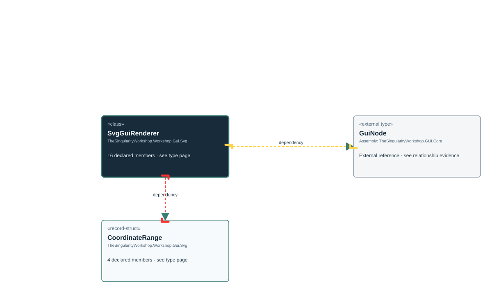

<!-- The Singularity Workshop moniker -->

# TheSingularityWorkshop.Workshop.Gui.Svg.SvgGuiRenderer

> Generated from compiler-backed source analysis. Do not edit by hand.

- Repository: `TrentBest/TheSingularityWorkshop.GUI`
- Revision: [`a95bc61121b500db4cada3fdfd03ab78e8127626`](https://github.com/TrentBest/TheSingularityWorkshop.GUI/tree/a95bc61121b500db4cada3fdfd03ab78e8127626)
- Project: `src/SVG/TheSingularityWorkshop.GUI.SVG.csproj`
- Type ID: `type:TheSingularityWorkshop.GUI.SVG, Version=0.1.0.0, Culture=neutral, PublicKeyToken=null:global::TheSingularityWorkshop.Workshop.Gui.Svg.SvgGuiRenderer`
- Metadata name: `SvgGuiRenderer`
- Kind: `class`
- Generic arity: 0

## UML diagram

## Source declarations

- [`src/SVG/SvgGuiRenderer.cs:13-626`](https://github.com/TrentBest/TheSingularityWorkshop.GUI/blob/a95bc61121b500db4cada3fdfd03ab78e8127626/src/SVG/SvgGuiRenderer.cs#L13-626)

## Members

| Kind | Signature | Source |
|---|---|---|
| `Method` | `TheSingularityWorkshop.Workshop.Gui.Svg.SvgGuiRenderer.AddCoordinateSystem(System.Xml.Linq.XElement, TheSingularityWorkshop.Workshop.Gui.GuiNode, TheSingularityWorkshop.Workshop.Gui.Svg.SvgGuiRenderer.CoordinateRange)` | [`src/SVG/SvgGuiRenderer.cs:454-506`](https://github.com/TrentBest/TheSingularityWorkshop.GUI/blob/a95bc61121b500db4cada3fdfd03ab78e8127626/src/SVG/SvgGuiRenderer.cs#L454-506) |
| `Method` | `TheSingularityWorkshop.Workshop.Gui.Svg.SvgGuiRenderer.AddPresentationAttributes(System.Xml.Linq.XElement, TheSingularityWorkshop.Workshop.Gui.GuiNode)` | [`src/SVG/SvgGuiRenderer.cs:508-518`](https://github.com/TrentBest/TheSingularityWorkshop.GUI/blob/a95bc61121b500db4cada3fdfd03ab78e8127626/src/SVG/SvgGuiRenderer.cs#L508-518) |
| `Method` | `TheSingularityWorkshop.Workshop.Gui.Svg.SvgGuiRenderer.CopyProperties(TheSingularityWorkshop.Workshop.Gui.GuiNode, System.Xml.Linq.XElement, params string[])` | [`src/SVG/SvgGuiRenderer.cs:588-593`](https://github.com/TrentBest/TheSingularityWorkshop.GUI/blob/a95bc61121b500db4cada3fdfd03ab78e8127626/src/SVG/SvgGuiRenderer.cs#L588-593) |
| `Method` | `TheSingularityWorkshop.Workshop.Gui.Svg.SvgGuiRenderer.F(double)` | [`src/SVG/SvgGuiRenderer.cs:623-623`](https://github.com/TrentBest/TheSingularityWorkshop.GUI/blob/a95bc61121b500db4cada3fdfd03ab78e8127626/src/SVG/SvgGuiRenderer.cs#L623-623) |
| `Method` | `TheSingularityWorkshop.Workshop.Gui.Svg.SvgGuiRenderer.Map(double, double, double)` | [`src/SVG/SvgGuiRenderer.cs:595-601`](https://github.com/TrentBest/TheSingularityWorkshop.GUI/blob/a95bc61121b500db4cada3fdfd03ab78e8127626/src/SVG/SvgGuiRenderer.cs#L595-601) |
| `Field` | `TheSingularityWorkshop.Workshop.Gui.Svg.SvgGuiRenderer.MaximumTreeDepth` | [`src/SVG/SvgGuiRenderer.cs:15-15`](https://github.com/TrentBest/TheSingularityWorkshop.GUI/blob/a95bc61121b500db4cada3fdfd03ab78e8127626/src/SVG/SvgGuiRenderer.cs#L15-15) |
| `Field` | `TheSingularityWorkshop.Workshop.Gui.Svg.SvgGuiRenderer.MaximumTreeNodes` | [`src/SVG/SvgGuiRenderer.cs:16-16`](https://github.com/TrentBest/TheSingularityWorkshop.GUI/blob/a95bc61121b500db4cada3fdfd03ab78e8127626/src/SVG/SvgGuiRenderer.cs#L16-16) |
| `Method` | `TheSingularityWorkshop.Workshop.Gui.Svg.SvgGuiRenderer.NonNegative(TheSingularityWorkshop.Workshop.Gui.GuiNode, string, double)` | [`src/SVG/SvgGuiRenderer.cs:612-618`](https://github.com/TrentBest/TheSingularityWorkshop.GUI/blob/a95bc61121b500db4cada3fdfd03ab78e8127626/src/SVG/SvgGuiRenderer.cs#L612-618) |
| `Method` | `TheSingularityWorkshop.Workshop.Gui.Svg.SvgGuiRenderer.Number(TheSingularityWorkshop.Workshop.Gui.GuiNode, string, double)` | [`src/SVG/SvgGuiRenderer.cs:603-610`](https://github.com/TrentBest/TheSingularityWorkshop.GUI/blob/a95bc61121b500db4cada3fdfd03ab78e8127626/src/SVG/SvgGuiRenderer.cs#L603-610) |
| `Field` | `TheSingularityWorkshop.Workshop.Gui.Svg.SvgGuiRenderer.PresentationAttributes` | [`src/SVG/SvgGuiRenderer.cs:19-29`](https://github.com/TrentBest/TheSingularityWorkshop.GUI/blob/a95bc61121b500db4cada3fdfd03ab78e8127626/src/SVG/SvgGuiRenderer.cs#L19-29) |
| `Method` | `TheSingularityWorkshop.Workshop.Gui.Svg.SvgGuiRenderer.ReadCoordinateRange(TheSingularityWorkshop.Workshop.Gui.GuiNode, double)` | [`src/SVG/SvgGuiRenderer.cs:578-586`](https://github.com/TrentBest/TheSingularityWorkshop.GUI/blob/a95bc61121b500db4cada3fdfd03ab78e8127626/src/SVG/SvgGuiRenderer.cs#L578-586) |
| `Method` | `TheSingularityWorkshop.Workshop.Gui.Svg.SvgGuiRenderer.Render(TheSingularityWorkshop.Workshop.Gui.GuiNode, int, int)` | [`src/SVG/SvgGuiRenderer.cs:35-82`](https://github.com/TrentBest/TheSingularityWorkshop.GUI/blob/a95bc61121b500db4cada3fdfd03ab78e8127626/src/SVG/SvgGuiRenderer.cs#L35-82) |
| `Method` | `TheSingularityWorkshop.Workshop.Gui.Svg.SvgGuiRenderer.RenderNode(TheSingularityWorkshop.Workshop.Gui.GuiNode, TheSingularityWorkshop.Workshop.Gui.Svg.SvgGuiRenderer.CoordinateRange?, bool)` | [`src/SVG/SvgGuiRenderer.cs:84-452`](https://github.com/TrentBest/TheSingularityWorkshop.GUI/blob/a95bc61121b500db4cada3fdfd03ab78e8127626/src/SVG/SvgGuiRenderer.cs#L84-452) |
| `Field` | `TheSingularityWorkshop.Workshop.Gui.Svg.SvgGuiRenderer.Svg` | [`src/SVG/SvgGuiRenderer.cs:17-17`](https://github.com/TrentBest/TheSingularityWorkshop.GUI/blob/a95bc61121b500db4cada3fdfd03ab78e8127626/src/SVG/SvgGuiRenderer.cs#L17-17) |
| `Method` | `TheSingularityWorkshop.Workshop.Gui.Svg.SvgGuiRenderer.ValidateUniqueIds(TheSingularityWorkshop.Workshop.Gui.GuiNode)` | [`src/SVG/SvgGuiRenderer.cs:520-576`](https://github.com/TrentBest/TheSingularityWorkshop.GUI/blob/a95bc61121b500db4cada3fdfd03ab78e8127626/src/SVG/SvgGuiRenderer.cs#L520-576) |
| `Method` | `TheSingularityWorkshop.Workshop.Gui.Svg.SvgGuiRenderer.Value(TheSingularityWorkshop.Workshop.Gui.GuiNode, string, string)` | [`src/SVG/SvgGuiRenderer.cs:620-621`](https://github.com/TrentBest/TheSingularityWorkshop.GUI/blob/a95bc61121b500db4cada3fdfd03ab78e8127626/src/SVG/SvgGuiRenderer.cs#L620-621) |

## Relationships

| Direction | Kind | Related type | Resolution | Evidence |
|---|---|---|---|---|
| outgoing | `Dependency` | `global::TheSingularityWorkshop.Workshop.Gui.GuiNode` | `External` | [`src/SVG/SvgGuiRenderer.cs:454-506`](https://github.com/TrentBest/TheSingularityWorkshop.GUI/blob/a95bc61121b500db4cada3fdfd03ab78e8127626/src/SVG/SvgGuiRenderer.cs#L454-506) |
| outgoing | `Dependency` | `global::TheSingularityWorkshop.Workshop.Gui.GuiNode` | `External` | [`src/SVG/SvgGuiRenderer.cs:508-518`](https://github.com/TrentBest/TheSingularityWorkshop.GUI/blob/a95bc61121b500db4cada3fdfd03ab78e8127626/src/SVG/SvgGuiRenderer.cs#L508-518) |
| outgoing | `Dependency` | `global::TheSingularityWorkshop.Workshop.Gui.GuiNode` | `External` | [`src/SVG/SvgGuiRenderer.cs:588-593`](https://github.com/TrentBest/TheSingularityWorkshop.GUI/blob/a95bc61121b500db4cada3fdfd03ab78e8127626/src/SVG/SvgGuiRenderer.cs#L588-593) |
| outgoing | `Dependency` | `global::TheSingularityWorkshop.Workshop.Gui.GuiNode` | `External` | [`src/SVG/SvgGuiRenderer.cs:612-618`](https://github.com/TrentBest/TheSingularityWorkshop.GUI/blob/a95bc61121b500db4cada3fdfd03ab78e8127626/src/SVG/SvgGuiRenderer.cs#L612-618) |
| outgoing | `Dependency` | `global::TheSingularityWorkshop.Workshop.Gui.GuiNode` | `External` | [`src/SVG/SvgGuiRenderer.cs:603-610`](https://github.com/TrentBest/TheSingularityWorkshop.GUI/blob/a95bc61121b500db4cada3fdfd03ab78e8127626/src/SVG/SvgGuiRenderer.cs#L603-610) |
| outgoing | `Dependency` | `global::TheSingularityWorkshop.Workshop.Gui.GuiNode` | `External` | [`src/SVG/SvgGuiRenderer.cs:578-586`](https://github.com/TrentBest/TheSingularityWorkshop.GUI/blob/a95bc61121b500db4cada3fdfd03ab78e8127626/src/SVG/SvgGuiRenderer.cs#L578-586) |
| outgoing | `Dependency` | `global::TheSingularityWorkshop.Workshop.Gui.GuiNode` | `External` | [`src/SVG/SvgGuiRenderer.cs:84-452`](https://github.com/TrentBest/TheSingularityWorkshop.GUI/blob/a95bc61121b500db4cada3fdfd03ab78e8127626/src/SVG/SvgGuiRenderer.cs#L84-452) |
| outgoing | `Dependency` | `global::TheSingularityWorkshop.Workshop.Gui.GuiNode` | `External` | [`src/SVG/SvgGuiRenderer.cs:620-621`](https://github.com/TrentBest/TheSingularityWorkshop.GUI/blob/a95bc61121b500db4cada3fdfd03ab78e8127626/src/SVG/SvgGuiRenderer.cs#L620-621) |
| outgoing | `Dependency` | `global::TheSingularityWorkshop.Workshop.Gui.GuiNode` | `External` | [`src/SVG/SvgGuiRenderer.cs:35-82`](https://github.com/TrentBest/TheSingularityWorkshop.GUI/blob/a95bc61121b500db4cada3fdfd03ab78e8127626/src/SVG/SvgGuiRenderer.cs#L35-82) |
| outgoing | `Dependency` | `global::TheSingularityWorkshop.Workshop.Gui.GuiNode` | `External` | [`src/SVG/SvgGuiRenderer.cs:520-576`](https://github.com/TrentBest/TheSingularityWorkshop.GUI/blob/a95bc61121b500db4cada3fdfd03ab78e8127626/src/SVG/SvgGuiRenderer.cs#L520-576) |
| outgoing | `Dependency` | `TheSingularityWorkshop.Workshop.Gui.Svg.SvgGuiRenderer.CoordinateRange` | `Resolved` | [`src/SVG/SvgGuiRenderer.cs:84-452`](https://github.com/TrentBest/TheSingularityWorkshop.GUI/blob/a95bc61121b500db4cada3fdfd03ab78e8127626/src/SVG/SvgGuiRenderer.cs#L84-452) |
| outgoing | `Dependency` | `TheSingularityWorkshop.Workshop.Gui.Svg.SvgGuiRenderer.CoordinateRange` | `Resolved` | [`src/SVG/SvgGuiRenderer.cs:454-506`](https://github.com/TrentBest/TheSingularityWorkshop.GUI/blob/a95bc61121b500db4cada3fdfd03ab78e8127626/src/SVG/SvgGuiRenderer.cs#L454-506) |
| outgoing | `Dependency` | `TheSingularityWorkshop.Workshop.Gui.Svg.SvgGuiRenderer.CoordinateRange` | `Resolved` | [`src/SVG/SvgGuiRenderer.cs:578-586`](https://github.com/TrentBest/TheSingularityWorkshop.GUI/blob/a95bc61121b500db4cada3fdfd03ab78e8127626/src/SVG/SvgGuiRenderer.cs#L578-586) |

[Back to the generated type index](index.md)

---

<!-- THE SINGULARITY WORKSHOP FOOTER -->

