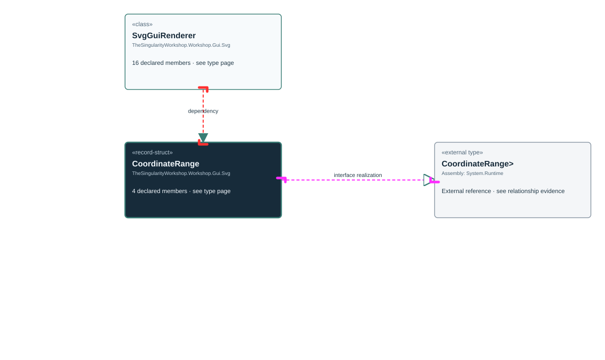

<!-- The Singularity Workshop moniker -->

# TheSingularityWorkshop.Workshop.Gui.Svg.SvgGuiRenderer.CoordinateRange

> Generated from compiler-backed source analysis. Do not edit by hand.

- Repository: `TrentBest/TheSingularityWorkshop.GUI`
- Revision: [`a9a0179aea747faa6e842574f1fd9cd65608a389`](https://github.com/TrentBest/TheSingularityWorkshop.GUI/tree/a9a0179aea747faa6e842574f1fd9cd65608a389)
- Project: `src/SVG/TheSingularityWorkshop.GUI.SVG.csproj`
- Type ID: `type:TheSingularityWorkshop.GUI.SVG, Version=0.1.0.0, Culture=neutral, PublicKeyToken=null:global::TheSingularityWorkshop.Workshop.Gui.Svg.SvgGuiRenderer.CoordinateRange`
- Metadata name: `CoordinateRange`
- Kind: `record-struct`
- Generic arity: 0

## UML diagram

## Source declarations

- [`src/SVG/SvgGuiRenderer.cs:631-631`](https://github.com/TrentBest/TheSingularityWorkshop.GUI/blob/a9a0179aea747faa6e842574f1fd9cd65608a389/src/SVG/SvgGuiRenderer.cs#L631-631)

## Members

| Kind | Signature | Source |
|---|---|---|
| `Method` | `TheSingularityWorkshop.Workshop.Gui.Svg.SvgGuiRenderer.CoordinateRange.CoordinateRange(double, double, double)` | [`src/SVG/SvgGuiRenderer.cs:631-631`](https://github.com/TrentBest/TheSingularityWorkshop.GUI/blob/a9a0179aea747faa6e842574f1fd9cd65608a389/src/SVG/SvgGuiRenderer.cs#L631-631) |
| `Property` | `TheSingularityWorkshop.Workshop.Gui.Svg.SvgGuiRenderer.CoordinateRange.Maximum` | [`src/SVG/SvgGuiRenderer.cs:631-631`](https://github.com/TrentBest/TheSingularityWorkshop.GUI/blob/a9a0179aea747faa6e842574f1fd9cd65608a389/src/SVG/SvgGuiRenderer.cs#L631-631) |
| `Property` | `TheSingularityWorkshop.Workshop.Gui.Svg.SvgGuiRenderer.CoordinateRange.Minimum` | [`src/SVG/SvgGuiRenderer.cs:631-631`](https://github.com/TrentBest/TheSingularityWorkshop.GUI/blob/a9a0179aea747faa6e842574f1fd9cd65608a389/src/SVG/SvgGuiRenderer.cs#L631-631) |
| `Property` | `TheSingularityWorkshop.Workshop.Gui.Svg.SvgGuiRenderer.CoordinateRange.ViewHeight` | [`src/SVG/SvgGuiRenderer.cs:631-631`](https://github.com/TrentBest/TheSingularityWorkshop.GUI/blob/a9a0179aea747faa6e842574f1fd9cd65608a389/src/SVG/SvgGuiRenderer.cs#L631-631) |

## Relationships

| Direction | Kind | Related type | Resolution | Evidence |
|---|---|---|---|---|
| outgoing | `InterfaceRealization` | `global::System.IEquatable<global::TheSingularityWorkshop.Workshop.Gui.Svg.SvgGuiRenderer.CoordinateRange>` | `External` | [`src/SVG/SvgGuiRenderer.cs:631-631`](https://github.com/TrentBest/TheSingularityWorkshop.GUI/blob/a9a0179aea747faa6e842574f1fd9cd65608a389/src/SVG/SvgGuiRenderer.cs#L631-631) |
| incoming | `Dependency` | `TheSingularityWorkshop.Workshop.Gui.Svg.SvgGuiRenderer` | `Resolved` | [`src/SVG/SvgGuiRenderer.cs:84-458`](https://github.com/TrentBest/TheSingularityWorkshop.GUI/blob/a9a0179aea747faa6e842574f1fd9cd65608a389/src/SVG/SvgGuiRenderer.cs#L84-458) |
| incoming | `Dependency` | `TheSingularityWorkshop.Workshop.Gui.Svg.SvgGuiRenderer` | `Resolved` | [`src/SVG/SvgGuiRenderer.cs:460-512`](https://github.com/TrentBest/TheSingularityWorkshop.GUI/blob/a9a0179aea747faa6e842574f1fd9cd65608a389/src/SVG/SvgGuiRenderer.cs#L460-512) |
| incoming | `Dependency` | `TheSingularityWorkshop.Workshop.Gui.Svg.SvgGuiRenderer` | `Resolved` | [`src/SVG/SvgGuiRenderer.cs:584-592`](https://github.com/TrentBest/TheSingularityWorkshop.GUI/blob/a9a0179aea747faa6e842574f1fd9cd65608a389/src/SVG/SvgGuiRenderer.cs#L584-592) |

[Back to the generated type index](index.md)

---

<!-- THE SINGULARITY WORKSHOP FOOTER -->

