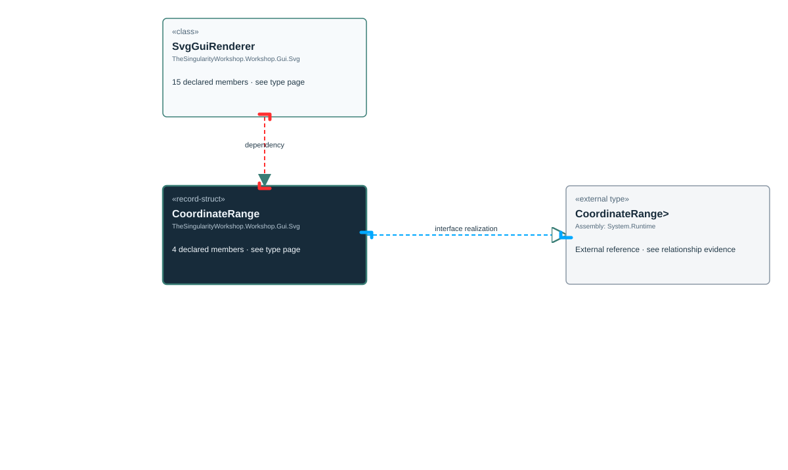

# TheSingularityWorkshop.Workshop.Gui.Svg.SvgGuiRenderer.CoordinateRange

> Generated from compiler-backed source analysis. Do not edit by hand.

- Repository: `TrentBest/TheSingularityWorkshop.GUI`
- Revision: [`3844b48b1a30f678cb8aa80c2a21aaaceed9348b`](https://github.com/TrentBest/TheSingularityWorkshop.GUI/tree/3844b48b1a30f678cb8aa80c2a21aaaceed9348b)
- Project: `src/SVG/TheSingularityWorkshop.GUI.SVG.csproj`
- Type ID: `type:TheSingularityWorkshop.GUI.SVG, Version=0.1.0.0, Culture=neutral, PublicKeyToken=null:global::TheSingularityWorkshop.Workshop.Gui.Svg.SvgGuiRenderer.CoordinateRange`
- Metadata name: `CoordinateRange`
- Kind: `record-struct`
- Generic arity: 0

## UML diagram

## Source declarations

- [`src/SVG/SvgGuiRenderer.cs:554-554`](https://github.com/TrentBest/TheSingularityWorkshop.GUI/blob/3844b48b1a30f678cb8aa80c2a21aaaceed9348b/src/SVG/SvgGuiRenderer.cs#L554-554)

## Members

| Kind | Signature | Source |
|---|---|---|
| `Method` | `TheSingularityWorkshop.Workshop.Gui.Svg.SvgGuiRenderer.CoordinateRange.CoordinateRange(double, double, double)` | [`src/SVG/SvgGuiRenderer.cs:554-554`](https://github.com/TrentBest/TheSingularityWorkshop.GUI/blob/3844b48b1a30f678cb8aa80c2a21aaaceed9348b/src/SVG/SvgGuiRenderer.cs#L554-554) |
| `Property` | `TheSingularityWorkshop.Workshop.Gui.Svg.SvgGuiRenderer.CoordinateRange.Maximum` | [`src/SVG/SvgGuiRenderer.cs:554-554`](https://github.com/TrentBest/TheSingularityWorkshop.GUI/blob/3844b48b1a30f678cb8aa80c2a21aaaceed9348b/src/SVG/SvgGuiRenderer.cs#L554-554) |
| `Property` | `TheSingularityWorkshop.Workshop.Gui.Svg.SvgGuiRenderer.CoordinateRange.Minimum` | [`src/SVG/SvgGuiRenderer.cs:554-554`](https://github.com/TrentBest/TheSingularityWorkshop.GUI/blob/3844b48b1a30f678cb8aa80c2a21aaaceed9348b/src/SVG/SvgGuiRenderer.cs#L554-554) |
| `Property` | `TheSingularityWorkshop.Workshop.Gui.Svg.SvgGuiRenderer.CoordinateRange.ViewHeight` | [`src/SVG/SvgGuiRenderer.cs:554-554`](https://github.com/TrentBest/TheSingularityWorkshop.GUI/blob/3844b48b1a30f678cb8aa80c2a21aaaceed9348b/src/SVG/SvgGuiRenderer.cs#L554-554) |

## Relationships

| Direction | Kind | Related type | Resolution | Evidence |
|---|---|---|---|---|
| outgoing | `InterfaceRealization` | `global::System.IEquatable<global::TheSingularityWorkshop.Workshop.Gui.Svg.SvgGuiRenderer.CoordinateRange>` | `External` | [`src/SVG/SvgGuiRenderer.cs:554-554`](https://github.com/TrentBest/TheSingularityWorkshop.GUI/blob/3844b48b1a30f678cb8aa80c2a21aaaceed9348b/src/SVG/SvgGuiRenderer.cs#L554-554) |
| incoming | `Dependency` | `TheSingularityWorkshop.Workshop.Gui.Svg.SvgGuiRenderer` | `Resolved` | [`src/SVG/SvgGuiRenderer.cs:84-381`](https://github.com/TrentBest/TheSingularityWorkshop.GUI/blob/3844b48b1a30f678cb8aa80c2a21aaaceed9348b/src/SVG/SvgGuiRenderer.cs#L84-381) |
| incoming | `Dependency` | `TheSingularityWorkshop.Workshop.Gui.Svg.SvgGuiRenderer` | `Resolved` | [`src/SVG/SvgGuiRenderer.cs:383-435`](https://github.com/TrentBest/TheSingularityWorkshop.GUI/blob/3844b48b1a30f678cb8aa80c2a21aaaceed9348b/src/SVG/SvgGuiRenderer.cs#L383-435) |
| incoming | `Dependency` | `TheSingularityWorkshop.Workshop.Gui.Svg.SvgGuiRenderer` | `Resolved` | [`src/SVG/SvgGuiRenderer.cs:507-515`](https://github.com/TrentBest/TheSingularityWorkshop.GUI/blob/3844b48b1a30f678cb8aa80c2a21aaaceed9348b/src/SVG/SvgGuiRenderer.cs#L507-515) |

[Back to the generated type index](index.md)

