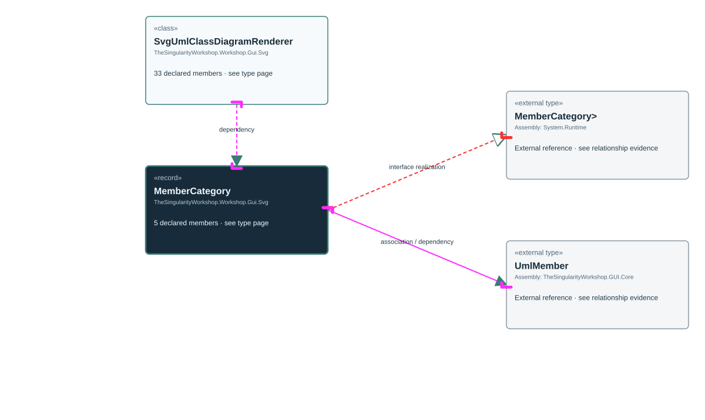

<!-- The Singularity Workshop moniker -->

# TheSingularityWorkshop.Workshop.Gui.Svg.SvgUmlClassDiagramRenderer.MemberCategory

> Generated from compiler-backed source analysis. Do not edit by hand.

- Repository: `TrentBest/TheSingularityWorkshop.GUI`
- Revision: [`ab72064a71716d2a2240016baaac9257896d425a`](https://github.com/TrentBest/TheSingularityWorkshop.GUI/tree/ab72064a71716d2a2240016baaac9257896d425a)
- Project: `src/SVG/TheSingularityWorkshop.GUI.SVG.csproj`
- Type ID: `type:TheSingularityWorkshop.GUI.SVG, Version=0.1.0.0, Culture=neutral, PublicKeyToken=null:global::TheSingularityWorkshop.Workshop.Gui.Svg.SvgUmlClassDiagramRenderer.MemberCategory`
- Metadata name: `MemberCategory`
- Kind: `record`
- Generic arity: 0

## UML diagram

## Source declarations

- [`src/SVG/SvgUmlClassDiagramRenderer.cs:38-38`](https://github.com/TrentBest/TheSingularityWorkshop.GUI/blob/ab72064a71716d2a2240016baaac9257896d425a/src/SVG/SvgUmlClassDiagramRenderer.cs#L38-38)

## Members

| Kind | Signature | Source |
|---|---|---|
| `Property` | `TheSingularityWorkshop.Workshop.Gui.Svg.SvgUmlClassDiagramRenderer.MemberCategory.Kind` | [`src/SVG/SvgUmlClassDiagramRenderer.cs:38-38`](https://github.com/TrentBest/TheSingularityWorkshop.GUI/blob/ab72064a71716d2a2240016baaac9257896d425a/src/SVG/SvgUmlClassDiagramRenderer.cs#L38-38) |
| `Method` | `TheSingularityWorkshop.Workshop.Gui.Svg.SvgUmlClassDiagramRenderer.MemberCategory.MemberCategory(string, string, string, System.Collections.Generic.IReadOnlyList<TheSingularityWorkshop.Workshop.Gui.UmlMember>)` | [`src/SVG/SvgUmlClassDiagramRenderer.cs:38-38`](https://github.com/TrentBest/TheSingularityWorkshop.GUI/blob/ab72064a71716d2a2240016baaac9257896d425a/src/SVG/SvgUmlClassDiagramRenderer.cs#L38-38) |
| `Property` | `TheSingularityWorkshop.Workshop.Gui.Svg.SvgUmlClassDiagramRenderer.MemberCategory.Members` | [`src/SVG/SvgUmlClassDiagramRenderer.cs:38-38`](https://github.com/TrentBest/TheSingularityWorkshop.GUI/blob/ab72064a71716d2a2240016baaac9257896d425a/src/SVG/SvgUmlClassDiagramRenderer.cs#L38-38) |
| `Property` | `TheSingularityWorkshop.Workshop.Gui.Svg.SvgUmlClassDiagramRenderer.MemberCategory.Stroke` | [`src/SVG/SvgUmlClassDiagramRenderer.cs:38-38`](https://github.com/TrentBest/TheSingularityWorkshop.GUI/blob/ab72064a71716d2a2240016baaac9257896d425a/src/SVG/SvgUmlClassDiagramRenderer.cs#L38-38) |
| `Property` | `TheSingularityWorkshop.Workshop.Gui.Svg.SvgUmlClassDiagramRenderer.MemberCategory.Title` | [`src/SVG/SvgUmlClassDiagramRenderer.cs:38-38`](https://github.com/TrentBest/TheSingularityWorkshop.GUI/blob/ab72064a71716d2a2240016baaac9257896d425a/src/SVG/SvgUmlClassDiagramRenderer.cs#L38-38) |

## Relationships

| Direction | Kind | Related type | Resolution | Evidence |
|---|---|---|---|---|
| outgoing | `InterfaceRealization` | `global::System.IEquatable<global::TheSingularityWorkshop.Workshop.Gui.Svg.SvgUmlClassDiagramRenderer.MemberCategory>` | `External` | [`src/SVG/SvgUmlClassDiagramRenderer.cs:38-38`](https://github.com/TrentBest/TheSingularityWorkshop.GUI/blob/ab72064a71716d2a2240016baaac9257896d425a/src/SVG/SvgUmlClassDiagramRenderer.cs#L38-38) |
| outgoing | `Association` | `global::TheSingularityWorkshop.Workshop.Gui.UmlMember` | `External` | [`src/SVG/SvgUmlClassDiagramRenderer.cs:38-38`](https://github.com/TrentBest/TheSingularityWorkshop.GUI/blob/ab72064a71716d2a2240016baaac9257896d425a/src/SVG/SvgUmlClassDiagramRenderer.cs#L38-38) |
| incoming | `Dependency` | `TheSingularityWorkshop.Workshop.Gui.Svg.SvgUmlClassDiagramRenderer` | `Resolved` | [`src/SVG/SvgUmlClassDiagramRenderer.cs:158-200`](https://github.com/TrentBest/TheSingularityWorkshop.GUI/blob/ab72064a71716d2a2240016baaac9257896d425a/src/SVG/SvgUmlClassDiagramRenderer.cs#L158-200) |
| incoming | `Dependency` | `TheSingularityWorkshop.Workshop.Gui.Svg.SvgUmlClassDiagramRenderer` | `Resolved` | [`src/SVG/SvgUmlClassDiagramRenderer.cs:144-150`](https://github.com/TrentBest/TheSingularityWorkshop.GUI/blob/ab72064a71716d2a2240016baaac9257896d425a/src/SVG/SvgUmlClassDiagramRenderer.cs#L144-150) |
| incoming | `Dependency` | `TheSingularityWorkshop.Workshop.Gui.Svg.SvgUmlClassDiagramRenderer` | `Resolved` | [`src/SVG/SvgUmlClassDiagramRenderer.cs:152-156`](https://github.com/TrentBest/TheSingularityWorkshop.GUI/blob/ab72064a71716d2a2240016baaac9257896d425a/src/SVG/SvgUmlClassDiagramRenderer.cs#L152-156) |
| outgoing | `Dependency` | `global::TheSingularityWorkshop.Workshop.Gui.UmlMember` | `External` | [`src/SVG/SvgUmlClassDiagramRenderer.cs:38-38`](https://github.com/TrentBest/TheSingularityWorkshop.GUI/blob/ab72064a71716d2a2240016baaac9257896d425a/src/SVG/SvgUmlClassDiagramRenderer.cs#L38-38) |

[Back to the generated type index](index.md)

---

<!-- THE SINGULARITY WORKSHOP FOOTER -->

