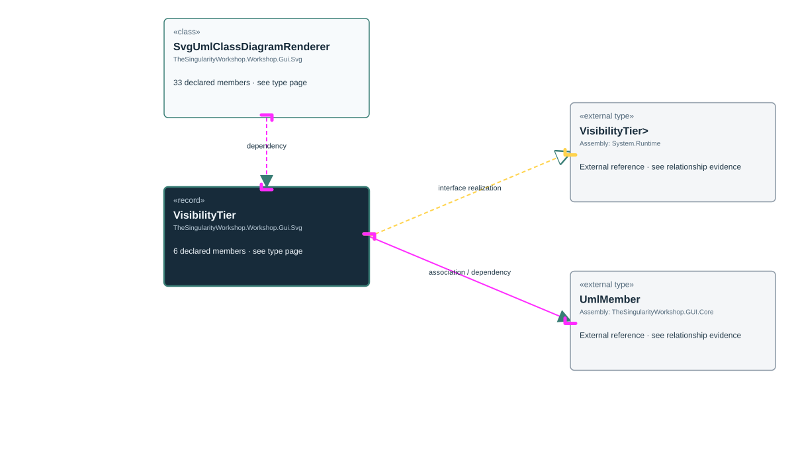

<!-- The Singularity Workshop moniker -->

# TheSingularityWorkshop.Workshop.Gui.Svg.SvgUmlClassDiagramRenderer.VisibilityTier

> Generated from compiler-backed source analysis. Do not edit by hand.

- Repository: `TrentBest/TheSingularityWorkshop.GUI`
- Revision: [`4fa33208ca046ee81f02d3dc3f244ffe960bcec8`](https://github.com/TrentBest/TheSingularityWorkshop.GUI/tree/4fa33208ca046ee81f02d3dc3f244ffe960bcec8)
- Project: `src/SVG/TheSingularityWorkshop.GUI.SVG.csproj`
- Type ID: `type:TheSingularityWorkshop.GUI.SVG, Version=0.1.0.0, Culture=neutral, PublicKeyToken=null:global::TheSingularityWorkshop.Workshop.Gui.Svg.SvgUmlClassDiagramRenderer.VisibilityTier`
- Metadata name: `VisibilityTier`
- Kind: `record`
- Generic arity: 0

## UML diagram

## Source declarations

- [`src/SVG/SvgUmlClassDiagramRenderer.cs:39-39`](https://github.com/TrentBest/TheSingularityWorkshop.GUI/blob/4fa33208ca046ee81f02d3dc3f244ffe960bcec8/src/SVG/SvgUmlClassDiagramRenderer.cs#L39-39)

## Members

| Kind | Signature | Source |
|---|---|---|
| `Property` | `TheSingularityWorkshop.Workshop.Gui.Svg.SvgUmlClassDiagramRenderer.VisibilityTier.Fill` | [`src/SVG/SvgUmlClassDiagramRenderer.cs:39-39`](https://github.com/TrentBest/TheSingularityWorkshop.GUI/blob/4fa33208ca046ee81f02d3dc3f244ffe960bcec8/src/SVG/SvgUmlClassDiagramRenderer.cs#L39-39) |
| `Property` | `TheSingularityWorkshop.Workshop.Gui.Svg.SvgUmlClassDiagramRenderer.VisibilityTier.Key` | [`src/SVG/SvgUmlClassDiagramRenderer.cs:39-39`](https://github.com/TrentBest/TheSingularityWorkshop.GUI/blob/4fa33208ca046ee81f02d3dc3f244ffe960bcec8/src/SVG/SvgUmlClassDiagramRenderer.cs#L39-39) |
| `Property` | `TheSingularityWorkshop.Workshop.Gui.Svg.SvgUmlClassDiagramRenderer.VisibilityTier.Members` | [`src/SVG/SvgUmlClassDiagramRenderer.cs:39-39`](https://github.com/TrentBest/TheSingularityWorkshop.GUI/blob/4fa33208ca046ee81f02d3dc3f244ffe960bcec8/src/SVG/SvgUmlClassDiagramRenderer.cs#L39-39) |
| `Property` | `TheSingularityWorkshop.Workshop.Gui.Svg.SvgUmlClassDiagramRenderer.VisibilityTier.Name` | [`src/SVG/SvgUmlClassDiagramRenderer.cs:39-39`](https://github.com/TrentBest/TheSingularityWorkshop.GUI/blob/4fa33208ca046ee81f02d3dc3f244ffe960bcec8/src/SVG/SvgUmlClassDiagramRenderer.cs#L39-39) |
| `Property` | `TheSingularityWorkshop.Workshop.Gui.Svg.SvgUmlClassDiagramRenderer.VisibilityTier.Stroke` | [`src/SVG/SvgUmlClassDiagramRenderer.cs:39-39`](https://github.com/TrentBest/TheSingularityWorkshop.GUI/blob/4fa33208ca046ee81f02d3dc3f244ffe960bcec8/src/SVG/SvgUmlClassDiagramRenderer.cs#L39-39) |
| `Method` | `TheSingularityWorkshop.Workshop.Gui.Svg.SvgUmlClassDiagramRenderer.VisibilityTier.VisibilityTier(string, string, string, string, System.Collections.Generic.IReadOnlyList<TheSingularityWorkshop.Workshop.Gui.UmlMember>)` | [`src/SVG/SvgUmlClassDiagramRenderer.cs:39-39`](https://github.com/TrentBest/TheSingularityWorkshop.GUI/blob/4fa33208ca046ee81f02d3dc3f244ffe960bcec8/src/SVG/SvgUmlClassDiagramRenderer.cs#L39-39) |

## Relationships

| Direction | Kind | Related type | Resolution | Evidence |
|---|---|---|---|---|
| outgoing | `InterfaceRealization` | `global::System.IEquatable<global::TheSingularityWorkshop.Workshop.Gui.Svg.SvgUmlClassDiagramRenderer.VisibilityTier>` | `External` | [`src/SVG/SvgUmlClassDiagramRenderer.cs:39-39`](https://github.com/TrentBest/TheSingularityWorkshop.GUI/blob/4fa33208ca046ee81f02d3dc3f244ffe960bcec8/src/SVG/SvgUmlClassDiagramRenderer.cs#L39-39) |
| outgoing | `Association` | `global::TheSingularityWorkshop.Workshop.Gui.UmlMember` | `External` | [`src/SVG/SvgUmlClassDiagramRenderer.cs:39-39`](https://github.com/TrentBest/TheSingularityWorkshop.GUI/blob/4fa33208ca046ee81f02d3dc3f244ffe960bcec8/src/SVG/SvgUmlClassDiagramRenderer.cs#L39-39) |
| incoming | `Dependency` | `TheSingularityWorkshop.Workshop.Gui.Svg.SvgUmlClassDiagramRenderer` | `Resolved` | [`src/SVG/SvgUmlClassDiagramRenderer.cs:158-200`](https://github.com/TrentBest/TheSingularityWorkshop.GUI/blob/4fa33208ca046ee81f02d3dc3f244ffe960bcec8/src/SVG/SvgUmlClassDiagramRenderer.cs#L158-200) |
| incoming | `Dependency` | `TheSingularityWorkshop.Workshop.Gui.Svg.SvgUmlClassDiagramRenderer` | `Resolved` | [`src/SVG/SvgUmlClassDiagramRenderer.cs:144-150`](https://github.com/TrentBest/TheSingularityWorkshop.GUI/blob/4fa33208ca046ee81f02d3dc3f244ffe960bcec8/src/SVG/SvgUmlClassDiagramRenderer.cs#L144-150) |
| incoming | `Dependency` | `TheSingularityWorkshop.Workshop.Gui.Svg.SvgUmlClassDiagramRenderer` | `Resolved` | [`src/SVG/SvgUmlClassDiagramRenderer.cs:116-132`](https://github.com/TrentBest/TheSingularityWorkshop.GUI/blob/4fa33208ca046ee81f02d3dc3f244ffe960bcec8/src/SVG/SvgUmlClassDiagramRenderer.cs#L116-132) |
| outgoing | `Dependency` | `global::TheSingularityWorkshop.Workshop.Gui.UmlMember` | `External` | [`src/SVG/SvgUmlClassDiagramRenderer.cs:39-39`](https://github.com/TrentBest/TheSingularityWorkshop.GUI/blob/4fa33208ca046ee81f02d3dc3f244ffe960bcec8/src/SVG/SvgUmlClassDiagramRenderer.cs#L39-39) |

[Back to the generated type index](index.md)

---

<!-- THE SINGULARITY WORKSHOP FOOTER -->

