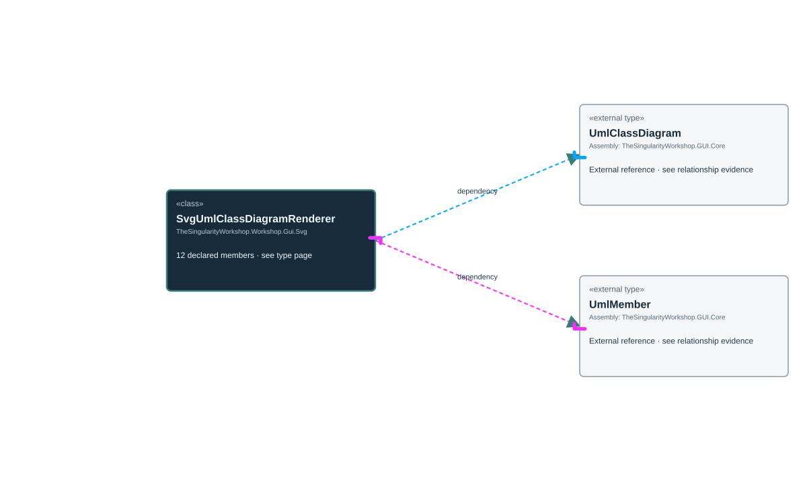

# TheSingularityWorkshop.Workshop.Gui.Svg.SvgUmlClassDiagramRenderer

> Generated from compiler-backed source analysis. Do not edit by hand.

- Repository: `TrentBest/TheSingularityWorkshop.GUI`
- Revision: [`8d11c5f449b73b519cfb1819c9c3942307f717c6`](https://github.com/TrentBest/TheSingularityWorkshop.GUI/tree/8d11c5f449b73b519cfb1819c9c3942307f717c6)
- Project: `src/SVG/TheSingularityWorkshop.GUI.SVG.csproj`
- Type ID: `type:TheSingularityWorkshop.GUI.SVG, Version=0.1.0.0, Culture=neutral, PublicKeyToken=null:global::TheSingularityWorkshop.Workshop.Gui.Svg.SvgUmlClassDiagramRenderer`
- Metadata name: `SvgUmlClassDiagramRenderer`
- Kind: `class`
- Generic arity: 0

## UML diagram

## Source declarations

- [`src/SVG/SvgUmlClassDiagramRenderer.cs:8-141`](https://github.com/TrentBest/TheSingularityWorkshop.GUI/blob/8d11c5f449b73b519cfb1819c9c3942307f717c6/src/SVG/SvgUmlClassDiagramRenderer.cs#L8-141)

## Members

| Kind | Signature | Source |
|---|---|---|
| `Method` | `TheSingularityWorkshop.Workshop.Gui.Svg.SvgUmlClassDiagramRenderer.DrawSection(System.Xml.Linq.XElement, double, double, double, string, System.Collections.Generic.IReadOnlyList<TheSingularityWorkshop.Workshop.Gui.UmlMember>)` | [`src/SVG/SvgUmlClassDiagramRenderer.cs:89-120`](https://github.com/TrentBest/TheSingularityWorkshop.GUI/blob/8d11c5f449b73b519cfb1819c9c3942307f717c6/src/SVG/SvgUmlClassDiagramRenderer.cs#L89-120) |
| `Method` | `TheSingularityWorkshop.Workshop.Gui.Svg.SvgUmlClassDiagramRenderer.DrawSectionHeading(System.Xml.Linq.XElement, double, double, double, string)` | [`src/SVG/SvgUmlClassDiagramRenderer.cs:122-130`](https://github.com/TrentBest/TheSingularityWorkshop.GUI/blob/8d11c5f449b73b519cfb1819c9c3942307f717c6/src/SVG/SvgUmlClassDiagramRenderer.cs#L122-130) |
| `Method` | `TheSingularityWorkshop.Workshop.Gui.Svg.SvgUmlClassDiagramRenderer.F(double)` | [`src/SVG/SvgUmlClassDiagramRenderer.cs:140-140`](https://github.com/TrentBest/TheSingularityWorkshop.GUI/blob/8d11c5f449b73b519cfb1819c9c3942307f717c6/src/SVG/SvgUmlClassDiagramRenderer.cs#L140-140) |
| `Field` | `TheSingularityWorkshop.Workshop.Gui.Svg.SvgUmlClassDiagramRenderer.HeaderHeight` | [`src/SVG/SvgUmlClassDiagramRenderer.cs:15-15`](https://github.com/TrentBest/TheSingularityWorkshop.GUI/blob/8d11c5f449b73b519cfb1819c9c3942307f717c6/src/SVG/SvgUmlClassDiagramRenderer.cs#L15-15) |
| `Field` | `TheSingularityWorkshop.Workshop.Gui.Svg.SvgUmlClassDiagramRenderer.Left` | [`src/SVG/SvgUmlClassDiagramRenderer.cs:11-11`](https://github.com/TrentBest/TheSingularityWorkshop.GUI/blob/8d11c5f449b73b519cfb1819c9c3942307f717c6/src/SVG/SvgUmlClassDiagramRenderer.cs#L11-11) |
| `Field` | `TheSingularityWorkshop.Workshop.Gui.Svg.SvgUmlClassDiagramRenderer.LineHeight` | [`src/SVG/SvgUmlClassDiagramRenderer.cs:13-13`](https://github.com/TrentBest/TheSingularityWorkshop.GUI/blob/8d11c5f449b73b519cfb1819c9c3942307f717c6/src/SVG/SvgUmlClassDiagramRenderer.cs#L13-13) |
| `Field` | `TheSingularityWorkshop.Workshop.Gui.Svg.SvgUmlClassDiagramRenderer.Padding` | [`src/SVG/SvgUmlClassDiagramRenderer.cs:14-14`](https://github.com/TrentBest/TheSingularityWorkshop.GUI/blob/8d11c5f449b73b519cfb1819c9c3942307f717c6/src/SVG/SvgUmlClassDiagramRenderer.cs#L14-14) |
| `Method` | `TheSingularityWorkshop.Workshop.Gui.Svg.SvgUmlClassDiagramRenderer.Render(TheSingularityWorkshop.Workshop.Gui.UmlClassDiagram, int)` | [`src/SVG/SvgUmlClassDiagramRenderer.cs:19-87`](https://github.com/TrentBest/TheSingularityWorkshop.GUI/blob/8d11c5f449b73b519cfb1819c9c3942307f717c6/src/SVG/SvgUmlClassDiagramRenderer.cs#L19-87) |
| `Field` | `TheSingularityWorkshop.Workshop.Gui.Svg.SvgUmlClassDiagramRenderer.SectionHeadingHeight` | [`src/SVG/SvgUmlClassDiagramRenderer.cs:16-16`](https://github.com/TrentBest/TheSingularityWorkshop.GUI/blob/8d11c5f449b73b519cfb1819c9c3942307f717c6/src/SVG/SvgUmlClassDiagramRenderer.cs#L16-16) |
| `Field` | `TheSingularityWorkshop.Workshop.Gui.Svg.SvgUmlClassDiagramRenderer.Svg` | [`src/SVG/SvgUmlClassDiagramRenderer.cs:10-10`](https://github.com/TrentBest/TheSingularityWorkshop.GUI/blob/8d11c5f449b73b519cfb1819c9c3942307f717c6/src/SVG/SvgUmlClassDiagramRenderer.cs#L10-10) |
| `Method` | `TheSingularityWorkshop.Workshop.Gui.Svg.SvgUmlClassDiagramRenderer.Text(double, double, string, string, string, string, string?)` | [`src/SVG/SvgUmlClassDiagramRenderer.cs:132-138`](https://github.com/TrentBest/TheSingularityWorkshop.GUI/blob/8d11c5f449b73b519cfb1819c9c3942307f717c6/src/SVG/SvgUmlClassDiagramRenderer.cs#L132-138) |
| `Field` | `TheSingularityWorkshop.Workshop.Gui.Svg.SvgUmlClassDiagramRenderer.Top` | [`src/SVG/SvgUmlClassDiagramRenderer.cs:12-12`](https://github.com/TrentBest/TheSingularityWorkshop.GUI/blob/8d11c5f449b73b519cfb1819c9c3942307f717c6/src/SVG/SvgUmlClassDiagramRenderer.cs#L12-12) |

## Relationships

| Direction | Kind | Related type | Resolution | Evidence |
|---|---|---|---|---|
| outgoing | `Dependency` | `global::TheSingularityWorkshop.Workshop.Gui.UmlClassDiagram` | `External` | [`src/SVG/SvgUmlClassDiagramRenderer.cs:19-87`](https://github.com/TrentBest/TheSingularityWorkshop.GUI/blob/8d11c5f449b73b519cfb1819c9c3942307f717c6/src/SVG/SvgUmlClassDiagramRenderer.cs#L19-87) |
| outgoing | `Dependency` | `global::TheSingularityWorkshop.Workshop.Gui.UmlMember` | `External` | [`src/SVG/SvgUmlClassDiagramRenderer.cs:89-120`](https://github.com/TrentBest/TheSingularityWorkshop.GUI/blob/8d11c5f449b73b519cfb1819c9c3942307f717c6/src/SVG/SvgUmlClassDiagramRenderer.cs#L89-120) |

[Back to the generated type index](index.md)

