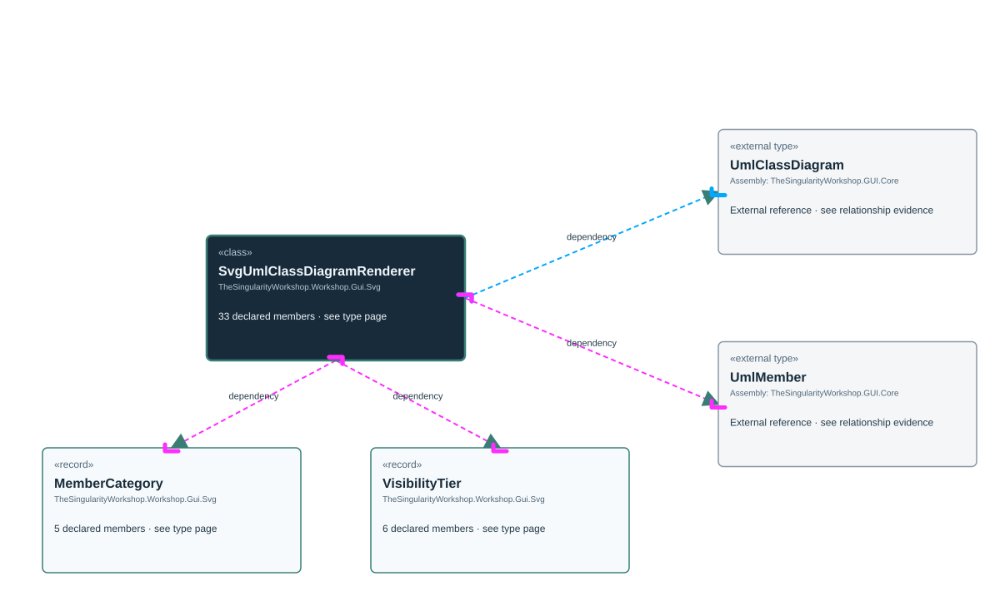

<!-- The Singularity Workshop moniker -->

# TheSingularityWorkshop.Workshop.Gui.Svg.SvgUmlClassDiagramRenderer

> Generated from compiler-backed source analysis. Do not edit by hand.

- Repository: `TrentBest/TheSingularityWorkshop.GUI`
- Revision: [`ab72064a71716d2a2240016baaac9257896d425a`](https://github.com/TrentBest/TheSingularityWorkshop.GUI/tree/ab72064a71716d2a2240016baaac9257896d425a)
- Project: `src/SVG/TheSingularityWorkshop.GUI.SVG.csproj`
- Type ID: `type:TheSingularityWorkshop.GUI.SVG, Version=0.1.0.0, Culture=neutral, PublicKeyToken=null:global::TheSingularityWorkshop.Workshop.Gui.Svg.SvgUmlClassDiagramRenderer`
- Metadata name: `SvgUmlClassDiagramRenderer`
- Kind: `class`
- Generic arity: 0

## UML diagram

## Source declarations

- [`src/SVG/SvgUmlClassDiagramRenderer.cs:12-244`](https://github.com/TrentBest/TheSingularityWorkshop.GUI/blob/ab72064a71716d2a2240016baaac9257896d425a/src/SVG/SvgUmlClassDiagramRenderer.cs#L12-244)

## Members

| Kind | Signature | Source |
|---|---|---|
| `Method` | `TheSingularityWorkshop.Workshop.Gui.Svg.SvgUmlClassDiagramRenderer.AccessibilityTiers(System.Collections.Generic.IReadOnlyList<TheSingularityWorkshop.Workshop.Gui.UmlMember>)` | [`src/SVG/SvgUmlClassDiagramRenderer.cs:116-132`](https://github.com/TrentBest/TheSingularityWorkshop.GUI/blob/ab72064a71716d2a2240016baaac9257896d425a/src/SVG/SvgUmlClassDiagramRenderer.cs#L116-132) |
| `Method` | `TheSingularityWorkshop.Workshop.Gui.Svg.SvgUmlClassDiagramRenderer.AddCard(System.Xml.Linq.XElement, double, double, double, double, string, string, string, string)` | [`src/SVG/SvgUmlClassDiagramRenderer.cs:227-236`](https://github.com/TrentBest/TheSingularityWorkshop.GUI/blob/ab72064a71716d2a2240016baaac9257896d425a/src/SVG/SvgUmlClassDiagramRenderer.cs#L227-236) |
| `Method` | `TheSingularityWorkshop.Workshop.Gui.Svg.SvgUmlClassDiagramRenderer.CategoryHeight(TheSingularityWorkshop.Workshop.Gui.Svg.SvgUmlClassDiagramRenderer.MemberCategory, System.Collections.Generic.IReadOnlyList<TheSingularityWorkshop.Workshop.Gui.UmlMember>)` | [`src/SVG/SvgUmlClassDiagramRenderer.cs:152-156`](https://github.com/TrentBest/TheSingularityWorkshop.GUI/blob/ab72064a71716d2a2240016baaac9257896d425a/src/SVG/SvgUmlClassDiagramRenderer.cs#L152-156) |
| `Method` | `TheSingularityWorkshop.Workshop.Gui.Svg.SvgUmlClassDiagramRenderer.DrawTier(System.Xml.Linq.XElement, double, double, double, TheSingularityWorkshop.Workshop.Gui.Svg.SvgUmlClassDiagramRenderer.VisibilityTier, System.Collections.Generic.IReadOnlyList<TheSingularityWorkshop.Workshop.Gui.Svg.SvgUmlClassDiagramRenderer.MemberCategory>)` | [`src/SVG/SvgUmlClassDiagramRenderer.cs:158-200`](https://github.com/TrentBest/TheSingularityWorkshop.GUI/blob/ab72064a71716d2a2240016baaac9257896d425a/src/SVG/SvgUmlClassDiagramRenderer.cs#L158-200) |
| `Method` | `TheSingularityWorkshop.Workshop.Gui.Svg.SvgUmlClassDiagramRenderer.F(double)` | [`src/SVG/SvgUmlClassDiagramRenderer.cs:243-243`](https://github.com/TrentBest/TheSingularityWorkshop.GUI/blob/ab72064a71716d2a2240016baaac9257896d425a/src/SVG/SvgUmlClassDiagramRenderer.cs#L243-243) |
| `Field` | `TheSingularityWorkshop.Workshop.Gui.Svg.SvgUmlClassDiagramRenderer.FieldStroke` | [`src/SVG/SvgUmlClassDiagramRenderer.cs:30-30`](https://github.com/TrentBest/TheSingularityWorkshop.GUI/blob/ab72064a71716d2a2240016baaac9257896d425a/src/SVG/SvgUmlClassDiagramRenderer.cs#L30-30) |
| `Field` | `TheSingularityWorkshop.Workshop.Gui.Svg.SvgUmlClassDiagramRenderer.Gap` | [`src/SVG/SvgUmlClassDiagramRenderer.cs:22-22`](https://github.com/TrentBest/TheSingularityWorkshop.GUI/blob/ab72064a71716d2a2240016baaac9257896d425a/src/SVG/SvgUmlClassDiagramRenderer.cs#L22-22) |
| `Field` | `TheSingularityWorkshop.Workshop.Gui.Svg.SvgUmlClassDiagramRenderer.GroupHeaderHeight` | [`src/SVG/SvgUmlClassDiagramRenderer.cs:19-19`](https://github.com/TrentBest/TheSingularityWorkshop.GUI/blob/ab72064a71716d2a2240016baaac9257896d425a/src/SVG/SvgUmlClassDiagramRenderer.cs#L19-19) |
| `Field` | `TheSingularityWorkshop.Workshop.Gui.Svg.SvgUmlClassDiagramRenderer.HeaderHeight` | [`src/SVG/SvgUmlClassDiagramRenderer.cs:17-17`](https://github.com/TrentBest/TheSingularityWorkshop.GUI/blob/ab72064a71716d2a2240016baaac9257896d425a/src/SVG/SvgUmlClassDiagramRenderer.cs#L17-17) |
| `Field` | `TheSingularityWorkshop.Workshop.Gui.Svg.SvgUmlClassDiagramRenderer.Ink` | [`src/SVG/SvgUmlClassDiagramRenderer.cs:35-35`](https://github.com/TrentBest/TheSingularityWorkshop.GUI/blob/ab72064a71716d2a2240016baaac9257896d425a/src/SVG/SvgUmlClassDiagramRenderer.cs#L35-35) |
| `Field` | `TheSingularityWorkshop.Workshop.Gui.Svg.SvgUmlClassDiagramRenderer.InternalStroke` | [`src/SVG/SvgUmlClassDiagramRenderer.cs:33-33`](https://github.com/TrentBest/TheSingularityWorkshop.GUI/blob/ab72064a71716d2a2240016baaac9257896d425a/src/SVG/SvgUmlClassDiagramRenderer.cs#L33-33) |
| `Field` | `TheSingularityWorkshop.Workshop.Gui.Svg.SvgUmlClassDiagramRenderer.Left` | [`src/SVG/SvgUmlClassDiagramRenderer.cs:15-15`](https://github.com/TrentBest/TheSingularityWorkshop.GUI/blob/ab72064a71716d2a2240016baaac9257896d425a/src/SVG/SvgUmlClassDiagramRenderer.cs#L15-15) |
| `Field` | `TheSingularityWorkshop.Workshop.Gui.Svg.SvgUmlClassDiagramRenderer.LineHeight` | [`src/SVG/SvgUmlClassDiagramRenderer.cs:21-21`](https://github.com/TrentBest/TheSingularityWorkshop.GUI/blob/ab72064a71716d2a2240016baaac9257896d425a/src/SVG/SvgUmlClassDiagramRenderer.cs#L21-21) |
| `Field` | `TheSingularityWorkshop.Workshop.Gui.Svg.SvgUmlClassDiagramRenderer.MemberHeaderHeight` | [`src/SVG/SvgUmlClassDiagramRenderer.cs:20-20`](https://github.com/TrentBest/TheSingularityWorkshop.GUI/blob/ab72064a71716d2a2240016baaac9257896d425a/src/SVG/SvgUmlClassDiagramRenderer.cs#L20-20) |
| `Method` | `TheSingularityWorkshop.Workshop.Gui.Svg.SvgUmlClassDiagramRenderer.MemberHeight(TheSingularityWorkshop.Workshop.Gui.UmlMember)` | [`src/SVG/SvgUmlClassDiagramRenderer.cs:223-225`](https://github.com/TrentBest/TheSingularityWorkshop.GUI/blob/ab72064a71716d2a2240016baaac9257896d425a/src/SVG/SvgUmlClassDiagramRenderer.cs#L223-225) |
| `Field` | `TheSingularityWorkshop.Workshop.Gui.Svg.SvgUmlClassDiagramRenderer.MethodStroke` | [`src/SVG/SvgUmlClassDiagramRenderer.cs:29-29`](https://github.com/TrentBest/TheSingularityWorkshop.GUI/blob/ab72064a71716d2a2240016baaac9257896d425a/src/SVG/SvgUmlClassDiagramRenderer.cs#L29-29) |
| `Field` | `TheSingularityWorkshop.Workshop.Gui.Svg.SvgUmlClassDiagramRenderer.NamespaceHeaderHeight` | [`src/SVG/SvgUmlClassDiagramRenderer.cs:18-18`](https://github.com/TrentBest/TheSingularityWorkshop.GUI/blob/ab72064a71716d2a2240016baaac9257896d425a/src/SVG/SvgUmlClassDiagramRenderer.cs#L18-18) |
| `Field` | `TheSingularityWorkshop.Workshop.Gui.Svg.SvgUmlClassDiagramRenderer.NamespaceStroke` | [`src/SVG/SvgUmlClassDiagramRenderer.cs:26-26`](https://github.com/TrentBest/TheSingularityWorkshop.GUI/blob/ab72064a71716d2a2240016baaac9257896d425a/src/SVG/SvgUmlClassDiagramRenderer.cs#L26-26) |
| `Method` | `TheSingularityWorkshop.Workshop.Gui.Svg.SvgUmlClassDiagramRenderer.NormalizeVisibility(string)` | [`src/SVG/SvgUmlClassDiagramRenderer.cs:134-142`](https://github.com/TrentBest/TheSingularityWorkshop.GUI/blob/ab72064a71716d2a2240016baaac9257896d425a/src/SVG/SvgUmlClassDiagramRenderer.cs#L134-142) |
| `Field` | `TheSingularityWorkshop.Workshop.Gui.Svg.SvgUmlClassDiagramRenderer.Padding` | [`src/SVG/SvgUmlClassDiagramRenderer.cs:23-23`](https://github.com/TrentBest/TheSingularityWorkshop.GUI/blob/ab72064a71716d2a2240016baaac9257896d425a/src/SVG/SvgUmlClassDiagramRenderer.cs#L23-23) |
| `Field` | `TheSingularityWorkshop.Workshop.Gui.Svg.SvgUmlClassDiagramRenderer.Paper` | [`src/SVG/SvgUmlClassDiagramRenderer.cs:36-36`](https://github.com/TrentBest/TheSingularityWorkshop.GUI/blob/ab72064a71716d2a2240016baaac9257896d425a/src/SVG/SvgUmlClassDiagramRenderer.cs#L36-36) |
| `Field` | `TheSingularityWorkshop.Workshop.Gui.Svg.SvgUmlClassDiagramRenderer.PrivateStroke` | [`src/SVG/SvgUmlClassDiagramRenderer.cs:34-34`](https://github.com/TrentBest/TheSingularityWorkshop.GUI/blob/ab72064a71716d2a2240016baaac9257896d425a/src/SVG/SvgUmlClassDiagramRenderer.cs#L34-34) |
| `Field` | `TheSingularityWorkshop.Workshop.Gui.Svg.SvgUmlClassDiagramRenderer.PropertyStroke` | [`src/SVG/SvgUmlClassDiagramRenderer.cs:28-28`](https://github.com/TrentBest/TheSingularityWorkshop.GUI/blob/ab72064a71716d2a2240016baaac9257896d425a/src/SVG/SvgUmlClassDiagramRenderer.cs#L28-28) |
| `Field` | `TheSingularityWorkshop.Workshop.Gui.Svg.SvgUmlClassDiagramRenderer.ProtectedStroke` | [`src/SVG/SvgUmlClassDiagramRenderer.cs:32-32`](https://github.com/TrentBest/TheSingularityWorkshop.GUI/blob/ab72064a71716d2a2240016baaac9257896d425a/src/SVG/SvgUmlClassDiagramRenderer.cs#L32-32) |
| `Field` | `TheSingularityWorkshop.Workshop.Gui.Svg.SvgUmlClassDiagramRenderer.PublicStroke` | [`src/SVG/SvgUmlClassDiagramRenderer.cs:31-31`](https://github.com/TrentBest/TheSingularityWorkshop.GUI/blob/ab72064a71716d2a2240016baaac9257896d425a/src/SVG/SvgUmlClassDiagramRenderer.cs#L31-31) |
| `Method` | `TheSingularityWorkshop.Workshop.Gui.Svg.SvgUmlClassDiagramRenderer.Render(TheSingularityWorkshop.Workshop.Gui.UmlClassDiagram, int)` | [`src/SVG/SvgUmlClassDiagramRenderer.cs:42-114`](https://github.com/TrentBest/TheSingularityWorkshop.GUI/blob/ab72064a71716d2a2240016baaac9257896d425a/src/SVG/SvgUmlClassDiagramRenderer.cs#L42-114) |
| `Field` | `TheSingularityWorkshop.Workshop.Gui.Svg.SvgUmlClassDiagramRenderer.Svg` | [`src/SVG/SvgUmlClassDiagramRenderer.cs:14-14`](https://github.com/TrentBest/TheSingularityWorkshop.GUI/blob/ab72064a71716d2a2240016baaac9257896d425a/src/SVG/SvgUmlClassDiagramRenderer.cs#L14-14) |
| `Method` | `TheSingularityWorkshop.Workshop.Gui.Svg.SvgUmlClassDiagramRenderer.Text(double, double, string, string, string, string)` | [`src/SVG/SvgUmlClassDiagramRenderer.cs:238-241`](https://github.com/TrentBest/TheSingularityWorkshop.GUI/blob/ab72064a71716d2a2240016baaac9257896d425a/src/SVG/SvgUmlClassDiagramRenderer.cs#L238-241) |
| `Method` | `TheSingularityWorkshop.Workshop.Gui.Svg.SvgUmlClassDiagramRenderer.TierHeight(TheSingularityWorkshop.Workshop.Gui.Svg.SvgUmlClassDiagramRenderer.VisibilityTier, System.Collections.Generic.IReadOnlyList<TheSingularityWorkshop.Workshop.Gui.Svg.SvgUmlClassDiagramRenderer.MemberCategory>)` | [`src/SVG/SvgUmlClassDiagramRenderer.cs:144-150`](https://github.com/TrentBest/TheSingularityWorkshop.GUI/blob/ab72064a71716d2a2240016baaac9257896d425a/src/SVG/SvgUmlClassDiagramRenderer.cs#L144-150) |
| `Field` | `TheSingularityWorkshop.Workshop.Gui.Svg.SvgUmlClassDiagramRenderer.Top` | [`src/SVG/SvgUmlClassDiagramRenderer.cs:16-16`](https://github.com/TrentBest/TheSingularityWorkshop.GUI/blob/ab72064a71716d2a2240016baaac9257896d425a/src/SVG/SvgUmlClassDiagramRenderer.cs#L16-16) |
| `Field` | `TheSingularityWorkshop.Workshop.Gui.Svg.SvgUmlClassDiagramRenderer.TypeStroke` | [`src/SVG/SvgUmlClassDiagramRenderer.cs:27-27`](https://github.com/TrentBest/TheSingularityWorkshop.GUI/blob/ab72064a71716d2a2240016baaac9257896d425a/src/SVG/SvgUmlClassDiagramRenderer.cs#L27-27) |
| `Method` | `TheSingularityWorkshop.Workshop.Gui.Svg.SvgUmlClassDiagramRenderer.VisibilityMarker(string)` | [`src/SVG/SvgUmlClassDiagramRenderer.cs:202-209`](https://github.com/TrentBest/TheSingularityWorkshop.GUI/blob/ab72064a71716d2a2240016baaac9257896d425a/src/SVG/SvgUmlClassDiagramRenderer.cs#L202-209) |
| `Method` | `TheSingularityWorkshop.Workshop.Gui.Svg.SvgUmlClassDiagramRenderer.VisibilityQualifier(string)` | [`src/SVG/SvgUmlClassDiagramRenderer.cs:213-221`](https://github.com/TrentBest/TheSingularityWorkshop.GUI/blob/ab72064a71716d2a2240016baaac9257896d425a/src/SVG/SvgUmlClassDiagramRenderer.cs#L213-221) |

## Relationships

| Direction | Kind | Related type | Resolution | Evidence |
|---|---|---|---|---|
| outgoing | `Dependency` | `TheSingularityWorkshop.Workshop.Gui.Svg.SvgUmlClassDiagramRenderer.MemberCategory` | `Resolved` | [`src/SVG/SvgUmlClassDiagramRenderer.cs:158-200`](https://github.com/TrentBest/TheSingularityWorkshop.GUI/blob/ab72064a71716d2a2240016baaac9257896d425a/src/SVG/SvgUmlClassDiagramRenderer.cs#L158-200) |
| outgoing | `Dependency` | `TheSingularityWorkshop.Workshop.Gui.Svg.SvgUmlClassDiagramRenderer.MemberCategory` | `Resolved` | [`src/SVG/SvgUmlClassDiagramRenderer.cs:144-150`](https://github.com/TrentBest/TheSingularityWorkshop.GUI/blob/ab72064a71716d2a2240016baaac9257896d425a/src/SVG/SvgUmlClassDiagramRenderer.cs#L144-150) |
| outgoing | `Dependency` | `TheSingularityWorkshop.Workshop.Gui.Svg.SvgUmlClassDiagramRenderer.MemberCategory` | `Resolved` | [`src/SVG/SvgUmlClassDiagramRenderer.cs:152-156`](https://github.com/TrentBest/TheSingularityWorkshop.GUI/blob/ab72064a71716d2a2240016baaac9257896d425a/src/SVG/SvgUmlClassDiagramRenderer.cs#L152-156) |
| outgoing | `Dependency` | `TheSingularityWorkshop.Workshop.Gui.Svg.SvgUmlClassDiagramRenderer.VisibilityTier` | `Resolved` | [`src/SVG/SvgUmlClassDiagramRenderer.cs:158-200`](https://github.com/TrentBest/TheSingularityWorkshop.GUI/blob/ab72064a71716d2a2240016baaac9257896d425a/src/SVG/SvgUmlClassDiagramRenderer.cs#L158-200) |
| outgoing | `Dependency` | `TheSingularityWorkshop.Workshop.Gui.Svg.SvgUmlClassDiagramRenderer.VisibilityTier` | `Resolved` | [`src/SVG/SvgUmlClassDiagramRenderer.cs:144-150`](https://github.com/TrentBest/TheSingularityWorkshop.GUI/blob/ab72064a71716d2a2240016baaac9257896d425a/src/SVG/SvgUmlClassDiagramRenderer.cs#L144-150) |
| outgoing | `Dependency` | `TheSingularityWorkshop.Workshop.Gui.Svg.SvgUmlClassDiagramRenderer.VisibilityTier` | `Resolved` | [`src/SVG/SvgUmlClassDiagramRenderer.cs:116-132`](https://github.com/TrentBest/TheSingularityWorkshop.GUI/blob/ab72064a71716d2a2240016baaac9257896d425a/src/SVG/SvgUmlClassDiagramRenderer.cs#L116-132) |
| outgoing | `Dependency` | `global::TheSingularityWorkshop.Workshop.Gui.UmlClassDiagram` | `External` | [`src/SVG/SvgUmlClassDiagramRenderer.cs:42-114`](https://github.com/TrentBest/TheSingularityWorkshop.GUI/blob/ab72064a71716d2a2240016baaac9257896d425a/src/SVG/SvgUmlClassDiagramRenderer.cs#L42-114) |
| outgoing | `Dependency` | `global::TheSingularityWorkshop.Workshop.Gui.UmlMember` | `External` | [`src/SVG/SvgUmlClassDiagramRenderer.cs:223-225`](https://github.com/TrentBest/TheSingularityWorkshop.GUI/blob/ab72064a71716d2a2240016baaac9257896d425a/src/SVG/SvgUmlClassDiagramRenderer.cs#L223-225) |
| outgoing | `Dependency` | `global::TheSingularityWorkshop.Workshop.Gui.UmlMember` | `External` | [`src/SVG/SvgUmlClassDiagramRenderer.cs:116-132`](https://github.com/TrentBest/TheSingularityWorkshop.GUI/blob/ab72064a71716d2a2240016baaac9257896d425a/src/SVG/SvgUmlClassDiagramRenderer.cs#L116-132) |
| outgoing | `Dependency` | `global::TheSingularityWorkshop.Workshop.Gui.UmlMember` | `External` | [`src/SVG/SvgUmlClassDiagramRenderer.cs:152-156`](https://github.com/TrentBest/TheSingularityWorkshop.GUI/blob/ab72064a71716d2a2240016baaac9257896d425a/src/SVG/SvgUmlClassDiagramRenderer.cs#L152-156) |

[Back to the generated type index](index.md)

---

<!-- THE SINGULARITY WORKSHOP FOOTER -->

