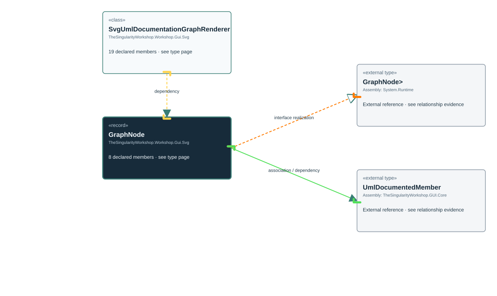

<!-- The Singularity Workshop moniker -->

# TheSingularityWorkshop.Workshop.Gui.Svg.SvgUmlDocumentationGraphRenderer.GraphNode

> Generated from compiler-backed source analysis. Do not edit by hand.

- Repository: `TrentBest/TheSingularityWorkshop.GUI`
- Revision: [`4fa33208ca046ee81f02d3dc3f244ffe960bcec8`](https://github.com/TrentBest/TheSingularityWorkshop.GUI/tree/4fa33208ca046ee81f02d3dc3f244ffe960bcec8)
- Project: `src/SVG/TheSingularityWorkshop.GUI.SVG.csproj`
- Type ID: `type:TheSingularityWorkshop.GUI.SVG, Version=0.1.0.0, Culture=neutral, PublicKeyToken=null:global::TheSingularityWorkshop.Workshop.Gui.Svg.SvgUmlDocumentationGraphRenderer.GraphNode`
- Metadata name: `GraphNode`
- Kind: `record`
- Generic arity: 0

## UML diagram

## Source declarations

- [`src/SVG/SvgUmlDocumentationGraphRenderer.cs:450-457`](https://github.com/TrentBest/TheSingularityWorkshop.GUI/blob/4fa33208ca046ee81f02d3dc3f244ffe960bcec8/src/SVG/SvgUmlDocumentationGraphRenderer.cs#L450-457)

## Members

| Kind | Signature | Source |
|---|---|---|
| `Method` | `TheSingularityWorkshop.Workshop.Gui.Svg.SvgUmlDocumentationGraphRenderer.GraphNode.GraphNode(string, string, string, string, System.Collections.Generic.IReadOnlyList<TheSingularityWorkshop.Workshop.Gui.UmlDocumentedMember>, bool, bool)` | [`src/SVG/SvgUmlDocumentationGraphRenderer.cs:450-457`](https://github.com/TrentBest/TheSingularityWorkshop.GUI/blob/4fa33208ca046ee81f02d3dc3f244ffe960bcec8/src/SVG/SvgUmlDocumentationGraphRenderer.cs#L450-457) |
| `Property` | `TheSingularityWorkshop.Workshop.Gui.Svg.SvgUmlDocumentationGraphRenderer.GraphNode.Id` | [`src/SVG/SvgUmlDocumentationGraphRenderer.cs:451-451`](https://github.com/TrentBest/TheSingularityWorkshop.GUI/blob/4fa33208ca046ee81f02d3dc3f244ffe960bcec8/src/SVG/SvgUmlDocumentationGraphRenderer.cs#L451-451) |
| `Property` | `TheSingularityWorkshop.Workshop.Gui.Svg.SvgUmlDocumentationGraphRenderer.GraphNode.IsExternal` | [`src/SVG/SvgUmlDocumentationGraphRenderer.cs:457-457`](https://github.com/TrentBest/TheSingularityWorkshop.GUI/blob/4fa33208ca046ee81f02d3dc3f244ffe960bcec8/src/SVG/SvgUmlDocumentationGraphRenderer.cs#L457-457) |
| `Property` | `TheSingularityWorkshop.Workshop.Gui.Svg.SvgUmlDocumentationGraphRenderer.GraphNode.IsFocus` | [`src/SVG/SvgUmlDocumentationGraphRenderer.cs:456-456`](https://github.com/TrentBest/TheSingularityWorkshop.GUI/blob/4fa33208ca046ee81f02d3dc3f244ffe960bcec8/src/SVG/SvgUmlDocumentationGraphRenderer.cs#L456-456) |
| `Property` | `TheSingularityWorkshop.Workshop.Gui.Svg.SvgUmlDocumentationGraphRenderer.GraphNode.Kind` | [`src/SVG/SvgUmlDocumentationGraphRenderer.cs:453-453`](https://github.com/TrentBest/TheSingularityWorkshop.GUI/blob/4fa33208ca046ee81f02d3dc3f244ffe960bcec8/src/SVG/SvgUmlDocumentationGraphRenderer.cs#L453-453) |
| `Property` | `TheSingularityWorkshop.Workshop.Gui.Svg.SvgUmlDocumentationGraphRenderer.GraphNode.Members` | [`src/SVG/SvgUmlDocumentationGraphRenderer.cs:455-455`](https://github.com/TrentBest/TheSingularityWorkshop.GUI/blob/4fa33208ca046ee81f02d3dc3f244ffe960bcec8/src/SVG/SvgUmlDocumentationGraphRenderer.cs#L455-455) |
| `Property` | `TheSingularityWorkshop.Workshop.Gui.Svg.SvgUmlDocumentationGraphRenderer.GraphNode.Name` | [`src/SVG/SvgUmlDocumentationGraphRenderer.cs:452-452`](https://github.com/TrentBest/TheSingularityWorkshop.GUI/blob/4fa33208ca046ee81f02d3dc3f244ffe960bcec8/src/SVG/SvgUmlDocumentationGraphRenderer.cs#L452-452) |
| `Property` | `TheSingularityWorkshop.Workshop.Gui.Svg.SvgUmlDocumentationGraphRenderer.GraphNode.Namespace` | [`src/SVG/SvgUmlDocumentationGraphRenderer.cs:454-454`](https://github.com/TrentBest/TheSingularityWorkshop.GUI/blob/4fa33208ca046ee81f02d3dc3f244ffe960bcec8/src/SVG/SvgUmlDocumentationGraphRenderer.cs#L454-454) |

## Relationships

| Direction | Kind | Related type | Resolution | Evidence |
|---|---|---|---|---|
| outgoing | `InterfaceRealization` | `global::System.IEquatable<global::TheSingularityWorkshop.Workshop.Gui.Svg.SvgUmlDocumentationGraphRenderer.GraphNode>` | `External` | [`src/SVG/SvgUmlDocumentationGraphRenderer.cs:450-457`](https://github.com/TrentBest/TheSingularityWorkshop.GUI/blob/4fa33208ca046ee81f02d3dc3f244ffe960bcec8/src/SVG/SvgUmlDocumentationGraphRenderer.cs#L450-457) |
| outgoing | `Association` | `global::TheSingularityWorkshop.Workshop.Gui.UmlDocumentedMember` | `External` | [`src/SVG/SvgUmlDocumentationGraphRenderer.cs:455-455`](https://github.com/TrentBest/TheSingularityWorkshop.GUI/blob/4fa33208ca046ee81f02d3dc3f244ffe960bcec8/src/SVG/SvgUmlDocumentationGraphRenderer.cs#L455-455) |
| incoming | `Dependency` | `TheSingularityWorkshop.Workshop.Gui.Svg.SvgUmlDocumentationGraphRenderer` | `Resolved` | [`src/SVG/SvgUmlDocumentationGraphRenderer.cs:440-440`](https://github.com/TrentBest/TheSingularityWorkshop.GUI/blob/4fa33208ca046ee81f02d3dc3f244ffe960bcec8/src/SVG/SvgUmlDocumentationGraphRenderer.cs#L440-440) |
| incoming | `Dependency` | `TheSingularityWorkshop.Workshop.Gui.Svg.SvgUmlDocumentationGraphRenderer` | `Resolved` | [`src/SVG/SvgUmlDocumentationGraphRenderer.cs:385-390`](https://github.com/TrentBest/TheSingularityWorkshop.GUI/blob/4fa33208ca046ee81f02d3dc3f244ffe960bcec8/src/SVG/SvgUmlDocumentationGraphRenderer.cs#L385-390) |
| incoming | `Dependency` | `TheSingularityWorkshop.Workshop.Gui.Svg.SvgUmlDocumentationGraphRenderer` | `Resolved` | [`src/SVG/SvgUmlDocumentationGraphRenderer.cs:382-383`](https://github.com/TrentBest/TheSingularityWorkshop.GUI/blob/4fa33208ca046ee81f02d3dc3f244ffe960bcec8/src/SVG/SvgUmlDocumentationGraphRenderer.cs#L382-383) |
| outgoing | `Dependency` | `global::TheSingularityWorkshop.Workshop.Gui.UmlDocumentedMember` | `External` | [`src/SVG/SvgUmlDocumentationGraphRenderer.cs:450-457`](https://github.com/TrentBest/TheSingularityWorkshop.GUI/blob/4fa33208ca046ee81f02d3dc3f244ffe960bcec8/src/SVG/SvgUmlDocumentationGraphRenderer.cs#L450-457) |

[Back to the generated type index](index.md)

---

<!-- THE SINGULARITY WORKSHOP FOOTER -->

