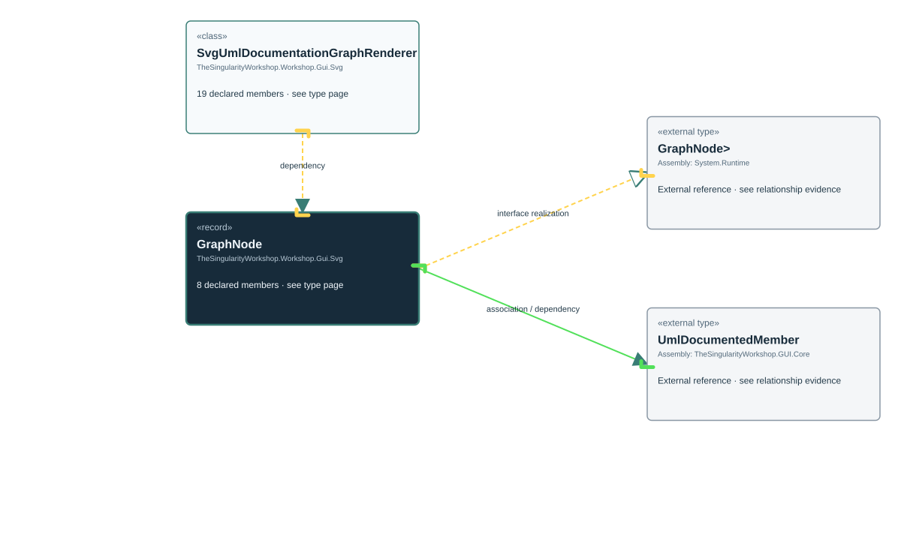

<!-- The Singularity Workshop moniker -->

# TheSingularityWorkshop.Workshop.Gui.Svg.SvgUmlDocumentationGraphRenderer.GraphNode

> Generated from compiler-backed source analysis. Do not edit by hand.

- Repository: `TrentBest/TheSingularityWorkshop.GUI`
- Revision: [`f48dd15256521c88fad88371742c89d5fd1d326f`](https://github.com/TrentBest/TheSingularityWorkshop.GUI/tree/f48dd15256521c88fad88371742c89d5fd1d326f)
- Project: `src/SVG/TheSingularityWorkshop.GUI.SVG.csproj`
- Type ID: `type:TheSingularityWorkshop.GUI.SVG, Version=0.1.0.0, Culture=neutral, PublicKeyToken=null:global::TheSingularityWorkshop.Workshop.Gui.Svg.SvgUmlDocumentationGraphRenderer.GraphNode`
- Metadata name: `GraphNode`
- Kind: `record`
- Generic arity: 0

## UML diagram

## Source declarations

- [`src/SVG/SvgUmlDocumentationGraphRenderer.cs:447-454`](https://github.com/TrentBest/TheSingularityWorkshop.GUI/blob/f48dd15256521c88fad88371742c89d5fd1d326f/src/SVG/SvgUmlDocumentationGraphRenderer.cs#L447-454)

## Members

| Kind | Signature | Source |
|---|---|---|
| `Method` | `TheSingularityWorkshop.Workshop.Gui.Svg.SvgUmlDocumentationGraphRenderer.GraphNode.GraphNode(string, string, string, string, System.Collections.Generic.IReadOnlyList<TheSingularityWorkshop.Workshop.Gui.UmlDocumentedMember>, bool, bool)` | [`src/SVG/SvgUmlDocumentationGraphRenderer.cs:447-454`](https://github.com/TrentBest/TheSingularityWorkshop.GUI/blob/f48dd15256521c88fad88371742c89d5fd1d326f/src/SVG/SvgUmlDocumentationGraphRenderer.cs#L447-454) |
| `Property` | `TheSingularityWorkshop.Workshop.Gui.Svg.SvgUmlDocumentationGraphRenderer.GraphNode.Id` | [`src/SVG/SvgUmlDocumentationGraphRenderer.cs:448-448`](https://github.com/TrentBest/TheSingularityWorkshop.GUI/blob/f48dd15256521c88fad88371742c89d5fd1d326f/src/SVG/SvgUmlDocumentationGraphRenderer.cs#L448-448) |
| `Property` | `TheSingularityWorkshop.Workshop.Gui.Svg.SvgUmlDocumentationGraphRenderer.GraphNode.IsExternal` | [`src/SVG/SvgUmlDocumentationGraphRenderer.cs:454-454`](https://github.com/TrentBest/TheSingularityWorkshop.GUI/blob/f48dd15256521c88fad88371742c89d5fd1d326f/src/SVG/SvgUmlDocumentationGraphRenderer.cs#L454-454) |
| `Property` | `TheSingularityWorkshop.Workshop.Gui.Svg.SvgUmlDocumentationGraphRenderer.GraphNode.IsFocus` | [`src/SVG/SvgUmlDocumentationGraphRenderer.cs:453-453`](https://github.com/TrentBest/TheSingularityWorkshop.GUI/blob/f48dd15256521c88fad88371742c89d5fd1d326f/src/SVG/SvgUmlDocumentationGraphRenderer.cs#L453-453) |
| `Property` | `TheSingularityWorkshop.Workshop.Gui.Svg.SvgUmlDocumentationGraphRenderer.GraphNode.Kind` | [`src/SVG/SvgUmlDocumentationGraphRenderer.cs:450-450`](https://github.com/TrentBest/TheSingularityWorkshop.GUI/blob/f48dd15256521c88fad88371742c89d5fd1d326f/src/SVG/SvgUmlDocumentationGraphRenderer.cs#L450-450) |
| `Property` | `TheSingularityWorkshop.Workshop.Gui.Svg.SvgUmlDocumentationGraphRenderer.GraphNode.Members` | [`src/SVG/SvgUmlDocumentationGraphRenderer.cs:452-452`](https://github.com/TrentBest/TheSingularityWorkshop.GUI/blob/f48dd15256521c88fad88371742c89d5fd1d326f/src/SVG/SvgUmlDocumentationGraphRenderer.cs#L452-452) |
| `Property` | `TheSingularityWorkshop.Workshop.Gui.Svg.SvgUmlDocumentationGraphRenderer.GraphNode.Name` | [`src/SVG/SvgUmlDocumentationGraphRenderer.cs:449-449`](https://github.com/TrentBest/TheSingularityWorkshop.GUI/blob/f48dd15256521c88fad88371742c89d5fd1d326f/src/SVG/SvgUmlDocumentationGraphRenderer.cs#L449-449) |
| `Property` | `TheSingularityWorkshop.Workshop.Gui.Svg.SvgUmlDocumentationGraphRenderer.GraphNode.Namespace` | [`src/SVG/SvgUmlDocumentationGraphRenderer.cs:451-451`](https://github.com/TrentBest/TheSingularityWorkshop.GUI/blob/f48dd15256521c88fad88371742c89d5fd1d326f/src/SVG/SvgUmlDocumentationGraphRenderer.cs#L451-451) |

## Relationships

| Direction | Kind | Related type | Resolution | Evidence |
|---|---|---|---|---|
| outgoing | `InterfaceRealization` | `global::System.IEquatable<global::TheSingularityWorkshop.Workshop.Gui.Svg.SvgUmlDocumentationGraphRenderer.GraphNode>` | `External` | [`src/SVG/SvgUmlDocumentationGraphRenderer.cs:447-454`](https://github.com/TrentBest/TheSingularityWorkshop.GUI/blob/f48dd15256521c88fad88371742c89d5fd1d326f/src/SVG/SvgUmlDocumentationGraphRenderer.cs#L447-454) |
| outgoing | `Association` | `global::TheSingularityWorkshop.Workshop.Gui.UmlDocumentedMember` | `External` | [`src/SVG/SvgUmlDocumentationGraphRenderer.cs:452-452`](https://github.com/TrentBest/TheSingularityWorkshop.GUI/blob/f48dd15256521c88fad88371742c89d5fd1d326f/src/SVG/SvgUmlDocumentationGraphRenderer.cs#L452-452) |
| incoming | `Dependency` | `TheSingularityWorkshop.Workshop.Gui.Svg.SvgUmlDocumentationGraphRenderer` | `Resolved` | [`src/SVG/SvgUmlDocumentationGraphRenderer.cs:437-437`](https://github.com/TrentBest/TheSingularityWorkshop.GUI/blob/f48dd15256521c88fad88371742c89d5fd1d326f/src/SVG/SvgUmlDocumentationGraphRenderer.cs#L437-437) |
| incoming | `Dependency` | `TheSingularityWorkshop.Workshop.Gui.Svg.SvgUmlDocumentationGraphRenderer` | `Resolved` | [`src/SVG/SvgUmlDocumentationGraphRenderer.cs:382-387`](https://github.com/TrentBest/TheSingularityWorkshop.GUI/blob/f48dd15256521c88fad88371742c89d5fd1d326f/src/SVG/SvgUmlDocumentationGraphRenderer.cs#L382-387) |
| incoming | `Dependency` | `TheSingularityWorkshop.Workshop.Gui.Svg.SvgUmlDocumentationGraphRenderer` | `Resolved` | [`src/SVG/SvgUmlDocumentationGraphRenderer.cs:379-380`](https://github.com/TrentBest/TheSingularityWorkshop.GUI/blob/f48dd15256521c88fad88371742c89d5fd1d326f/src/SVG/SvgUmlDocumentationGraphRenderer.cs#L379-380) |
| outgoing | `Dependency` | `global::TheSingularityWorkshop.Workshop.Gui.UmlDocumentedMember` | `External` | [`src/SVG/SvgUmlDocumentationGraphRenderer.cs:447-454`](https://github.com/TrentBest/TheSingularityWorkshop.GUI/blob/f48dd15256521c88fad88371742c89d5fd1d326f/src/SVG/SvgUmlDocumentationGraphRenderer.cs#L447-454) |

[Back to the generated type index](index.md)

---

<!-- THE SINGULARITY WORKSHOP FOOTER -->

