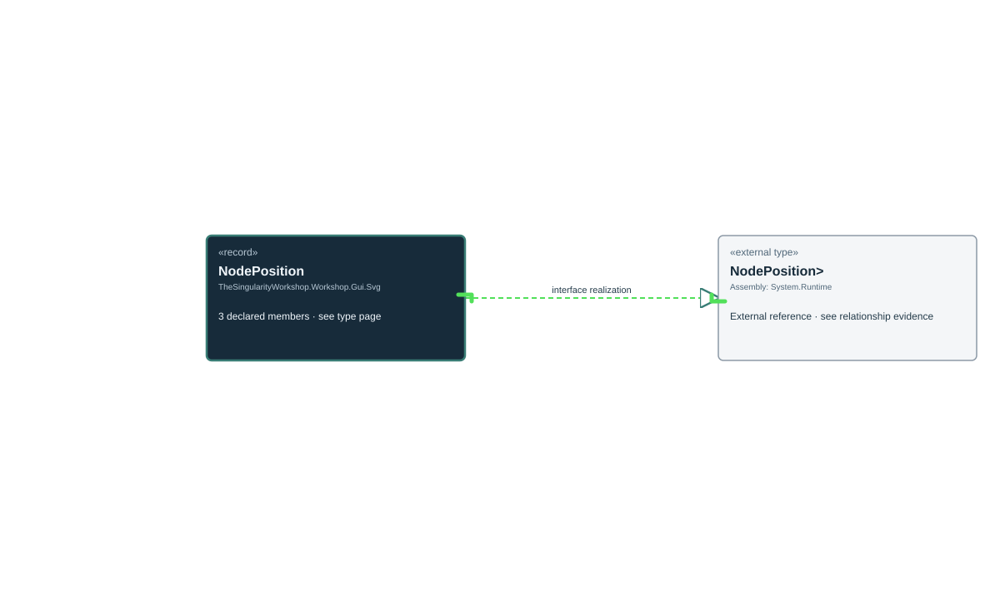

<!-- The Singularity Workshop moniker -->

# TheSingularityWorkshop.Workshop.Gui.Svg.SvgUmlDocumentationGraphRenderer.NodePosition

> Generated from compiler-backed source analysis. Do not edit by hand.

- Repository: `TrentBest/TheSingularityWorkshop.GUI`
- Revision: [`0f256ace8cf4a63c92d5edefcf667f2ee0238ee4`](https://github.com/TrentBest/TheSingularityWorkshop.GUI/tree/0f256ace8cf4a63c92d5edefcf667f2ee0238ee4)
- Project: `src/SVG/TheSingularityWorkshop.GUI.SVG.csproj`
- Type ID: `type:TheSingularityWorkshop.GUI.SVG, Version=0.1.0.0, Culture=neutral, PublicKeyToken=null:global::TheSingularityWorkshop.Workshop.Gui.Svg.SvgUmlDocumentationGraphRenderer.NodePosition`
- Metadata name: `NodePosition`
- Kind: `record`
- Generic arity: 0

## UML diagram

## Source declarations

- [`src/SVG/SvgUmlDocumentationGraphRenderer.cs:456-456`](https://github.com/TrentBest/TheSingularityWorkshop.GUI/blob/0f256ace8cf4a63c92d5edefcf667f2ee0238ee4/src/SVG/SvgUmlDocumentationGraphRenderer.cs#L456-456)

## Members

| Kind | Signature | Source |
|---|---|---|
| `Method` | `TheSingularityWorkshop.Workshop.Gui.Svg.SvgUmlDocumentationGraphRenderer.NodePosition.NodePosition(double, double)` | [`src/SVG/SvgUmlDocumentationGraphRenderer.cs:456-456`](https://github.com/TrentBest/TheSingularityWorkshop.GUI/blob/0f256ace8cf4a63c92d5edefcf667f2ee0238ee4/src/SVG/SvgUmlDocumentationGraphRenderer.cs#L456-456) |
| `Property` | `TheSingularityWorkshop.Workshop.Gui.Svg.SvgUmlDocumentationGraphRenderer.NodePosition.X` | [`src/SVG/SvgUmlDocumentationGraphRenderer.cs:456-456`](https://github.com/TrentBest/TheSingularityWorkshop.GUI/blob/0f256ace8cf4a63c92d5edefcf667f2ee0238ee4/src/SVG/SvgUmlDocumentationGraphRenderer.cs#L456-456) |
| `Property` | `TheSingularityWorkshop.Workshop.Gui.Svg.SvgUmlDocumentationGraphRenderer.NodePosition.Y` | [`src/SVG/SvgUmlDocumentationGraphRenderer.cs:456-456`](https://github.com/TrentBest/TheSingularityWorkshop.GUI/blob/0f256ace8cf4a63c92d5edefcf667f2ee0238ee4/src/SVG/SvgUmlDocumentationGraphRenderer.cs#L456-456) |

## Relationships

| Direction | Kind | Related type | Resolution | Evidence |
|---|---|---|---|---|
| outgoing | `InterfaceRealization` | `global::System.IEquatable<global::TheSingularityWorkshop.Workshop.Gui.Svg.SvgUmlDocumentationGraphRenderer.NodePosition>` | `External` | [`src/SVG/SvgUmlDocumentationGraphRenderer.cs:456-456`](https://github.com/TrentBest/TheSingularityWorkshop.GUI/blob/0f256ace8cf4a63c92d5edefcf667f2ee0238ee4/src/SVG/SvgUmlDocumentationGraphRenderer.cs#L456-456) |

[Back to the generated type index](index.md)

---

<!-- THE SINGULARITY WORKSHOP FOOTER -->

