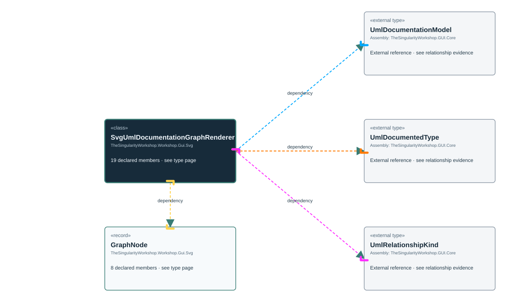

<!-- The Singularity Workshop moniker -->

# TheSingularityWorkshop.Workshop.Gui.Svg.SvgUmlDocumentationGraphRenderer

> Generated from compiler-backed source analysis. Do not edit by hand.

- Repository: `TrentBest/TheSingularityWorkshop.GUI`
- Revision: [`59362b4a57a60809f338977e3e978b9eb3ee5099`](https://github.com/TrentBest/TheSingularityWorkshop.GUI/tree/59362b4a57a60809f338977e3e978b9eb3ee5099)
- Project: `src/SVG/TheSingularityWorkshop.GUI.SVG.csproj`
- Type ID: `type:TheSingularityWorkshop.GUI.SVG, Version=0.1.0.0, Culture=neutral, PublicKeyToken=null:global::TheSingularityWorkshop.Workshop.Gui.Svg.SvgUmlDocumentationGraphRenderer`
- Metadata name: `SvgUmlDocumentationGraphRenderer`
- Kind: `class`
- Generic arity: 0

## UML diagram

## Source declarations

- [`src/SVG/SvgUmlDocumentationGraphRenderer.cs:11-451`](https://github.com/TrentBest/TheSingularityWorkshop.GUI/blob/59362b4a57a60809f338977e3e978b9eb3ee5099/src/SVG/SvgUmlDocumentationGraphRenderer.cs#L11-451)

## Members

| Kind | Signature | Source |
|---|---|---|
| `Method` | `TheSingularityWorkshop.Workshop.Gui.Svg.SvgUmlDocumentationGraphRenderer.AssemblyLabel(string?)` | [`src/SVG/SvgUmlDocumentationGraphRenderer.cs:383-390`](https://github.com/TrentBest/TheSingularityWorkshop.GUI/blob/59362b4a57a60809f338977e3e978b9eb3ee5099/src/SVG/SvgUmlDocumentationGraphRenderer.cs#L383-390) |
| `Method` | `TheSingularityWorkshop.Workshop.Gui.Svg.SvgUmlDocumentationGraphRenderer.CreateTypePort(string, string, double, double, bool)` | [`src/SVG/SvgUmlDocumentationGraphRenderer.cs:349-362`](https://github.com/TrentBest/TheSingularityWorkshop.GUI/blob/59362b4a57a60809f338977e3e978b9eb3ee5099/src/SVG/SvgUmlDocumentationGraphRenderer.cs#L349-362) |
| `Method` | `TheSingularityWorkshop.Workshop.Gui.Svg.SvgUmlDocumentationGraphRenderer.DisplayName(TheSingularityWorkshop.Workshop.Gui.Svg.SvgUmlDocumentationGraphRenderer.GraphNode)` | [`src/SVG/SvgUmlDocumentationGraphRenderer.cs:431-431`](https://github.com/TrentBest/TheSingularityWorkshop.GUI/blob/59362b4a57a60809f338977e3e978b9eb3ee5099/src/SVG/SvgUmlDocumentationGraphRenderer.cs#L431-431) |
| `Method` | `TheSingularityWorkshop.Workshop.Gui.Svg.SvgUmlDocumentationGraphRenderer.DisplayName(TheSingularityWorkshop.Workshop.Gui.UmlDocumentedType)` | [`src/SVG/SvgUmlDocumentationGraphRenderer.cs:422-429`](https://github.com/TrentBest/TheSingularityWorkshop.GUI/blob/59362b4a57a60809f338977e3e978b9eb3ee5099/src/SVG/SvgUmlDocumentationGraphRenderer.cs#L422-429) |
| `Method` | `TheSingularityWorkshop.Workshop.Gui.Svg.SvgUmlDocumentationGraphRenderer.F(double)` | [`src/SVG/SvgUmlDocumentationGraphRenderer.cs:439-439`](https://github.com/TrentBest/TheSingularityWorkshop.GUI/blob/59362b4a57a60809f338977e3e978b9eb3ee5099/src/SVG/SvgUmlDocumentationGraphRenderer.cs#L439-439) |
| `Method` | `TheSingularityWorkshop.Workshop.Gui.Svg.SvgUmlDocumentationGraphRenderer.FromType(TheSingularityWorkshop.Workshop.Gui.UmlDocumentedType, bool)` | [`src/SVG/SvgUmlDocumentationGraphRenderer.cs:373-374`](https://github.com/TrentBest/TheSingularityWorkshop.GUI/blob/59362b4a57a60809f338977e3e978b9eb3ee5099/src/SVG/SvgUmlDocumentationGraphRenderer.cs#L373-374) |
| `Field` | `TheSingularityWorkshop.Workshop.Gui.Svg.SvgUmlDocumentationGraphRenderer.HorizontalGap` | [`src/SVG/SvgUmlDocumentationGraphRenderer.cs:17-17`](https://github.com/TrentBest/TheSingularityWorkshop.GUI/blob/59362b4a57a60809f338977e3e978b9eb3ee5099/src/SVG/SvgUmlDocumentationGraphRenderer.cs#L17-17) |
| `Field` | `TheSingularityWorkshop.Workshop.Gui.Svg.SvgUmlDocumentationGraphRenderer.Margin` | [`src/SVG/SvgUmlDocumentationGraphRenderer.cs:14-14`](https://github.com/TrentBest/TheSingularityWorkshop.GUI/blob/59362b4a57a60809f338977e3e978b9eb3ee5099/src/SVG/SvgUmlDocumentationGraphRenderer.cs#L14-14) |
| `Field` | `TheSingularityWorkshop.Workshop.Gui.Svg.SvgUmlDocumentationGraphRenderer.NodeHeight` | [`src/SVG/SvgUmlDocumentationGraphRenderer.cs:16-16`](https://github.com/TrentBest/TheSingularityWorkshop.GUI/blob/59362b4a57a60809f338977e3e978b9eb3ee5099/src/SVG/SvgUmlDocumentationGraphRenderer.cs#L16-16) |
| `Field` | `TheSingularityWorkshop.Workshop.Gui.Svg.SvgUmlDocumentationGraphRenderer.NodeWidth` | [`src/SVG/SvgUmlDocumentationGraphRenderer.cs:15-15`](https://github.com/TrentBest/TheSingularityWorkshop.GUI/blob/59362b4a57a60809f338977e3e978b9eb3ee5099/src/SVG/SvgUmlDocumentationGraphRenderer.cs#L15-15) |
| `Method` | `TheSingularityWorkshop.Workshop.Gui.Svg.SvgUmlDocumentationGraphRenderer.RelationshipLabel(TheSingularityWorkshop.Workshop.Gui.UmlRelationshipKind)` | [`src/SVG/SvgUmlDocumentationGraphRenderer.cs:364-371`](https://github.com/TrentBest/TheSingularityWorkshop.GUI/blob/59362b4a57a60809f338977e3e978b9eb3ee5099/src/SVG/SvgUmlDocumentationGraphRenderer.cs#L364-371) |
| `Method` | `TheSingularityWorkshop.Workshop.Gui.Svg.SvgUmlDocumentationGraphRenderer.Render(TheSingularityWorkshop.Workshop.Gui.UmlDocumentationModel, string, int)` | [`src/SVG/SvgUmlDocumentationGraphRenderer.cs:21-332`](https://github.com/TrentBest/TheSingularityWorkshop.GUI/blob/59362b4a57a60809f338977e3e978b9eb3ee5099/src/SVG/SvgUmlDocumentationGraphRenderer.cs#L21-332) |
| `Method` | `TheSingularityWorkshop.Workshop.Gui.Svg.SvgUmlDocumentationGraphRenderer.ShortDisplayName(TheSingularityWorkshop.Workshop.Gui.Svg.SvgUmlDocumentationGraphRenderer.GraphNode)` | [`src/SVG/SvgUmlDocumentationGraphRenderer.cs:376-381`](https://github.com/TrentBest/TheSingularityWorkshop.GUI/blob/59362b4a57a60809f338977e3e978b9eb3ee5099/src/SVG/SvgUmlDocumentationGraphRenderer.cs#L376-381) |
| `Method` | `TheSingularityWorkshop.Workshop.Gui.Svg.SvgUmlDocumentationGraphRenderer.SourceHref(TheSingularityWorkshop.Workshop.Gui.UmlDocumentationModel, TheSingularityWorkshop.Workshop.Gui.UmlDocumentedType)` | [`src/SVG/SvgUmlDocumentationGraphRenderer.cs:392-420`](https://github.com/TrentBest/TheSingularityWorkshop.GUI/blob/59362b4a57a60809f338977e3e978b9eb3ee5099/src/SVG/SvgUmlDocumentationGraphRenderer.cs#L392-420) |
| `Method` | `TheSingularityWorkshop.Workshop.Gui.Svg.SvgUmlDocumentationGraphRenderer.StripArity(string)` | [`src/SVG/SvgUmlDocumentationGraphRenderer.cs:433-437`](https://github.com/TrentBest/TheSingularityWorkshop.GUI/blob/59362b4a57a60809f338977e3e978b9eb3ee5099/src/SVG/SvgUmlDocumentationGraphRenderer.cs#L433-437) |
| `Field` | `TheSingularityWorkshop.Workshop.Gui.Svg.SvgUmlDocumentationGraphRenderer.Svg` | [`src/SVG/SvgUmlDocumentationGraphRenderer.cs:13-13`](https://github.com/TrentBest/TheSingularityWorkshop.GUI/blob/59362b4a57a60809f338977e3e978b9eb3ee5099/src/SVG/SvgUmlDocumentationGraphRenderer.cs#L13-13) |
| `Method` | `TheSingularityWorkshop.Workshop.Gui.Svg.SvgUmlDocumentationGraphRenderer.TypeColor(string)` | [`src/SVG/SvgUmlDocumentationGraphRenderer.cs:339-347`](https://github.com/TrentBest/TheSingularityWorkshop.GUI/blob/59362b4a57a60809f338977e3e978b9eb3ee5099/src/SVG/SvgUmlDocumentationGraphRenderer.cs#L339-347) |
| `Field` | `TheSingularityWorkshop.Workshop.Gui.Svg.SvgUmlDocumentationGraphRenderer.TypePalette` | [`src/SVG/SvgUmlDocumentationGraphRenderer.cs:334-337`](https://github.com/TrentBest/TheSingularityWorkshop.GUI/blob/59362b4a57a60809f338977e3e978b9eb3ee5099/src/SVG/SvgUmlDocumentationGraphRenderer.cs#L334-337) |
| `Field` | `TheSingularityWorkshop.Workshop.Gui.Svg.SvgUmlDocumentationGraphRenderer.VerticalGap` | [`src/SVG/SvgUmlDocumentationGraphRenderer.cs:18-18`](https://github.com/TrentBest/TheSingularityWorkshop.GUI/blob/59362b4a57a60809f338977e3e978b9eb3ee5099/src/SVG/SvgUmlDocumentationGraphRenderer.cs#L18-18) |

## Relationships

| Direction | Kind | Related type | Resolution | Evidence |
|---|---|---|---|---|
| outgoing | `Dependency` | `TheSingularityWorkshop.Workshop.Gui.Svg.SvgUmlDocumentationGraphRenderer.GraphNode` | `Resolved` | [`src/SVG/SvgUmlDocumentationGraphRenderer.cs:431-431`](https://github.com/TrentBest/TheSingularityWorkshop.GUI/blob/59362b4a57a60809f338977e3e978b9eb3ee5099/src/SVG/SvgUmlDocumentationGraphRenderer.cs#L431-431) |
| outgoing | `Dependency` | `TheSingularityWorkshop.Workshop.Gui.Svg.SvgUmlDocumentationGraphRenderer.GraphNode` | `Resolved` | [`src/SVG/SvgUmlDocumentationGraphRenderer.cs:376-381`](https://github.com/TrentBest/TheSingularityWorkshop.GUI/blob/59362b4a57a60809f338977e3e978b9eb3ee5099/src/SVG/SvgUmlDocumentationGraphRenderer.cs#L376-381) |
| outgoing | `Dependency` | `TheSingularityWorkshop.Workshop.Gui.Svg.SvgUmlDocumentationGraphRenderer.GraphNode` | `Resolved` | [`src/SVG/SvgUmlDocumentationGraphRenderer.cs:373-374`](https://github.com/TrentBest/TheSingularityWorkshop.GUI/blob/59362b4a57a60809f338977e3e978b9eb3ee5099/src/SVG/SvgUmlDocumentationGraphRenderer.cs#L373-374) |
| outgoing | `Dependency` | `global::TheSingularityWorkshop.Workshop.Gui.UmlDocumentationModel` | `External` | [`src/SVG/SvgUmlDocumentationGraphRenderer.cs:21-332`](https://github.com/TrentBest/TheSingularityWorkshop.GUI/blob/59362b4a57a60809f338977e3e978b9eb3ee5099/src/SVG/SvgUmlDocumentationGraphRenderer.cs#L21-332) |
| outgoing | `Dependency` | `global::TheSingularityWorkshop.Workshop.Gui.UmlDocumentationModel` | `External` | [`src/SVG/SvgUmlDocumentationGraphRenderer.cs:392-420`](https://github.com/TrentBest/TheSingularityWorkshop.GUI/blob/59362b4a57a60809f338977e3e978b9eb3ee5099/src/SVG/SvgUmlDocumentationGraphRenderer.cs#L392-420) |
| outgoing | `Dependency` | `global::TheSingularityWorkshop.Workshop.Gui.UmlDocumentedType` | `External` | [`src/SVG/SvgUmlDocumentationGraphRenderer.cs:422-429`](https://github.com/TrentBest/TheSingularityWorkshop.GUI/blob/59362b4a57a60809f338977e3e978b9eb3ee5099/src/SVG/SvgUmlDocumentationGraphRenderer.cs#L422-429) |
| outgoing | `Dependency` | `global::TheSingularityWorkshop.Workshop.Gui.UmlDocumentedType` | `External` | [`src/SVG/SvgUmlDocumentationGraphRenderer.cs:373-374`](https://github.com/TrentBest/TheSingularityWorkshop.GUI/blob/59362b4a57a60809f338977e3e978b9eb3ee5099/src/SVG/SvgUmlDocumentationGraphRenderer.cs#L373-374) |
| outgoing | `Dependency` | `global::TheSingularityWorkshop.Workshop.Gui.UmlDocumentedType` | `External` | [`src/SVG/SvgUmlDocumentationGraphRenderer.cs:392-420`](https://github.com/TrentBest/TheSingularityWorkshop.GUI/blob/59362b4a57a60809f338977e3e978b9eb3ee5099/src/SVG/SvgUmlDocumentationGraphRenderer.cs#L392-420) |
| outgoing | `Dependency` | `global::TheSingularityWorkshop.Workshop.Gui.UmlRelationshipKind` | `External` | [`src/SVG/SvgUmlDocumentationGraphRenderer.cs:364-371`](https://github.com/TrentBest/TheSingularityWorkshop.GUI/blob/59362b4a57a60809f338977e3e978b9eb3ee5099/src/SVG/SvgUmlDocumentationGraphRenderer.cs#L364-371) |

[Back to the generated type index](index.md)

---

<!-- THE SINGULARITY WORKSHOP FOOTER -->

