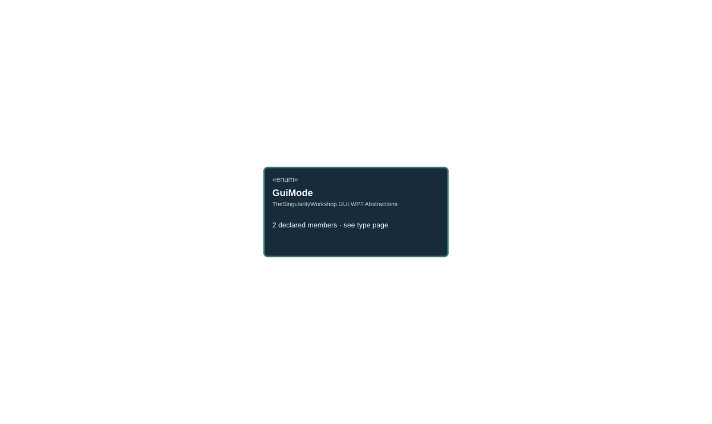

<!-- The Singularity Workshop moniker -->

# TheSingularityWorkshop.GUI.WPF.Abstractions.GuiMode

> Generated from compiler-backed source analysis. Do not edit by hand.

- Repository: `TrentBest/TheSingularityWorkshop.GUI`
- Revision: [`f48dd15256521c88fad88371742c89d5fd1d326f`](https://github.com/TrentBest/TheSingularityWorkshop.GUI/tree/f48dd15256521c88fad88371742c89d5fd1d326f)
- Project: `src/WPF/TheSingularityWorkshop.GUI.WPF.csproj`
- Type ID: `type:TheSingularityWorkshop.GUI.WPF, Version=0.1.0.0, Culture=neutral, PublicKeyToken=null:global::TheSingularityWorkshop.GUI.WPF.Abstractions.GuiMode`
- Metadata name: `GuiMode`
- Kind: `enum`
- Generic arity: 0

## UML diagram

## Source declarations

- [`src/WPF/GuiMode.cs:3-3`](https://github.com/TrentBest/TheSingularityWorkshop.GUI/blob/f48dd15256521c88fad88371742c89d5fd1d326f/src/WPF/GuiMode.cs#L3-3)

## Members

| Kind | Signature | Source |
|---|---|---|
| `Field` | `TheSingularityWorkshop.GUI.WPF.Abstractions.GuiMode.Interactable` | [`src/WPF/GuiMode.cs:3-3`](https://github.com/TrentBest/TheSingularityWorkshop.GUI/blob/f48dd15256521c88fad88371742c89d5fd1d326f/src/WPF/GuiMode.cs#L3-3) |
| `Field` | `TheSingularityWorkshop.GUI.WPF.Abstractions.GuiMode.Reporting` | [`src/WPF/GuiMode.cs:3-3`](https://github.com/TrentBest/TheSingularityWorkshop.GUI/blob/f48dd15256521c88fad88371742c89d5fd1d326f/src/WPF/GuiMode.cs#L3-3) |

## Relationships

_No relationships were recorded by this analysis mode._

[Back to the generated type index](index.md)

---

<!-- THE SINGULARITY WORKSHOP FOOTER -->

