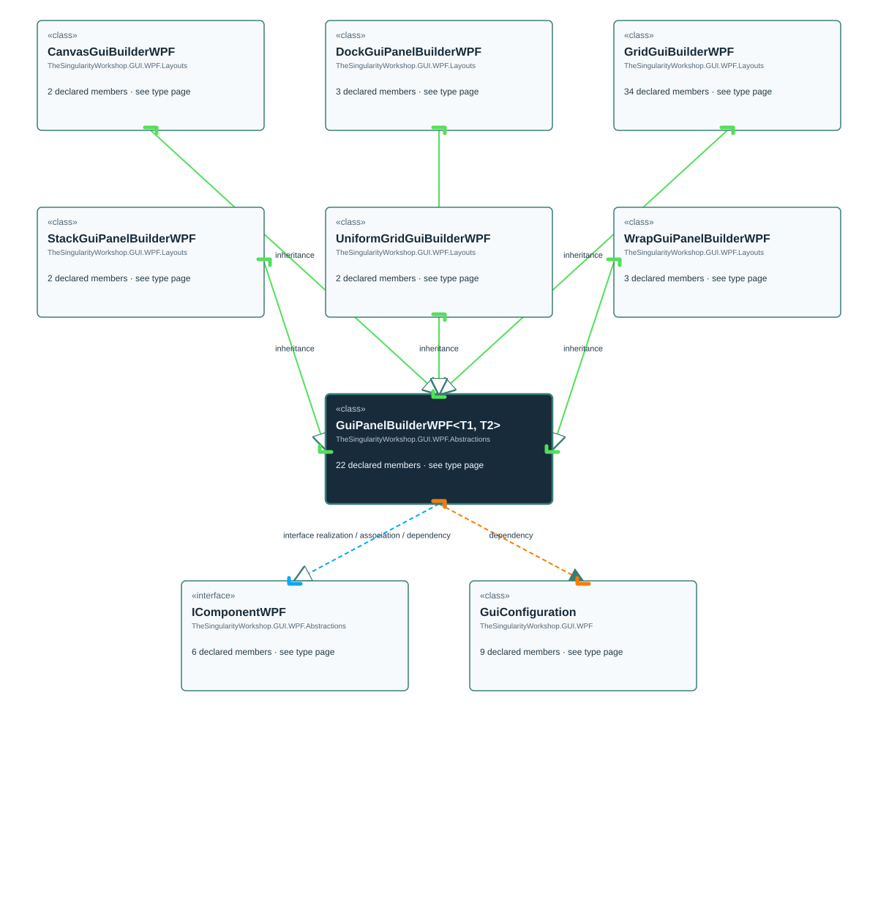

<!-- The Singularity Workshop moniker -->

# TheSingularityWorkshop.GUI.WPF.Abstractions.GuiPanelBuilderWPF

> Generated from compiler-backed source analysis. Do not edit by hand.

- Repository: `TrentBest/TheSingularityWorkshop.GUI`
- Revision: [`0f256ace8cf4a63c92d5edefcf667f2ee0238ee4`](https://github.com/TrentBest/TheSingularityWorkshop.GUI/tree/0f256ace8cf4a63c92d5edefcf667f2ee0238ee4)
- Project: `src/WPF/TheSingularityWorkshop.GUI.WPF.csproj`
- Type ID: `type:TheSingularityWorkshop.GUI.WPF, Version=0.1.0.0, Culture=neutral, PublicKeyToken=null:global::TheSingularityWorkshop.GUI.WPF.Abstractions.GuiPanelBuilderWPF<TPanel, TBuilder>`
- Metadata name: `GuiPanelBuilderWPF'2`
- Kind: `class`
- Generic arity: 2

## UML diagram

## Source declarations

- [`src/WPF/GuiPanelBuilderWPF.cs:14-175`](https://github.com/TrentBest/TheSingularityWorkshop.GUI/blob/0f256ace8cf4a63c92d5edefcf667f2ee0238ee4/src/WPF/GuiPanelBuilderWPF.cs#L14-175)

## Members

| Kind | Signature | Source |
|---|---|---|
| `Property` | `TheSingularityWorkshop.GUI.WPF.Abstractions.GuiPanelBuilderWPF<TPanel, TBuilder>.Actual` | [`src/WPF/GuiPanelBuilderWPF.cs:34-34`](https://github.com/TrentBest/TheSingularityWorkshop.GUI/blob/0f256ace8cf4a63c92d5edefcf667f2ee0238ee4/src/WPF/GuiPanelBuilderWPF.cs#L34-34) |
| `Method` | `TheSingularityWorkshop.GUI.WPF.Abstractions.GuiPanelBuilderWPF<TPanel, TBuilder>.Actual.get` | [`src/WPF/GuiPanelBuilderWPF.cs:34-34`](https://github.com/TrentBest/TheSingularityWorkshop.GUI/blob/0f256ace8cf4a63c92d5edefcf667f2ee0238ee4/src/WPF/GuiPanelBuilderWPF.cs#L34-34) |
| `Method` | `TheSingularityWorkshop.GUI.WPF.Abstractions.GuiPanelBuilderWPF<TPanel, TBuilder>.Add<T>(System.Action<T>)` | [`src/WPF/GuiPanelBuilderWPF.cs:83-91`](https://github.com/TrentBest/TheSingularityWorkshop.GUI/blob/0f256ace8cf4a63c92d5edefcf667f2ee0238ee4/src/WPF/GuiPanelBuilderWPF.cs#L83-91) |
| `Method` | `TheSingularityWorkshop.GUI.WPF.Abstractions.GuiPanelBuilderWPF<TPanel, TBuilder>.AddComponent(TheSingularityWorkshop.GUI.WPF.Abstractions.IComponentWPF)` | [`src/WPF/GuiPanelBuilderWPF.cs:96-104`](https://github.com/TrentBest/TheSingularityWorkshop.GUI/blob/0f256ace8cf4a63c92d5edefcf667f2ee0238ee4/src/WPF/GuiPanelBuilderWPF.cs#L96-104) |
| `Method` | `TheSingularityWorkshop.GUI.WPF.Abstractions.GuiPanelBuilderWPF<TPanel, TBuilder>.Build()` | [`src/WPF/GuiPanelBuilderWPF.cs:146-154`](https://github.com/TrentBest/TheSingularityWorkshop.GUI/blob/0f256ace8cf4a63c92d5edefcf667f2ee0238ee4/src/WPF/GuiPanelBuilderWPF.cs#L146-154) |
| `Method` | `TheSingularityWorkshop.GUI.WPF.Abstractions.GuiPanelBuilderWPF<TPanel, TBuilder>.Capture()` | [`src/WPF/GuiPanelBuilderWPF.cs:159-174`](https://github.com/TrentBest/TheSingularityWorkshop.GUI/blob/0f256ace8cf4a63c92d5edefcf667f2ee0238ee4/src/WPF/GuiPanelBuilderWPF.cs#L159-174) |
| `Method` | `TheSingularityWorkshop.GUI.WPF.Abstractions.GuiPanelBuilderWPF<TPanel, TBuilder>.GetBuilderId()` | [`src/WPF/GuiPanelBuilderWPF.cs:63-63`](https://github.com/TrentBest/TheSingularityWorkshop.GUI/blob/0f256ace8cf4a63c92d5edefcf667f2ee0238ee4/src/WPF/GuiPanelBuilderWPF.cs#L63-63) |
| `Method` | `TheSingularityWorkshop.GUI.WPF.Abstractions.GuiPanelBuilderWPF<TPanel, TBuilder>.GetParent()` | [`src/WPF/GuiPanelBuilderWPF.cs:67-67`](https://github.com/TrentBest/TheSingularityWorkshop.GUI/blob/0f256ace8cf4a63c92d5edefcf667f2ee0238ee4/src/WPF/GuiPanelBuilderWPF.cs#L67-67) |
| `Method` | `TheSingularityWorkshop.GUI.WPF.Abstractions.GuiPanelBuilderWPF<TPanel, TBuilder>.GuiPanelBuilderWPF(TheSingularityWorkshop.GUI.WPF.GuiConfiguration)` | [`src/WPF/GuiPanelBuilderWPF.cs:41-56`](https://github.com/TrentBest/TheSingularityWorkshop.GUI/blob/0f256ace8cf4a63c92d5edefcf667f2ee0238ee4/src/WPF/GuiPanelBuilderWPF.cs#L41-56) |
| `Property` | `TheSingularityWorkshop.GUI.WPF.Abstractions.GuiPanelBuilderWPF<TPanel, TBuilder>.Id` | [`src/WPF/GuiPanelBuilderWPF.cs:23-23`](https://github.com/TrentBest/TheSingularityWorkshop.GUI/blob/0f256ace8cf4a63c92d5edefcf667f2ee0238ee4/src/WPF/GuiPanelBuilderWPF.cs#L23-23) |
| `Method` | `TheSingularityWorkshop.GUI.WPF.Abstractions.GuiPanelBuilderWPF<TPanel, TBuilder>.Id.get` | [`src/WPF/GuiPanelBuilderWPF.cs:23-23`](https://github.com/TrentBest/TheSingularityWorkshop.GUI/blob/0f256ace8cf4a63c92d5edefcf667f2ee0238ee4/src/WPF/GuiPanelBuilderWPF.cs#L23-23) |
| `Method` | `TheSingularityWorkshop.GUI.WPF.Abstractions.GuiPanelBuilderWPF<TPanel, TBuilder>.Publish(string, object)` | [`src/WPF/GuiPanelBuilderWPF.cs:72-72`](https://github.com/TrentBest/TheSingularityWorkshop.GUI/blob/0f256ace8cf4a63c92d5edefcf667f2ee0238ee4/src/WPF/GuiPanelBuilderWPF.cs#L72-72) |
| `Method` | `TheSingularityWorkshop.GUI.WPF.Abstractions.GuiPanelBuilderWPF<TPanel, TBuilder>.Receive(string, object)` | [`src/WPF/GuiPanelBuilderWPF.cs:77-77`](https://github.com/TrentBest/TheSingularityWorkshop.GUI/blob/0f256ace8cf4a63c92d5edefcf667f2ee0238ee4/src/WPF/GuiPanelBuilderWPF.cs#L77-77) |
| `Method` | `TheSingularityWorkshop.GUI.WPF.Abstractions.GuiPanelBuilderWPF<TPanel, TBuilder>.RegisterChildComponent(TheSingularityWorkshop.GUI.WPF.Abstractions.IComponentWPF)` | [`src/WPF/GuiPanelBuilderWPF.cs:109-122`](https://github.com/TrentBest/TheSingularityWorkshop.GUI/blob/0f256ace8cf4a63c92d5edefcf667f2ee0238ee4/src/WPF/GuiPanelBuilderWPF.cs#L109-122) |
| `Method` | `TheSingularityWorkshop.GUI.WPF.Abstractions.GuiPanelBuilderWPF<TPanel, TBuilder>.RegisterRawElement(System.Windows.UIElement)` | [`src/WPF/GuiPanelBuilderWPF.cs:127-142`](https://github.com/TrentBest/TheSingularityWorkshop.GUI/blob/0f256ace8cf4a63c92d5edefcf667f2ee0238ee4/src/WPF/GuiPanelBuilderWPF.cs#L127-142) |
| `Property` | `TheSingularityWorkshop.GUI.WPF.Abstractions.GuiPanelBuilderWPF<TPanel, TBuilder>.Root` | [`src/WPF/GuiPanelBuilderWPF.cs:19-19`](https://github.com/TrentBest/TheSingularityWorkshop.GUI/blob/0f256ace8cf4a63c92d5edefcf667f2ee0238ee4/src/WPF/GuiPanelBuilderWPF.cs#L19-19) |
| `Method` | `TheSingularityWorkshop.GUI.WPF.Abstractions.GuiPanelBuilderWPF<TPanel, TBuilder>.Root.get` | [`src/WPF/GuiPanelBuilderWPF.cs:19-19`](https://github.com/TrentBest/TheSingularityWorkshop.GUI/blob/0f256ace8cf4a63c92d5edefcf667f2ee0238ee4/src/WPF/GuiPanelBuilderWPF.cs#L19-19) |
| `Method` | `TheSingularityWorkshop.GUI.WPF.Abstractions.GuiPanelBuilderWPF<TPanel, TBuilder>.SetParent(TheSingularityWorkshop.GUI.WPF.Abstractions.IComponentWPF?)` | [`src/WPF/GuiPanelBuilderWPF.cs:60-60`](https://github.com/TrentBest/TheSingularityWorkshop.GUI/blob/0f256ace8cf4a63c92d5edefcf667f2ee0238ee4/src/WPF/GuiPanelBuilderWPF.cs#L60-60) |
| `Field` | `TheSingularityWorkshop.GUI.WPF.Abstractions.GuiPanelBuilderWPF<TPanel, TBuilder>._definitionRoster` | [`src/WPF/GuiPanelBuilderWPF.cs:26-26`](https://github.com/TrentBest/TheSingularityWorkshop.GUI/blob/0f256ace8cf4a63c92d5edefcf667f2ee0238ee4/src/WPF/GuiPanelBuilderWPF.cs#L26-26) |
| `Field` | `TheSingularityWorkshop.GUI.WPF.Abstractions.GuiPanelBuilderWPF<TPanel, TBuilder>._parent` | [`src/WPF/GuiPanelBuilderWPF.cs:21-21`](https://github.com/TrentBest/TheSingularityWorkshop.GUI/blob/0f256ace8cf4a63c92d5edefcf667f2ee0238ee4/src/WPF/GuiPanelBuilderWPF.cs#L21-21) |
| `Field` | `TheSingularityWorkshop.GUI.WPF.Abstractions.GuiPanelBuilderWPF<TPanel, TBuilder>._registeredComponents` | [`src/WPF/GuiPanelBuilderWPF.cs:29-29`](https://github.com/TrentBest/TheSingularityWorkshop.GUI/blob/0f256ace8cf4a63c92d5edefcf667f2ee0238ee4/src/WPF/GuiPanelBuilderWPF.cs#L29-29) |
| `Field` | `TheSingularityWorkshop.GUI.WPF.Abstractions.GuiPanelBuilderWPF<TPanel, TBuilder>._registeredRawElements` | [`src/WPF/GuiPanelBuilderWPF.cs:30-30`](https://github.com/TrentBest/TheSingularityWorkshop.GUI/blob/0f256ace8cf4a63c92d5edefcf667f2ee0238ee4/src/WPF/GuiPanelBuilderWPF.cs#L30-30) |

## Relationships

| Direction | Kind | Related type | Resolution | Evidence |
|---|---|---|---|---|
| incoming | `Inheritance` | `TheSingularityWorkshop.GUI.WPF.Layouts.CanvasGuiBuilderWPF` | `Resolved` | [`src/WPF/CanvasGuiBuilderWPF.cs:9-31`](https://github.com/TrentBest/TheSingularityWorkshop.GUI/blob/0f256ace8cf4a63c92d5edefcf667f2ee0238ee4/src/WPF/CanvasGuiBuilderWPF.cs#L9-31) |
| incoming | `Inheritance` | `TheSingularityWorkshop.GUI.WPF.Layouts.DockGuiPanelBuilderWPF` | `Resolved` | [`src/WPF/DockGuiPanelBuilderWPF.cs:8-36`](https://github.com/TrentBest/TheSingularityWorkshop.GUI/blob/0f256ace8cf4a63c92d5edefcf667f2ee0238ee4/src/WPF/DockGuiPanelBuilderWPF.cs#L8-36) |
| incoming | `Inheritance` | `TheSingularityWorkshop.GUI.WPF.Layouts.GridGuiBuilderWPF` | `Resolved` | [`src/WPF/GridGuiBuilderWPF.cs:17-330`](https://github.com/TrentBest/TheSingularityWorkshop.GUI/blob/0f256ace8cf4a63c92d5edefcf667f2ee0238ee4/src/WPF/GridGuiBuilderWPF.cs#L17-330) |
| incoming | `Inheritance` | `TheSingularityWorkshop.GUI.WPF.Layouts.StackGuiPanelBuilderWPF` | `Resolved` | [`src/WPF/StackGuiPanelBuilderWPF.cs:6-15`](https://github.com/TrentBest/TheSingularityWorkshop.GUI/blob/0f256ace8cf4a63c92d5edefcf667f2ee0238ee4/src/WPF/StackGuiPanelBuilderWPF.cs#L6-15) |
| incoming | `Inheritance` | `TheSingularityWorkshop.GUI.WPF.Layouts.UniformGridGuiBuilderWPF` | `Resolved` | [`src/WPF/UniformGridGuiPanelBuilderWPF.cs:6-18`](https://github.com/TrentBest/TheSingularityWorkshop.GUI/blob/0f256ace8cf4a63c92d5edefcf667f2ee0238ee4/src/WPF/UniformGridGuiPanelBuilderWPF.cs#L6-18) |
| incoming | `Inheritance` | `TheSingularityWorkshop.GUI.WPF.Layouts.WrapGuiPanelBuilderWPF` | `Resolved` | [`src/WPF/WrapGuiPanelBuilderWPF.cs:6-24`](https://github.com/TrentBest/TheSingularityWorkshop.GUI/blob/0f256ace8cf4a63c92d5edefcf667f2ee0238ee4/src/WPF/WrapGuiPanelBuilderWPF.cs#L6-24) |
| outgoing | `InterfaceRealization` | `TheSingularityWorkshop.GUI.WPF.Abstractions.IComponentWPF` | `Resolved` | [`src/WPF/GuiPanelBuilderWPF.cs:14-175`](https://github.com/TrentBest/TheSingularityWorkshop.GUI/blob/0f256ace8cf4a63c92d5edefcf667f2ee0238ee4/src/WPF/GuiPanelBuilderWPF.cs#L14-175) |
| outgoing | `Association` | `TheSingularityWorkshop.GUI.WPF.Abstractions.IComponentWPF` | `Resolved` | [`src/WPF/GuiPanelBuilderWPF.cs:21-21`](https://github.com/TrentBest/TheSingularityWorkshop.GUI/blob/0f256ace8cf4a63c92d5edefcf667f2ee0238ee4/src/WPF/GuiPanelBuilderWPF.cs#L21-21) |
| outgoing | `Association` | `TheSingularityWorkshop.GUI.WPF.Abstractions.IComponentWPF` | `Resolved` | [`src/WPF/GuiPanelBuilderWPF.cs:29-29`](https://github.com/TrentBest/TheSingularityWorkshop.GUI/blob/0f256ace8cf4a63c92d5edefcf667f2ee0238ee4/src/WPF/GuiPanelBuilderWPF.cs#L29-29) |
| outgoing | `Dependency` | `TheSingularityWorkshop.GUI.WPF.Abstractions.IComponentWPF` | `Resolved` | [`src/WPF/GuiPanelBuilderWPF.cs:96-104`](https://github.com/TrentBest/TheSingularityWorkshop.GUI/blob/0f256ace8cf4a63c92d5edefcf667f2ee0238ee4/src/WPF/GuiPanelBuilderWPF.cs#L96-104) |
| outgoing | `Dependency` | `TheSingularityWorkshop.GUI.WPF.Abstractions.IComponentWPF` | `Resolved` | [`src/WPF/GuiPanelBuilderWPF.cs:109-122`](https://github.com/TrentBest/TheSingularityWorkshop.GUI/blob/0f256ace8cf4a63c92d5edefcf667f2ee0238ee4/src/WPF/GuiPanelBuilderWPF.cs#L109-122) |
| outgoing | `Dependency` | `TheSingularityWorkshop.GUI.WPF.Abstractions.IComponentWPF` | `Resolved` | [`src/WPF/GuiPanelBuilderWPF.cs:60-60`](https://github.com/TrentBest/TheSingularityWorkshop.GUI/blob/0f256ace8cf4a63c92d5edefcf667f2ee0238ee4/src/WPF/GuiPanelBuilderWPF.cs#L60-60) |
| outgoing | `Dependency` | `TheSingularityWorkshop.GUI.WPF.Abstractions.IComponentWPF` | `Resolved` | [`src/WPF/GuiPanelBuilderWPF.cs:67-67`](https://github.com/TrentBest/TheSingularityWorkshop.GUI/blob/0f256ace8cf4a63c92d5edefcf667f2ee0238ee4/src/WPF/GuiPanelBuilderWPF.cs#L67-67) |
| outgoing | `Dependency` | `TheSingularityWorkshop.GUI.WPF.GuiConfiguration` | `Resolved` | [`src/WPF/GuiPanelBuilderWPF.cs:41-56`](https://github.com/TrentBest/TheSingularityWorkshop.GUI/blob/0f256ace8cf4a63c92d5edefcf667f2ee0238ee4/src/WPF/GuiPanelBuilderWPF.cs#L41-56) |
| outgoing | `Dependency` | `TheSingularityWorkshop.GUI.WPF.GuiConfiguration` | `Resolved` | [`src/WPF/GuiPanelBuilderWPF.cs:159-174`](https://github.com/TrentBest/TheSingularityWorkshop.GUI/blob/0f256ace8cf4a63c92d5edefcf667f2ee0238ee4/src/WPF/GuiPanelBuilderWPF.cs#L159-174) |

[Back to the generated type index](index.md)

---

<!-- THE SINGULARITY WORKSHOP FOOTER -->

