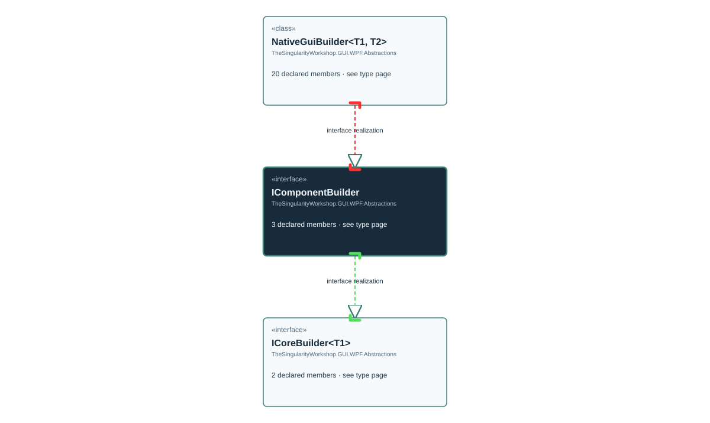

# TheSingularityWorkshop.GUI.WPF.Abstractions.IComponentBuilder

> Generated from compiler-backed source analysis. Do not edit by hand.

- Repository: `TrentBest/TheSingularityWorkshop.GUI`
- Revision: [`3844b48b1a30f678cb8aa80c2a21aaaceed9348b`](https://github.com/TrentBest/TheSingularityWorkshop.GUI/tree/3844b48b1a30f678cb8aa80c2a21aaaceed9348b)
- Project: `src/WPF/TheSingularityWorkshop.GUI.WPF.csproj`
- Type ID: `type:TheSingularityWorkshop.GUI.WPF, Version=0.1.0.0, Culture=neutral, PublicKeyToken=null:global::TheSingularityWorkshop.GUI.WPF.Abstractions.IComponentBuilder`
- Metadata name: `IComponentBuilder`
- Kind: `interface`
- Generic arity: 0

## UML diagram

## Source declarations

- [`src/WPF/IComponentBuilder.cs:9-16`](https://github.com/TrentBest/TheSingularityWorkshop.GUI/blob/3844b48b1a30f678cb8aa80c2a21aaaceed9348b/src/WPF/IComponentBuilder.cs#L9-16)

## Members

| Kind | Signature | Source |
|---|---|---|
| `Property` | `TheSingularityWorkshop.GUI.WPF.Abstractions.IComponentBuilder.Parent` | [`src/WPF/IComponentBuilder.cs:15-15`](https://github.com/TrentBest/TheSingularityWorkshop.GUI/blob/3844b48b1a30f678cb8aa80c2a21aaaceed9348b/src/WPF/IComponentBuilder.cs#L15-15) |
| `Method` | `TheSingularityWorkshop.GUI.WPF.Abstractions.IComponentBuilder.Parent.get` | [`src/WPF/IComponentBuilder.cs:15-15`](https://github.com/TrentBest/TheSingularityWorkshop.GUI/blob/3844b48b1a30f678cb8aa80c2a21aaaceed9348b/src/WPF/IComponentBuilder.cs#L15-15) |
| `Method` | `TheSingularityWorkshop.GUI.WPF.Abstractions.IComponentBuilder.Parent.set` | [`src/WPF/IComponentBuilder.cs:15-15`](https://github.com/TrentBest/TheSingularityWorkshop.GUI/blob/3844b48b1a30f678cb8aa80c2a21aaaceed9348b/src/WPF/IComponentBuilder.cs#L15-15) |

## Relationships

| Direction | Kind | Related type | Resolution | Evidence |
|---|---|---|---|---|
| outgoing | `InterfaceRealization` | `TheSingularityWorkshop.GUI.WPF.Abstractions.ICoreBuilder` | `Resolved` | [`src/WPF/IComponentBuilder.cs:9-16`](https://github.com/TrentBest/TheSingularityWorkshop.GUI/blob/3844b48b1a30f678cb8aa80c2a21aaaceed9348b/src/WPF/IComponentBuilder.cs#L9-16) |
| incoming | `InterfaceRealization` | `TheSingularityWorkshop.GUI.WPF.Abstractions.NativeGuiBuilder` | `Resolved` | [`src/WPF/NativeGuiBuilder.cs:14-123`](https://github.com/TrentBest/TheSingularityWorkshop.GUI/blob/3844b48b1a30f678cb8aa80c2a21aaaceed9348b/src/WPF/NativeGuiBuilder.cs#L14-123) |

[Back to the generated type index](index.md)

