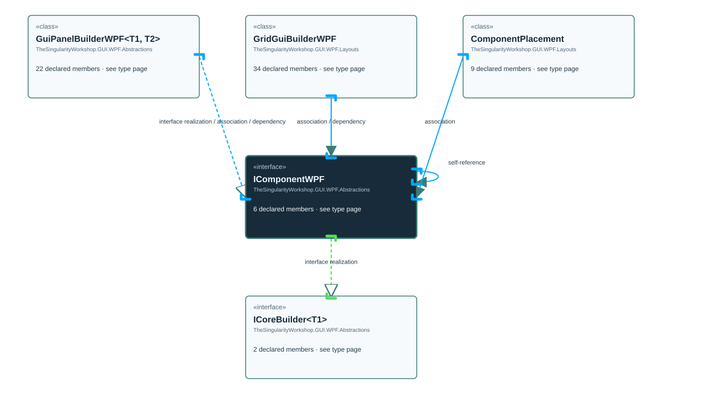

<!-- The Singularity Workshop moniker -->

# TheSingularityWorkshop.GUI.WPF.Abstractions.IComponentWPF

> Generated from compiler-backed source analysis. Do not edit by hand.

- Repository: `TrentBest/TheSingularityWorkshop.GUI`
- Revision: [`d01597026d83f798e62a2a144bfd9400a3cd44a8`](https://github.com/TrentBest/TheSingularityWorkshop.GUI/tree/d01597026d83f798e62a2a144bfd9400a3cd44a8)
- Project: `src/WPF/TheSingularityWorkshop.GUI.WPF.csproj`
- Type ID: `type:TheSingularityWorkshop.GUI.WPF, Version=0.1.0.0, Culture=neutral, PublicKeyToken=null:global::TheSingularityWorkshop.GUI.WPF.Abstractions.IComponentWPF`
- Metadata name: `IComponentWPF`
- Kind: `interface`
- Generic arity: 0

## UML diagram

## Source declarations

- [`src/WPF/IComponentWPF.cs:9-25`](https://github.com/TrentBest/TheSingularityWorkshop.GUI/blob/d01597026d83f798e62a2a144bfd9400a3cd44a8/src/WPF/IComponentWPF.cs#L9-25)

## Members

| Kind | Signature | Source |
|---|---|---|
| `Method` | `TheSingularityWorkshop.GUI.WPF.Abstractions.IComponentWPF.GetParent()` | [`src/WPF/IComponentWPF.cs:18-18`](https://github.com/TrentBest/TheSingularityWorkshop.GUI/blob/d01597026d83f798e62a2a144bfd9400a3cd44a8/src/WPF/IComponentWPF.cs#L18-18) |
| `Property` | `TheSingularityWorkshop.GUI.WPF.Abstractions.IComponentWPF.Id` | [`src/WPF/IComponentWPF.cs:12-12`](https://github.com/TrentBest/TheSingularityWorkshop.GUI/blob/d01597026d83f798e62a2a144bfd9400a3cd44a8/src/WPF/IComponentWPF.cs#L12-12) |
| `Method` | `TheSingularityWorkshop.GUI.WPF.Abstractions.IComponentWPF.Id.get` | [`src/WPF/IComponentWPF.cs:12-12`](https://github.com/TrentBest/TheSingularityWorkshop.GUI/blob/d01597026d83f798e62a2a144bfd9400a3cd44a8/src/WPF/IComponentWPF.cs#L12-12) |
| `Method` | `TheSingularityWorkshop.GUI.WPF.Abstractions.IComponentWPF.Publish(string, object)` | [`src/WPF/IComponentWPF.cs:21-21`](https://github.com/TrentBest/TheSingularityWorkshop.GUI/blob/d01597026d83f798e62a2a144bfd9400a3cd44a8/src/WPF/IComponentWPF.cs#L21-21) |
| `Method` | `TheSingularityWorkshop.GUI.WPF.Abstractions.IComponentWPF.Receive(string, object)` | [`src/WPF/IComponentWPF.cs:24-24`](https://github.com/TrentBest/TheSingularityWorkshop.GUI/blob/d01597026d83f798e62a2a144bfd9400a3cd44a8/src/WPF/IComponentWPF.cs#L24-24) |
| `Method` | `TheSingularityWorkshop.GUI.WPF.Abstractions.IComponentWPF.SetParent(TheSingularityWorkshop.GUI.WPF.Abstractions.IComponentWPF?)` | [`src/WPF/IComponentWPF.cs:15-15`](https://github.com/TrentBest/TheSingularityWorkshop.GUI/blob/d01597026d83f798e62a2a144bfd9400a3cd44a8/src/WPF/IComponentWPF.cs#L15-15) |

## Relationships

| Direction | Kind | Related type | Resolution | Evidence |
|---|---|---|---|---|
| incoming | `InterfaceRealization` | `TheSingularityWorkshop.GUI.WPF.Abstractions.GuiPanelBuilderWPF` | `Resolved` | [`src/WPF/GuiPanelBuilderWPF.cs:14-175`](https://github.com/TrentBest/TheSingularityWorkshop.GUI/blob/d01597026d83f798e62a2a144bfd9400a3cd44a8/src/WPF/GuiPanelBuilderWPF.cs#L14-175) |
| outgoing | `InterfaceRealization` | `TheSingularityWorkshop.GUI.WPF.Abstractions.ICoreBuilder` | `Resolved` | [`src/WPF/IComponentWPF.cs:9-25`](https://github.com/TrentBest/TheSingularityWorkshop.GUI/blob/d01597026d83f798e62a2a144bfd9400a3cd44a8/src/WPF/IComponentWPF.cs#L9-25) |
| incoming | `Association` | `TheSingularityWorkshop.GUI.WPF.Abstractions.GuiPanelBuilderWPF` | `Resolved` | [`src/WPF/GuiPanelBuilderWPF.cs:21-21`](https://github.com/TrentBest/TheSingularityWorkshop.GUI/blob/d01597026d83f798e62a2a144bfd9400a3cd44a8/src/WPF/GuiPanelBuilderWPF.cs#L21-21) |
| incoming | `Association` | `TheSingularityWorkshop.GUI.WPF.Abstractions.GuiPanelBuilderWPF` | `Resolved` | [`src/WPF/GuiPanelBuilderWPF.cs:29-29`](https://github.com/TrentBest/TheSingularityWorkshop.GUI/blob/d01597026d83f798e62a2a144bfd9400a3cd44a8/src/WPF/GuiPanelBuilderWPF.cs#L29-29) |
| incoming | `Association` | `TheSingularityWorkshop.GUI.WPF.Layouts.GridGuiBuilderWPF` | `Resolved` | [`src/WPF/GridGuiBuilderWPF.cs:32-32`](https://github.com/TrentBest/TheSingularityWorkshop.GUI/blob/d01597026d83f798e62a2a144bfd9400a3cd44a8/src/WPF/GridGuiBuilderWPF.cs#L32-32) |
| incoming | `Association` | `TheSingularityWorkshop.GUI.WPF.Layouts.GridGuiBuilderWPF` | `Resolved` | [`src/WPF/GridGuiBuilderWPF.cs:38-42`](https://github.com/TrentBest/TheSingularityWorkshop.GUI/blob/d01597026d83f798e62a2a144bfd9400a3cd44a8/src/WPF/GridGuiBuilderWPF.cs#L38-42) |
| incoming | `Association` | `TheSingularityWorkshop.GUI.WPF.Layouts.GridGuiBuilderWPF.ComponentPlacement` | `Resolved` | [`src/WPF/GridGuiBuilderWPF.cs:329-329`](https://github.com/TrentBest/TheSingularityWorkshop.GUI/blob/d01597026d83f798e62a2a144bfd9400a3cd44a8/src/WPF/GridGuiBuilderWPF.cs#L329-329) |
| incoming | `Dependency` | `TheSingularityWorkshop.GUI.WPF.Abstractions.GuiPanelBuilderWPF` | `Resolved` | [`src/WPF/GuiPanelBuilderWPF.cs:96-104`](https://github.com/TrentBest/TheSingularityWorkshop.GUI/blob/d01597026d83f798e62a2a144bfd9400a3cd44a8/src/WPF/GuiPanelBuilderWPF.cs#L96-104) |
| incoming | `Dependency` | `TheSingularityWorkshop.GUI.WPF.Abstractions.GuiPanelBuilderWPF` | `Resolved` | [`src/WPF/GuiPanelBuilderWPF.cs:109-122`](https://github.com/TrentBest/TheSingularityWorkshop.GUI/blob/d01597026d83f798e62a2a144bfd9400a3cd44a8/src/WPF/GuiPanelBuilderWPF.cs#L109-122) |
| incoming | `Dependency` | `TheSingularityWorkshop.GUI.WPF.Abstractions.GuiPanelBuilderWPF` | `Resolved` | [`src/WPF/GuiPanelBuilderWPF.cs:60-60`](https://github.com/TrentBest/TheSingularityWorkshop.GUI/blob/d01597026d83f798e62a2a144bfd9400a3cd44a8/src/WPF/GuiPanelBuilderWPF.cs#L60-60) |
| incoming | `Dependency` | `TheSingularityWorkshop.GUI.WPF.Abstractions.GuiPanelBuilderWPF` | `Resolved` | [`src/WPF/GuiPanelBuilderWPF.cs:67-67`](https://github.com/TrentBest/TheSingularityWorkshop.GUI/blob/d01597026d83f798e62a2a144bfd9400a3cd44a8/src/WPF/GuiPanelBuilderWPF.cs#L67-67) |
| outgoing | `Dependency` | `TheSingularityWorkshop.GUI.WPF.Abstractions.IComponentWPF` | `Resolved` | [`src/WPF/IComponentWPF.cs:15-15`](https://github.com/TrentBest/TheSingularityWorkshop.GUI/blob/d01597026d83f798e62a2a144bfd9400a3cd44a8/src/WPF/IComponentWPF.cs#L15-15) |
| outgoing | `Dependency` | `TheSingularityWorkshop.GUI.WPF.Abstractions.IComponentWPF` | `Resolved` | [`src/WPF/IComponentWPF.cs:18-18`](https://github.com/TrentBest/TheSingularityWorkshop.GUI/blob/d01597026d83f798e62a2a144bfd9400a3cd44a8/src/WPF/IComponentWPF.cs#L18-18) |
| incoming | `Dependency` | `TheSingularityWorkshop.GUI.WPF.Layouts.GridGuiBuilderWPF` | `Resolved` | [`src/WPF/GridGuiBuilderWPF.cs:210-216`](https://github.com/TrentBest/TheSingularityWorkshop.GUI/blob/d01597026d83f798e62a2a144bfd9400a3cd44a8/src/WPF/GridGuiBuilderWPF.cs#L210-216) |

[Back to the generated type index](index.md)

---

<!-- THE SINGULARITY WORKSHOP FOOTER -->

