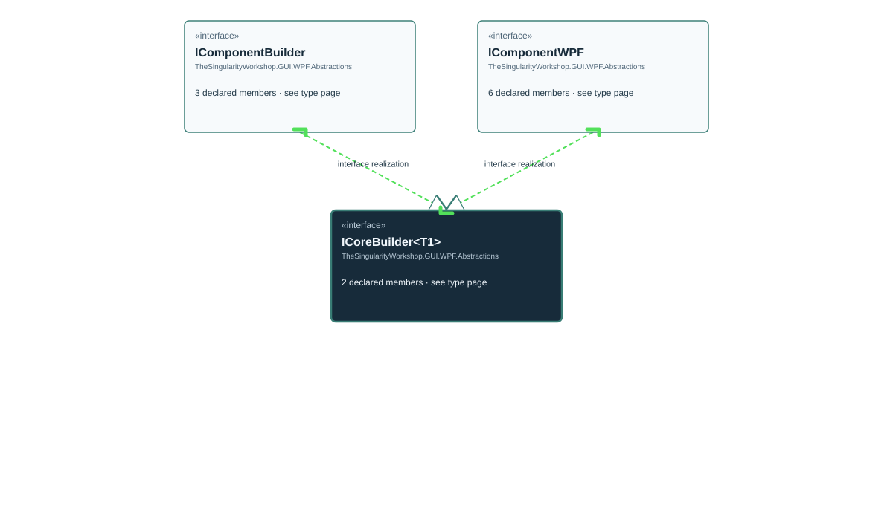

# TheSingularityWorkshop.GUI.WPF.Abstractions.ICoreBuilder

> Generated from compiler-backed source analysis. Do not edit by hand.

- Repository: `TrentBest/TheSingularityWorkshop.GUI`
- Revision: [`0644fd4a6c6dc743fb9882f25358651ebbed954b`](https://github.com/TrentBest/TheSingularityWorkshop.GUI/tree/0644fd4a6c6dc743fb9882f25358651ebbed954b)
- Project: `src/WPF/TheSingularityWorkshop.GUI.WPF.csproj`
- Type ID: `type:TheSingularityWorkshop.GUI.WPF, Version=0.1.0.0, Culture=neutral, PublicKeyToken=null:global::TheSingularityWorkshop.GUI.WPF.Abstractions.ICoreBuilder<TProduct>`
- Metadata name: `ICoreBuilder'1`
- Kind: `interface`
- Generic arity: 1

## UML diagram

## Source declarations

- [`src/WPF/ICoreBuilder.cs:7-18`](https://github.com/TrentBest/TheSingularityWorkshop.GUI/blob/0644fd4a6c6dc743fb9882f25358651ebbed954b/src/WPF/ICoreBuilder.cs#L7-18)

## Members

| Kind | Signature | Source |
|---|---|---|
| `Method` | `TheSingularityWorkshop.GUI.WPF.Abstractions.ICoreBuilder<TProduct>.Build()` | [`src/WPF/ICoreBuilder.cs:12-12`](https://github.com/TrentBest/TheSingularityWorkshop.GUI/blob/0644fd4a6c6dc743fb9882f25358651ebbed954b/src/WPF/ICoreBuilder.cs#L12-12) |
| `Method` | `TheSingularityWorkshop.GUI.WPF.Abstractions.ICoreBuilder<TProduct>.GetBuilderId()` | [`src/WPF/ICoreBuilder.cs:17-17`](https://github.com/TrentBest/TheSingularityWorkshop.GUI/blob/0644fd4a6c6dc743fb9882f25358651ebbed954b/src/WPF/ICoreBuilder.cs#L17-17) |

## Relationships

| Direction | Kind | Related type | Resolution | Evidence |
|---|---|---|---|---|
| incoming | `InterfaceRealization` | `TheSingularityWorkshop.GUI.WPF.Abstractions.IComponentBuilder` | `Resolved` | [`src/WPF/IComponentBuilder.cs:9-16`](https://github.com/TrentBest/TheSingularityWorkshop.GUI/blob/0644fd4a6c6dc743fb9882f25358651ebbed954b/src/WPF/IComponentBuilder.cs#L9-16) |
| incoming | `InterfaceRealization` | `TheSingularityWorkshop.GUI.WPF.Abstractions.IComponentWPF` | `Resolved` | [`src/WPF/IComponentWPF.cs:9-25`](https://github.com/TrentBest/TheSingularityWorkshop.GUI/blob/0644fd4a6c6dc743fb9882f25358651ebbed954b/src/WPF/IComponentWPF.cs#L9-25) |

[Back to the generated type index](index.md)

