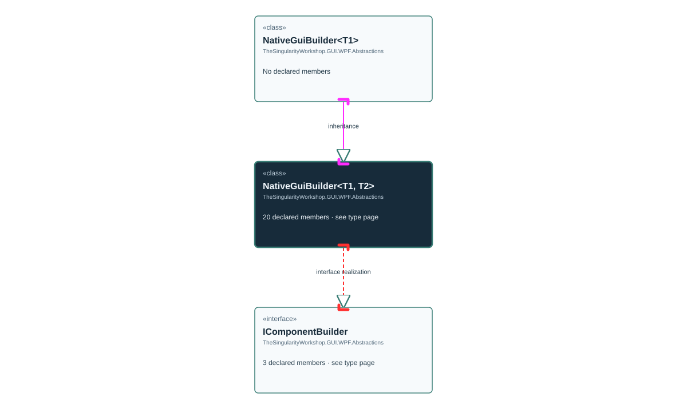

# TheSingularityWorkshop.GUI.WPF.Abstractions.NativeGuiBuilder

> Generated from compiler-backed source analysis. Do not edit by hand.

- Repository: `TrentBest/TheSingularityWorkshop.GUI`
- Revision: [`3844b48b1a30f678cb8aa80c2a21aaaceed9348b`](https://github.com/TrentBest/TheSingularityWorkshop.GUI/tree/3844b48b1a30f678cb8aa80c2a21aaaceed9348b)
- Project: `src/WPF/TheSingularityWorkshop.GUI.WPF.csproj`
- Type ID: `type:TheSingularityWorkshop.GUI.WPF, Version=0.1.0.0, Culture=neutral, PublicKeyToken=null:global::TheSingularityWorkshop.GUI.WPF.Abstractions.NativeGuiBuilder<T, TBuilder>`
- Metadata name: `NativeGuiBuilder'2`
- Kind: `class`
- Generic arity: 2

## UML diagram

## Source declarations

- [`src/WPF/NativeGuiBuilder.cs:14-123`](https://github.com/TrentBest/TheSingularityWorkshop.GUI/blob/3844b48b1a30f678cb8aa80c2a21aaaceed9348b/src/WPF/NativeGuiBuilder.cs#L14-123)

## Members

| Kind | Signature | Source |
|---|---|---|
| `Property` | `TheSingularityWorkshop.GUI.WPF.Abstractions.NativeGuiBuilder<T, TBuilder>.Actual` | [`src/WPF/NativeGuiBuilder.cs:34-34`](https://github.com/TrentBest/TheSingularityWorkshop.GUI/blob/3844b48b1a30f678cb8aa80c2a21aaaceed9348b/src/WPF/NativeGuiBuilder.cs#L34-34) |
| `Method` | `TheSingularityWorkshop.GUI.WPF.Abstractions.NativeGuiBuilder<T, TBuilder>.Actual.get` | [`src/WPF/NativeGuiBuilder.cs:34-34`](https://github.com/TrentBest/TheSingularityWorkshop.GUI/blob/3844b48b1a30f678cb8aa80c2a21aaaceed9348b/src/WPF/NativeGuiBuilder.cs#L34-34) |
| `Method` | `TheSingularityWorkshop.GUI.WPF.Abstractions.NativeGuiBuilder<T, TBuilder>.ApplyDefaultNativeTheme(System.Windows.FrameworkElement)` | [`src/WPF/NativeGuiBuilder.cs:36-46`](https://github.com/TrentBest/TheSingularityWorkshop.GUI/blob/3844b48b1a30f678cb8aa80c2a21aaaceed9348b/src/WPF/NativeGuiBuilder.cs#L36-46) |
| `Method` | `TheSingularityWorkshop.GUI.WPF.Abstractions.NativeGuiBuilder<T, TBuilder>.Build()` | [`src/WPF/NativeGuiBuilder.cs:119-119`](https://github.com/TrentBest/TheSingularityWorkshop.GUI/blob/3844b48b1a30f678cb8aa80c2a21aaaceed9348b/src/WPF/NativeGuiBuilder.cs#L119-119) |
| `Method` | `TheSingularityWorkshop.GUI.WPF.Abstractions.NativeGuiBuilder<T, TBuilder>.Configure(System.Action<T>)` | [`src/WPF/NativeGuiBuilder.cs:111-116`](https://github.com/TrentBest/TheSingularityWorkshop.GUI/blob/3844b48b1a30f678cb8aa80c2a21aaaceed9348b/src/WPF/NativeGuiBuilder.cs#L111-116) |
| `Method` | `TheSingularityWorkshop.GUI.WPF.Abstractions.NativeGuiBuilder<T, TBuilder>.GetBuilderId()` | [`src/WPF/NativeGuiBuilder.cs:122-122`](https://github.com/TrentBest/TheSingularityWorkshop.GUI/blob/3844b48b1a30f678cb8aa80c2a21aaaceed9348b/src/WPF/NativeGuiBuilder.cs#L122-122) |
| `Method` | `TheSingularityWorkshop.GUI.WPF.Abstractions.NativeGuiBuilder<T, TBuilder>.NativeGuiBuilder()` | [`src/WPF/NativeGuiBuilder.cs:27-31`](https://github.com/TrentBest/TheSingularityWorkshop.GUI/blob/3844b48b1a30f678cb8aa80c2a21aaaceed9348b/src/WPF/NativeGuiBuilder.cs#L27-31) |
| `Property` | `TheSingularityWorkshop.GUI.WPF.Abstractions.NativeGuiBuilder<T, TBuilder>.Parent` | [`src/WPF/NativeGuiBuilder.cs:24-24`](https://github.com/TrentBest/TheSingularityWorkshop.GUI/blob/3844b48b1a30f678cb8aa80c2a21aaaceed9348b/src/WPF/NativeGuiBuilder.cs#L24-24) |
| `Method` | `TheSingularityWorkshop.GUI.WPF.Abstractions.NativeGuiBuilder<T, TBuilder>.Parent.get` | [`src/WPF/NativeGuiBuilder.cs:24-24`](https://github.com/TrentBest/TheSingularityWorkshop.GUI/blob/3844b48b1a30f678cb8aa80c2a21aaaceed9348b/src/WPF/NativeGuiBuilder.cs#L24-24) |
| `Method` | `TheSingularityWorkshop.GUI.WPF.Abstractions.NativeGuiBuilder<T, TBuilder>.Parent.set` | [`src/WPF/NativeGuiBuilder.cs:24-24`](https://github.com/TrentBest/TheSingularityWorkshop.GUI/blob/3844b48b1a30f678cb8aa80c2a21aaaceed9348b/src/WPF/NativeGuiBuilder.cs#L24-24) |
| `Method` | `TheSingularityWorkshop.GUI.WPF.Abstractions.NativeGuiBuilder<T, TBuilder>.WithAlignment(System.Windows.HorizontalAlignment, System.Windows.VerticalAlignment)` | [`src/WPF/NativeGuiBuilder.cs:103-108`](https://github.com/TrentBest/TheSingularityWorkshop.GUI/blob/3844b48b1a30f678cb8aa80c2a21aaaceed9348b/src/WPF/NativeGuiBuilder.cs#L103-108) |
| `Method` | `TheSingularityWorkshop.GUI.WPF.Abstractions.NativeGuiBuilder<T, TBuilder>.WithBackground(System.Windows.Media.Brush)` | [`src/WPF/NativeGuiBuilder.cs:49-54`](https://github.com/TrentBest/TheSingularityWorkshop.GUI/blob/3844b48b1a30f678cb8aa80c2a21aaaceed9348b/src/WPF/NativeGuiBuilder.cs#L49-54) |
| `Method` | `TheSingularityWorkshop.GUI.WPF.Abstractions.NativeGuiBuilder<T, TBuilder>.WithBorder(System.Windows.Media.Brush, System.Windows.Thickness)` | [`src/WPF/NativeGuiBuilder.cs:65-74`](https://github.com/TrentBest/TheSingularityWorkshop.GUI/blob/3844b48b1a30f678cb8aa80c2a21aaaceed9348b/src/WPF/NativeGuiBuilder.cs#L65-74) |
| `Method` | `TheSingularityWorkshop.GUI.WPF.Abstractions.NativeGuiBuilder<T, TBuilder>.WithForeground(System.Windows.Media.Brush)` | [`src/WPF/NativeGuiBuilder.cs:57-62`](https://github.com/TrentBest/TheSingularityWorkshop.GUI/blob/3844b48b1a30f678cb8aa80c2a21aaaceed9348b/src/WPF/NativeGuiBuilder.cs#L57-62) |
| `Method` | `TheSingularityWorkshop.GUI.WPF.Abstractions.NativeGuiBuilder<T, TBuilder>.WithMargin(System.Windows.Thickness)` | [`src/WPF/NativeGuiBuilder.cs:84-88`](https://github.com/TrentBest/TheSingularityWorkshop.GUI/blob/3844b48b1a30f678cb8aa80c2a21aaaceed9348b/src/WPF/NativeGuiBuilder.cs#L84-88) |
| `Method` | `TheSingularityWorkshop.GUI.WPF.Abstractions.NativeGuiBuilder<T, TBuilder>.WithPadding(System.Windows.Thickness)` | [`src/WPF/NativeGuiBuilder.cs:77-81`](https://github.com/TrentBest/TheSingularityWorkshop.GUI/blob/3844b48b1a30f678cb8aa80c2a21aaaceed9348b/src/WPF/NativeGuiBuilder.cs#L77-81) |
| `Method` | `TheSingularityWorkshop.GUI.WPF.Abstractions.NativeGuiBuilder<T, TBuilder>.WithSize(double, double)` | [`src/WPF/NativeGuiBuilder.cs:91-100`](https://github.com/TrentBest/TheSingularityWorkshop.GUI/blob/3844b48b1a30f678cb8aa80c2a21aaaceed9348b/src/WPF/NativeGuiBuilder.cs#L91-100) |
| `Field` | `TheSingularityWorkshop.GUI.WPF.Abstractions.NativeGuiBuilder<T, TBuilder>._builderId` | [`src/WPF/NativeGuiBuilder.cs:21-21`](https://github.com/TrentBest/TheSingularityWorkshop.GUI/blob/3844b48b1a30f678cb8aa80c2a21aaaceed9348b/src/WPF/NativeGuiBuilder.cs#L21-21) |
| `Field` | `TheSingularityWorkshop.GUI.WPF.Abstractions.NativeGuiBuilder<T, TBuilder>._element` | [`src/WPF/NativeGuiBuilder.cs:19-19`](https://github.com/TrentBest/TheSingularityWorkshop.GUI/blob/3844b48b1a30f678cb8aa80c2a21aaaceed9348b/src/WPF/NativeGuiBuilder.cs#L19-19) |
| `Field` | `TheSingularityWorkshop.GUI.WPF.Abstractions.NativeGuiBuilder<T, TBuilder>._parent` | [`src/WPF/NativeGuiBuilder.cs:20-20`](https://github.com/TrentBest/TheSingularityWorkshop.GUI/blob/3844b48b1a30f678cb8aa80c2a21aaaceed9348b/src/WPF/NativeGuiBuilder.cs#L20-20) |

## Relationships

| Direction | Kind | Related type | Resolution | Evidence |
|---|---|---|---|---|
| incoming | `Inheritance` | `TheSingularityWorkshop.GUI.WPF.Abstractions.NativeGuiBuilder` | `Resolved` | [`src/WPF/NativeGuiBuilder.cs:130-133`](https://github.com/TrentBest/TheSingularityWorkshop.GUI/blob/3844b48b1a30f678cb8aa80c2a21aaaceed9348b/src/WPF/NativeGuiBuilder.cs#L130-133) |
| outgoing | `InterfaceRealization` | `TheSingularityWorkshop.GUI.WPF.Abstractions.IComponentBuilder` | `Resolved` | [`src/WPF/NativeGuiBuilder.cs:14-123`](https://github.com/TrentBest/TheSingularityWorkshop.GUI/blob/3844b48b1a30f678cb8aa80c2a21aaaceed9348b/src/WPF/NativeGuiBuilder.cs#L14-123) |

[Back to the generated type index](index.md)

