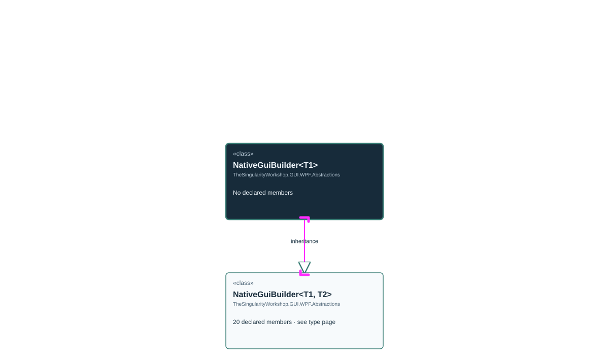

# TheSingularityWorkshop.GUI.WPF.Abstractions.NativeGuiBuilder

> Generated from compiler-backed source analysis. Do not edit by hand.

- Repository: `TrentBest/TheSingularityWorkshop.GUI`
- Revision: [`35bb31b337c1340f8713babd0d411f86f0d602cd`](https://github.com/TrentBest/TheSingularityWorkshop.GUI/tree/35bb31b337c1340f8713babd0d411f86f0d602cd)
- Project: `src/WPF/TheSingularityWorkshop.GUI.WPF.csproj`
- Type ID: `type:TheSingularityWorkshop.GUI.WPF, Version=0.1.0.0, Culture=neutral, PublicKeyToken=null:global::TheSingularityWorkshop.GUI.WPF.Abstractions.NativeGuiBuilder<T>`
- Metadata name: `NativeGuiBuilder'1`
- Kind: `class`
- Generic arity: 1

## UML diagram

## Source declarations

- [`src/WPF/NativeGuiBuilder.cs:130-133`](https://github.com/TrentBest/TheSingularityWorkshop.GUI/blob/35bb31b337c1340f8713babd0d411f86f0d602cd/src/WPF/NativeGuiBuilder.cs#L130-133)

## Members

_No explicit source members were recorded._

## Relationships

| Direction | Kind | Related type | Resolution | Evidence |
|---|---|---|---|---|
| outgoing | `Inheritance` | `TheSingularityWorkshop.GUI.WPF.Abstractions.NativeGuiBuilder` | `Resolved` | [`src/WPF/NativeGuiBuilder.cs:130-133`](https://github.com/TrentBest/TheSingularityWorkshop.GUI/blob/35bb31b337c1340f8713babd0d411f86f0d602cd/src/WPF/NativeGuiBuilder.cs#L130-133) |

[Back to the generated type index](index.md)

