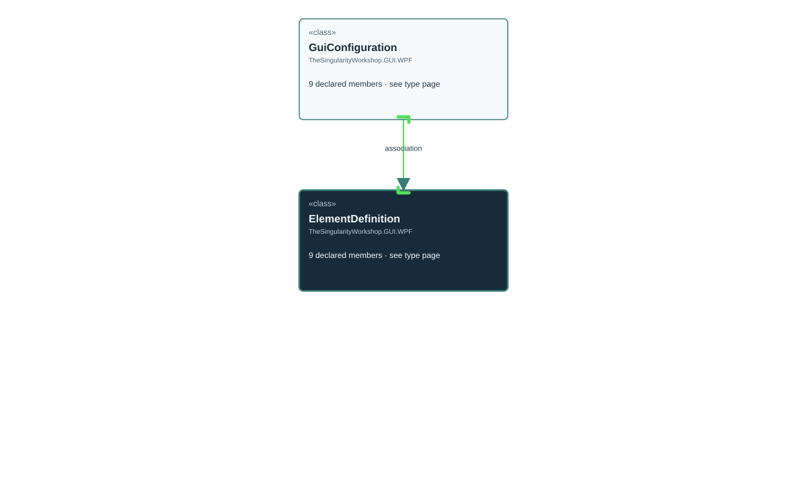

# TheSingularityWorkshop.GUI.WPF.ElementDefinition

> Generated from compiler-backed source analysis. Do not edit by hand.

- Repository: `TrentBest/TheSingularityWorkshop.GUI`
- Revision: [`8d11c5f449b73b519cfb1819c9c3942307f717c6`](https://github.com/TrentBest/TheSingularityWorkshop.GUI/tree/8d11c5f449b73b519cfb1819c9c3942307f717c6)
- Project: `src/WPF/TheSingularityWorkshop.GUI.WPF.csproj`
- Type ID: `type:TheSingularityWorkshop.GUI.WPF, Version=0.1.0.0, Culture=neutral, PublicKeyToken=null:global::TheSingularityWorkshop.GUI.WPF.ElementDefinition`
- Metadata name: `ElementDefinition`
- Kind: `class`
- Generic arity: 0

## UML diagram

## Source declarations

- [`src/WPF/ElementDefinition.cs:3-8`](https://github.com/TrentBest/TheSingularityWorkshop.GUI/blob/8d11c5f449b73b519cfb1819c9c3942307f717c6/src/WPF/ElementDefinition.cs#L3-8)

## Members

| Kind | Signature | Source |
|---|---|---|
| `Property` | `TheSingularityWorkshop.GUI.WPF.ElementDefinition.Label` | [`src/WPF/ElementDefinition.cs:6-6`](https://github.com/TrentBest/TheSingularityWorkshop.GUI/blob/8d11c5f449b73b519cfb1819c9c3942307f717c6/src/WPF/ElementDefinition.cs#L6-6) |
| `Method` | `TheSingularityWorkshop.GUI.WPF.ElementDefinition.Label.get` | [`src/WPF/ElementDefinition.cs:6-6`](https://github.com/TrentBest/TheSingularityWorkshop.GUI/blob/8d11c5f449b73b519cfb1819c9c3942307f717c6/src/WPF/ElementDefinition.cs#L6-6) |
| `Method` | `TheSingularityWorkshop.GUI.WPF.ElementDefinition.Label.set` | [`src/WPF/ElementDefinition.cs:6-6`](https://github.com/TrentBest/TheSingularityWorkshop.GUI/blob/8d11c5f449b73b519cfb1819c9c3942307f717c6/src/WPF/ElementDefinition.cs#L6-6) |
| `Property` | `TheSingularityWorkshop.GUI.WPF.ElementDefinition.Properties` | [`src/WPF/ElementDefinition.cs:7-7`](https://github.com/TrentBest/TheSingularityWorkshop.GUI/blob/8d11c5f449b73b519cfb1819c9c3942307f717c6/src/WPF/ElementDefinition.cs#L7-7) |
| `Method` | `TheSingularityWorkshop.GUI.WPF.ElementDefinition.Properties.get` | [`src/WPF/ElementDefinition.cs:7-7`](https://github.com/TrentBest/TheSingularityWorkshop.GUI/blob/8d11c5f449b73b519cfb1819c9c3942307f717c6/src/WPF/ElementDefinition.cs#L7-7) |
| `Method` | `TheSingularityWorkshop.GUI.WPF.ElementDefinition.Properties.set` | [`src/WPF/ElementDefinition.cs:7-7`](https://github.com/TrentBest/TheSingularityWorkshop.GUI/blob/8d11c5f449b73b519cfb1819c9c3942307f717c6/src/WPF/ElementDefinition.cs#L7-7) |
| `Property` | `TheSingularityWorkshop.GUI.WPF.ElementDefinition.TypeName` | [`src/WPF/ElementDefinition.cs:5-5`](https://github.com/TrentBest/TheSingularityWorkshop.GUI/blob/8d11c5f449b73b519cfb1819c9c3942307f717c6/src/WPF/ElementDefinition.cs#L5-5) |
| `Method` | `TheSingularityWorkshop.GUI.WPF.ElementDefinition.TypeName.get` | [`src/WPF/ElementDefinition.cs:5-5`](https://github.com/TrentBest/TheSingularityWorkshop.GUI/blob/8d11c5f449b73b519cfb1819c9c3942307f717c6/src/WPF/ElementDefinition.cs#L5-5) |
| `Method` | `TheSingularityWorkshop.GUI.WPF.ElementDefinition.TypeName.set` | [`src/WPF/ElementDefinition.cs:5-5`](https://github.com/TrentBest/TheSingularityWorkshop.GUI/blob/8d11c5f449b73b519cfb1819c9c3942307f717c6/src/WPF/ElementDefinition.cs#L5-5) |

## Relationships

| Direction | Kind | Related type | Resolution | Evidence |
|---|---|---|---|---|
| incoming | `Association` | `TheSingularityWorkshop.GUI.WPF.GuiConfiguration` | `Resolved` | [`src/WPF/GuiConfiguration.cs:8-8`](https://github.com/TrentBest/TheSingularityWorkshop.GUI/blob/8d11c5f449b73b519cfb1819c9c3942307f717c6/src/WPF/GuiConfiguration.cs#L8-8) |

[Back to the generated type index](index.md)

