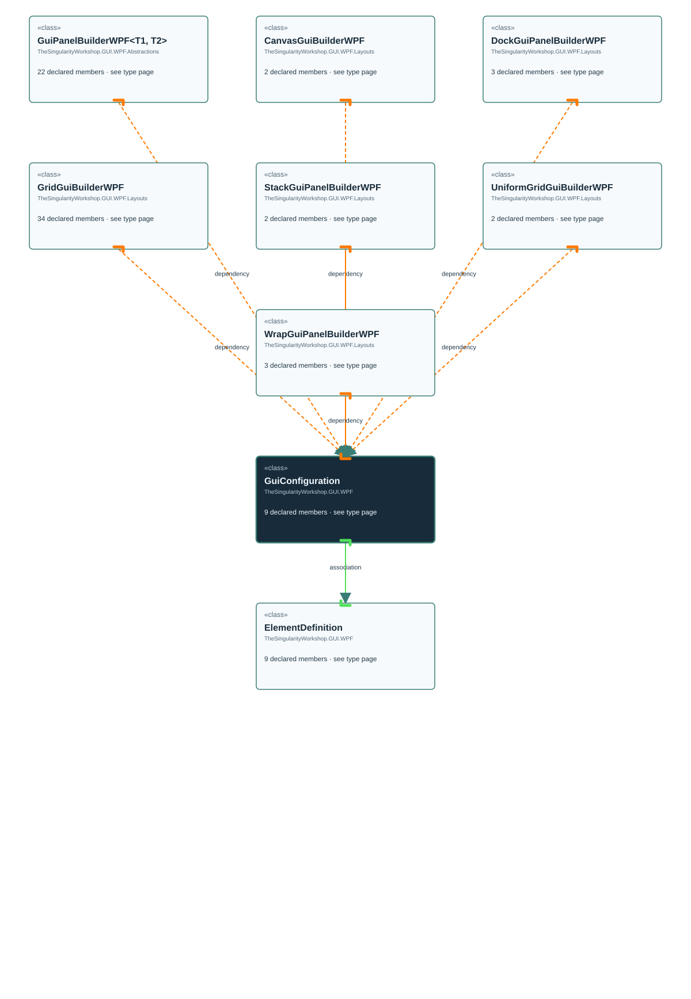

<!-- The Singularity Workshop moniker -->

# TheSingularityWorkshop.GUI.WPF.GuiConfiguration

> Generated from compiler-backed source analysis. Do not edit by hand.

- Repository: `TrentBest/TheSingularityWorkshop.GUI`
- Revision: [`0f256ace8cf4a63c92d5edefcf667f2ee0238ee4`](https://github.com/TrentBest/TheSingularityWorkshop.GUI/tree/0f256ace8cf4a63c92d5edefcf667f2ee0238ee4)
- Project: `src/WPF/TheSingularityWorkshop.GUI.WPF.csproj`
- Type ID: `type:TheSingularityWorkshop.GUI.WPF, Version=0.1.0.0, Culture=neutral, PublicKeyToken=null:global::TheSingularityWorkshop.GUI.WPF.GuiConfiguration`
- Metadata name: `GuiConfiguration`
- Kind: `class`
- Generic arity: 0

## UML diagram

## Source declarations

- [`src/WPF/GuiConfiguration.cs:3-9`](https://github.com/TrentBest/TheSingularityWorkshop.GUI/blob/0f256ace8cf4a63c92d5edefcf667f2ee0238ee4/src/WPF/GuiConfiguration.cs#L3-9)

## Members

| Kind | Signature | Source |
|---|---|---|
| `Property` | `TheSingularityWorkshop.GUI.WPF.GuiConfiguration.Elements` | [`src/WPF/GuiConfiguration.cs:8-8`](https://github.com/TrentBest/TheSingularityWorkshop.GUI/blob/0f256ace8cf4a63c92d5edefcf667f2ee0238ee4/src/WPF/GuiConfiguration.cs#L8-8) |
| `Method` | `TheSingularityWorkshop.GUI.WPF.GuiConfiguration.Elements.get` | [`src/WPF/GuiConfiguration.cs:8-8`](https://github.com/TrentBest/TheSingularityWorkshop.GUI/blob/0f256ace8cf4a63c92d5edefcf667f2ee0238ee4/src/WPF/GuiConfiguration.cs#L8-8) |
| `Method` | `TheSingularityWorkshop.GUI.WPF.GuiConfiguration.Elements.set` | [`src/WPF/GuiConfiguration.cs:8-8`](https://github.com/TrentBest/TheSingularityWorkshop.GUI/blob/0f256ace8cf4a63c92d5edefcf667f2ee0238ee4/src/WPF/GuiConfiguration.cs#L8-8) |
| `Property` | `TheSingularityWorkshop.GUI.WPF.GuiConfiguration.Name` | [`src/WPF/GuiConfiguration.cs:6-6`](https://github.com/TrentBest/TheSingularityWorkshop.GUI/blob/0f256ace8cf4a63c92d5edefcf667f2ee0238ee4/src/WPF/GuiConfiguration.cs#L6-6) |
| `Method` | `TheSingularityWorkshop.GUI.WPF.GuiConfiguration.Name.get` | [`src/WPF/GuiConfiguration.cs:6-6`](https://github.com/TrentBest/TheSingularityWorkshop.GUI/blob/0f256ace8cf4a63c92d5edefcf667f2ee0238ee4/src/WPF/GuiConfiguration.cs#L6-6) |
| `Method` | `TheSingularityWorkshop.GUI.WPF.GuiConfiguration.Name.set` | [`src/WPF/GuiConfiguration.cs:6-6`](https://github.com/TrentBest/TheSingularityWorkshop.GUI/blob/0f256ace8cf4a63c92d5edefcf667f2ee0238ee4/src/WPF/GuiConfiguration.cs#L6-6) |
| `Property` | `TheSingularityWorkshop.GUI.WPF.GuiConfiguration.PanelType` | [`src/WPF/GuiConfiguration.cs:7-7`](https://github.com/TrentBest/TheSingularityWorkshop.GUI/blob/0f256ace8cf4a63c92d5edefcf667f2ee0238ee4/src/WPF/GuiConfiguration.cs#L7-7) |
| `Method` | `TheSingularityWorkshop.GUI.WPF.GuiConfiguration.PanelType.get` | [`src/WPF/GuiConfiguration.cs:7-7`](https://github.com/TrentBest/TheSingularityWorkshop.GUI/blob/0f256ace8cf4a63c92d5edefcf667f2ee0238ee4/src/WPF/GuiConfiguration.cs#L7-7) |
| `Method` | `TheSingularityWorkshop.GUI.WPF.GuiConfiguration.PanelType.set` | [`src/WPF/GuiConfiguration.cs:7-7`](https://github.com/TrentBest/TheSingularityWorkshop.GUI/blob/0f256ace8cf4a63c92d5edefcf667f2ee0238ee4/src/WPF/GuiConfiguration.cs#L7-7) |

## Relationships

| Direction | Kind | Related type | Resolution | Evidence |
|---|---|---|---|---|
| outgoing | `Association` | `TheSingularityWorkshop.GUI.WPF.ElementDefinition` | `Resolved` | [`src/WPF/GuiConfiguration.cs:8-8`](https://github.com/TrentBest/TheSingularityWorkshop.GUI/blob/0f256ace8cf4a63c92d5edefcf667f2ee0238ee4/src/WPF/GuiConfiguration.cs#L8-8) |
| incoming | `Dependency` | `TheSingularityWorkshop.GUI.WPF.Abstractions.GuiPanelBuilderWPF` | `Resolved` | [`src/WPF/GuiPanelBuilderWPF.cs:41-56`](https://github.com/TrentBest/TheSingularityWorkshop.GUI/blob/0f256ace8cf4a63c92d5edefcf667f2ee0238ee4/src/WPF/GuiPanelBuilderWPF.cs#L41-56) |
| incoming | `Dependency` | `TheSingularityWorkshop.GUI.WPF.Abstractions.GuiPanelBuilderWPF` | `Resolved` | [`src/WPF/GuiPanelBuilderWPF.cs:159-174`](https://github.com/TrentBest/TheSingularityWorkshop.GUI/blob/0f256ace8cf4a63c92d5edefcf667f2ee0238ee4/src/WPF/GuiPanelBuilderWPF.cs#L159-174) |
| incoming | `Dependency` | `TheSingularityWorkshop.GUI.WPF.Layouts.CanvasGuiBuilderWPF` | `Resolved` | [`src/WPF/CanvasGuiBuilderWPF.cs:13-13`](https://github.com/TrentBest/TheSingularityWorkshop.GUI/blob/0f256ace8cf4a63c92d5edefcf667f2ee0238ee4/src/WPF/CanvasGuiBuilderWPF.cs#L13-13) |
| incoming | `Dependency` | `TheSingularityWorkshop.GUI.WPF.Layouts.DockGuiPanelBuilderWPF` | `Resolved` | [`src/WPF/DockGuiPanelBuilderWPF.cs:12-12`](https://github.com/TrentBest/TheSingularityWorkshop.GUI/blob/0f256ace8cf4a63c92d5edefcf667f2ee0238ee4/src/WPF/DockGuiPanelBuilderWPF.cs#L12-12) |
| incoming | `Dependency` | `TheSingularityWorkshop.GUI.WPF.Layouts.GridGuiBuilderWPF` | `Resolved` | [`src/WPF/GridGuiBuilderWPF.cs:148-150`](https://github.com/TrentBest/TheSingularityWorkshop.GUI/blob/0f256ace8cf4a63c92d5edefcf667f2ee0238ee4/src/WPF/GridGuiBuilderWPF.cs#L148-150) |
| incoming | `Dependency` | `TheSingularityWorkshop.GUI.WPF.Layouts.StackGuiPanelBuilderWPF` | `Resolved` | [`src/WPF/StackGuiPanelBuilderWPF.cs:8-8`](https://github.com/TrentBest/TheSingularityWorkshop.GUI/blob/0f256ace8cf4a63c92d5edefcf667f2ee0238ee4/src/WPF/StackGuiPanelBuilderWPF.cs#L8-8) |
| incoming | `Dependency` | `TheSingularityWorkshop.GUI.WPF.Layouts.UniformGridGuiBuilderWPF` | `Resolved` | [`src/WPF/UniformGridGuiPanelBuilderWPF.cs:8-8`](https://github.com/TrentBest/TheSingularityWorkshop.GUI/blob/0f256ace8cf4a63c92d5edefcf667f2ee0238ee4/src/WPF/UniformGridGuiPanelBuilderWPF.cs#L8-8) |
| incoming | `Dependency` | `TheSingularityWorkshop.GUI.WPF.Layouts.WrapGuiPanelBuilderWPF` | `Resolved` | [`src/WPF/WrapGuiPanelBuilderWPF.cs:8-8`](https://github.com/TrentBest/TheSingularityWorkshop.GUI/blob/0f256ace8cf4a63c92d5edefcf667f2ee0238ee4/src/WPF/WrapGuiPanelBuilderWPF.cs#L8-8) |

[Back to the generated type index](index.md)

---

<!-- THE SINGULARITY WORKSHOP FOOTER -->

