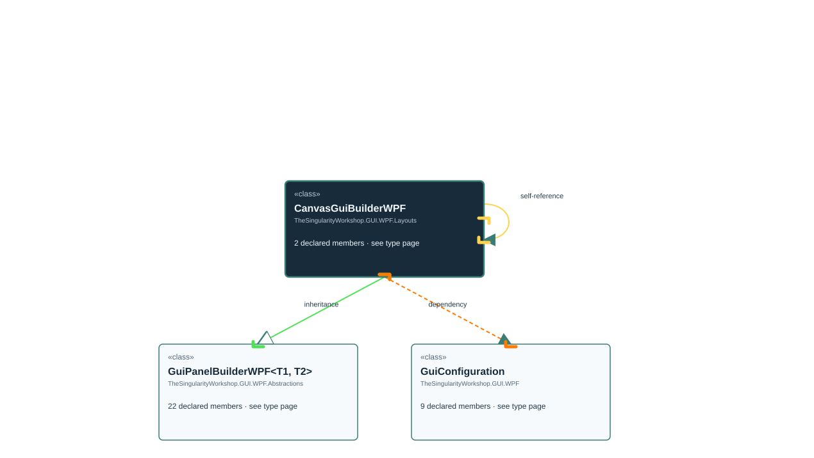

<!-- The Singularity Workshop moniker -->

# TheSingularityWorkshop.GUI.WPF.Layouts.CanvasGuiBuilderWPF

> Generated from compiler-backed source analysis. Do not edit by hand.

- Repository: `TrentBest/TheSingularityWorkshop.GUI`
- Revision: [`f48dd15256521c88fad88371742c89d5fd1d326f`](https://github.com/TrentBest/TheSingularityWorkshop.GUI/tree/f48dd15256521c88fad88371742c89d5fd1d326f)
- Project: `src/WPF/TheSingularityWorkshop.GUI.WPF.csproj`
- Type ID: `type:TheSingularityWorkshop.GUI.WPF, Version=0.1.0.0, Culture=neutral, PublicKeyToken=null:global::TheSingularityWorkshop.GUI.WPF.Layouts.CanvasGuiBuilderWPF`
- Metadata name: `CanvasGuiBuilderWPF`
- Kind: `class`
- Generic arity: 0

## UML diagram

## Source declarations

- [`src/WPF/CanvasGuiBuilderWPF.cs:9-31`](https://github.com/TrentBest/TheSingularityWorkshop.GUI/blob/f48dd15256521c88fad88371742c89d5fd1d326f/src/WPF/CanvasGuiBuilderWPF.cs#L9-31)

## Members

| Kind | Signature | Source |
|---|---|---|
| `Method` | `TheSingularityWorkshop.GUI.WPF.Layouts.CanvasGuiBuilderWPF.CanvasGuiBuilderWPF(TheSingularityWorkshop.GUI.WPF.GuiConfiguration)` | [`src/WPF/CanvasGuiBuilderWPF.cs:13-13`](https://github.com/TrentBest/TheSingularityWorkshop.GUI/blob/f48dd15256521c88fad88371742c89d5fd1d326f/src/WPF/CanvasGuiBuilderWPF.cs#L13-13) |
| `Method` | `TheSingularityWorkshop.GUI.WPF.Layouts.CanvasGuiBuilderWPF.PlaceAt(System.Windows.UIElement, double, double)` | [`src/WPF/CanvasGuiBuilderWPF.cs:20-30`](https://github.com/TrentBest/TheSingularityWorkshop.GUI/blob/f48dd15256521c88fad88371742c89d5fd1d326f/src/WPF/CanvasGuiBuilderWPF.cs#L20-30) |

## Relationships

| Direction | Kind | Related type | Resolution | Evidence |
|---|---|---|---|---|
| outgoing | `Inheritance` | `TheSingularityWorkshop.GUI.WPF.Abstractions.GuiPanelBuilderWPF` | `Resolved` | [`src/WPF/CanvasGuiBuilderWPF.cs:9-31`](https://github.com/TrentBest/TheSingularityWorkshop.GUI/blob/f48dd15256521c88fad88371742c89d5fd1d326f/src/WPF/CanvasGuiBuilderWPF.cs#L9-31) |
| outgoing | `Dependency` | `TheSingularityWorkshop.GUI.WPF.GuiConfiguration` | `Resolved` | [`src/WPF/CanvasGuiBuilderWPF.cs:13-13`](https://github.com/TrentBest/TheSingularityWorkshop.GUI/blob/f48dd15256521c88fad88371742c89d5fd1d326f/src/WPF/CanvasGuiBuilderWPF.cs#L13-13) |
| outgoing | `Dependency` | `TheSingularityWorkshop.GUI.WPF.Layouts.CanvasGuiBuilderWPF` | `Resolved` | [`src/WPF/CanvasGuiBuilderWPF.cs:20-30`](https://github.com/TrentBest/TheSingularityWorkshop.GUI/blob/f48dd15256521c88fad88371742c89d5fd1d326f/src/WPF/CanvasGuiBuilderWPF.cs#L20-30) |

[Back to the generated type index](index.md)

---

<!-- THE SINGULARITY WORKSHOP FOOTER -->

