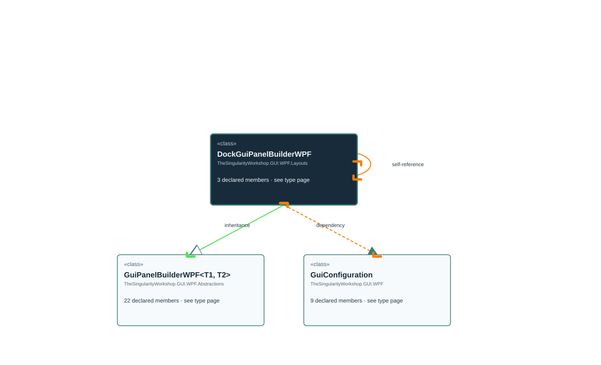

# TheSingularityWorkshop.GUI.WPF.Layouts.DockGuiPanelBuilderWPF

> Generated from compiler-backed source analysis. Do not edit by hand.

- Repository: `TrentBest/TheSingularityWorkshop.GUI`
- Revision: [`8d11c5f449b73b519cfb1819c9c3942307f717c6`](https://github.com/TrentBest/TheSingularityWorkshop.GUI/tree/8d11c5f449b73b519cfb1819c9c3942307f717c6)
- Project: `src/WPF/TheSingularityWorkshop.GUI.WPF.csproj`
- Type ID: `type:TheSingularityWorkshop.GUI.WPF, Version=0.1.0.0, Culture=neutral, PublicKeyToken=null:global::TheSingularityWorkshop.GUI.WPF.Layouts.DockGuiPanelBuilderWPF`
- Metadata name: `DockGuiPanelBuilderWPF`
- Kind: `class`
- Generic arity: 0

## UML diagram

## Source declarations

- [`src/WPF/DockGuiPanelBuilderWPF.cs:8-36`](https://github.com/TrentBest/TheSingularityWorkshop.GUI/blob/8d11c5f449b73b519cfb1819c9c3942307f717c6/src/WPF/DockGuiPanelBuilderWPF.cs#L8-36)

## Members

| Kind | Signature | Source |
|---|---|---|
| `Method` | `TheSingularityWorkshop.GUI.WPF.Layouts.DockGuiPanelBuilderWPF.AddDocked(System.Windows.UIElement, System.Windows.Controls.Dock)` | [`src/WPF/DockGuiPanelBuilderWPF.cs:27-35`](https://github.com/TrentBest/TheSingularityWorkshop.GUI/blob/8d11c5f449b73b519cfb1819c9c3942307f717c6/src/WPF/DockGuiPanelBuilderWPF.cs#L27-35) |
| `Method` | `TheSingularityWorkshop.GUI.WPF.Layouts.DockGuiPanelBuilderWPF.DockGuiPanelBuilderWPF(TheSingularityWorkshop.GUI.WPF.GuiConfiguration)` | [`src/WPF/DockGuiPanelBuilderWPF.cs:12-12`](https://github.com/TrentBest/TheSingularityWorkshop.GUI/blob/8d11c5f449b73b519cfb1819c9c3942307f717c6/src/WPF/DockGuiPanelBuilderWPF.cs#L12-12) |
| `Method` | `TheSingularityWorkshop.GUI.WPF.Layouts.DockGuiPanelBuilderWPF.WithLastChildFill(bool)` | [`src/WPF/DockGuiPanelBuilderWPF.cs:17-21`](https://github.com/TrentBest/TheSingularityWorkshop.GUI/blob/8d11c5f449b73b519cfb1819c9c3942307f717c6/src/WPF/DockGuiPanelBuilderWPF.cs#L17-21) |

## Relationships

| Direction | Kind | Related type | Resolution | Evidence |
|---|---|---|---|---|
| outgoing | `Inheritance` | `TheSingularityWorkshop.GUI.WPF.Abstractions.GuiPanelBuilderWPF` | `Resolved` | [`src/WPF/DockGuiPanelBuilderWPF.cs:8-36`](https://github.com/TrentBest/TheSingularityWorkshop.GUI/blob/8d11c5f449b73b519cfb1819c9c3942307f717c6/src/WPF/DockGuiPanelBuilderWPF.cs#L8-36) |
| outgoing | `Dependency` | `TheSingularityWorkshop.GUI.WPF.GuiConfiguration` | `Resolved` | [`src/WPF/DockGuiPanelBuilderWPF.cs:12-12`](https://github.com/TrentBest/TheSingularityWorkshop.GUI/blob/8d11c5f449b73b519cfb1819c9c3942307f717c6/src/WPF/DockGuiPanelBuilderWPF.cs#L12-12) |
| outgoing | `Dependency` | `TheSingularityWorkshop.GUI.WPF.Layouts.DockGuiPanelBuilderWPF` | `Resolved` | [`src/WPF/DockGuiPanelBuilderWPF.cs:27-35`](https://github.com/TrentBest/TheSingularityWorkshop.GUI/blob/8d11c5f449b73b519cfb1819c9c3942307f717c6/src/WPF/DockGuiPanelBuilderWPF.cs#L27-35) |
| outgoing | `Dependency` | `TheSingularityWorkshop.GUI.WPF.Layouts.DockGuiPanelBuilderWPF` | `Resolved` | [`src/WPF/DockGuiPanelBuilderWPF.cs:17-21`](https://github.com/TrentBest/TheSingularityWorkshop.GUI/blob/8d11c5f449b73b519cfb1819c9c3942307f717c6/src/WPF/DockGuiPanelBuilderWPF.cs#L17-21) |

[Back to the generated type index](index.md)

